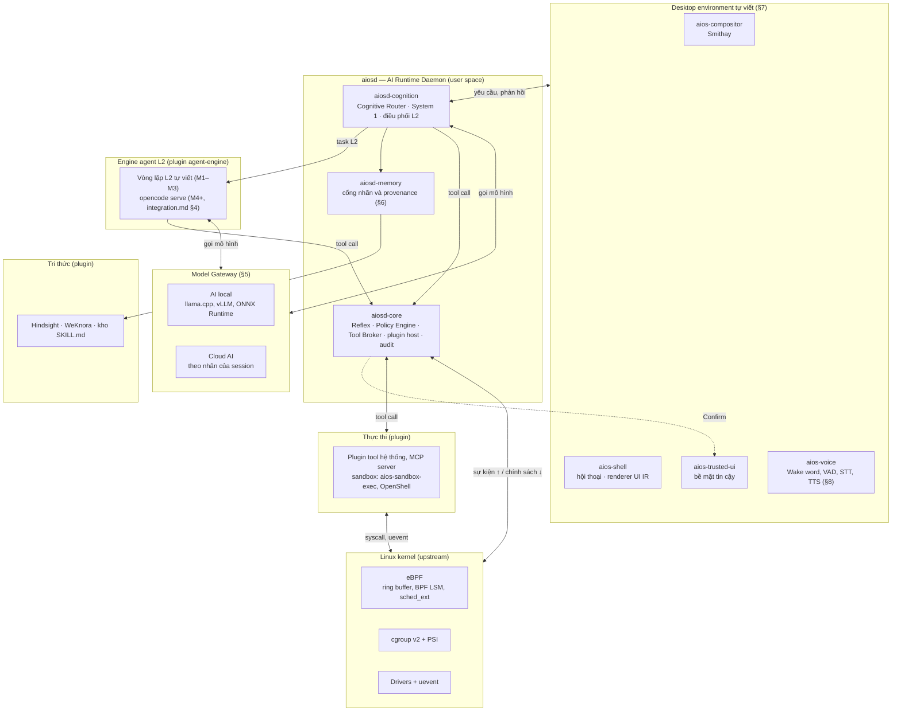
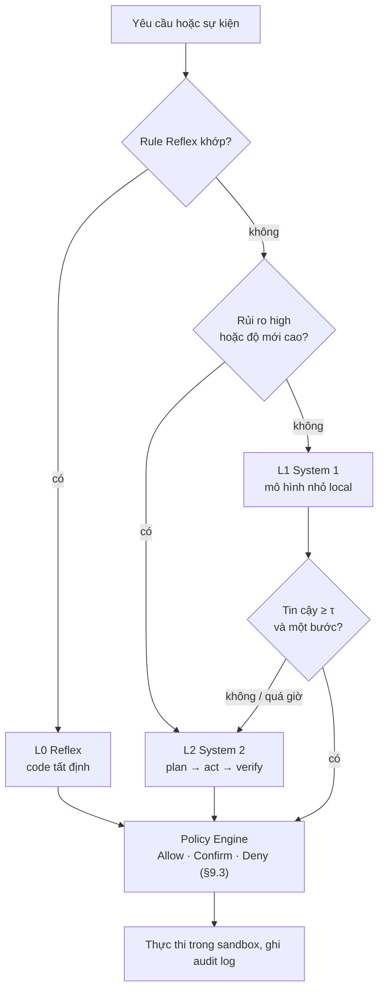
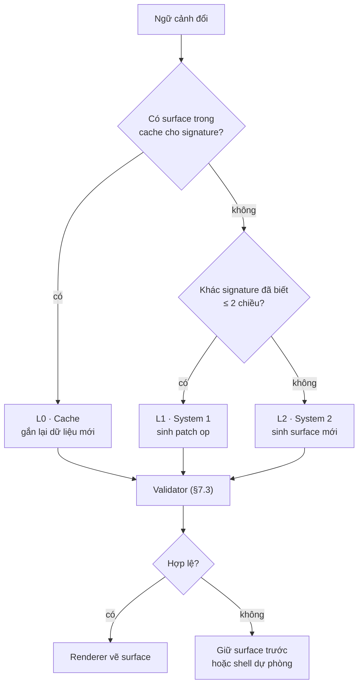
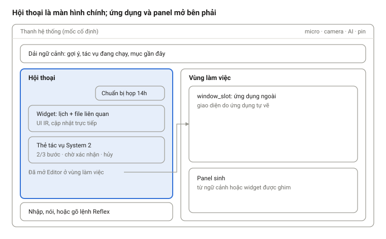
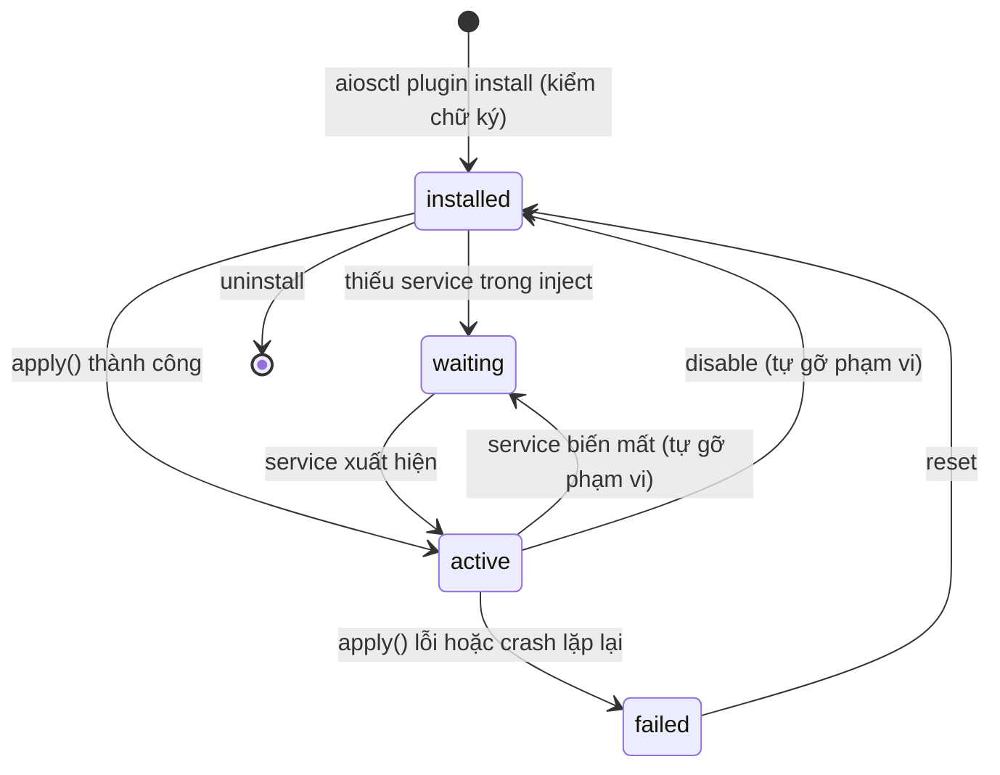
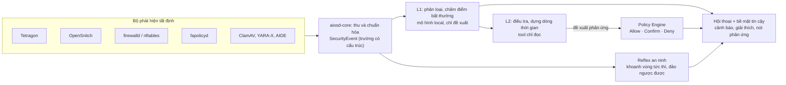

# AiOS — Thiết kế chi tiết hệ điều hành tự hành tích hợp LLM

_Cập nhật: 2026-10-18_

## 0. Phạm vi và quy ước

**\[Inference\] Toàn bộ tài liệu là thiết kế đề xuất, chưa được kiểm chứng bằng triển khai thực tế. Mọi số liệu độ trễ, tài nguyên và ngưỡng là ước lượng khởi đầu, PHẢI hiệu chỉnh bằng đo đạc.**

Tài liệu chuyển 8 quyết định thiết kế của chủ dự án thành kiến trúc chi tiết. Văn bản dùng các nhãn sau:

| Nhãn | Ý nghĩa |
| --- | --- |
| \[Inference\] | Suy luận kỹ thuật từ kiến thức hiện có, chưa đo trên AiOS |
| \[Speculation\] | Hướng nghiên cứu, chưa có bằng chứng khả thi |
| \[Unverified\] | Thông tin cần kiểm tra lại trên phiên bản kernel hoặc thư viện thực tế |
| UNKNOWN | Thiếu dữ liệu đầu vào từ chủ dự án |

Từ khóa yêu cầu: **PHẢI** = bắt buộc, **KHÔNG ĐƯỢC** = cấm, **NÊN** = khuyến nghị, **CÓ THỂ** = tùy chọn.

| # | Quyết định thiết kế | Mục |
| --- | --- | --- |
| 1 | Tích hợp LLM vào nhân Linux | §1, §3 |
| 2 | Ba cấp phản hồi: code logic, System 1, System 2 | §4 |
| 3 | Tự học, tự ghi nhớ kiến thức mới | §6 |
| 4 | UI thích ứng | §7 |
| 5 | Cấu hình AI local và cloud AI | §5 |
| 6 | Giao tiếp bằng giọng nói | §8 |
| 7 | Sử dụng công cụ | §9 |
| 8 | Tự khám phá và dùng phần cứng mới | §10 |

Nghiên cứu tech stack cho từng tầng: [tech-stack.md](tech-stack.md)

Kiến trúc tích hợp 12 thành phần mã nguồn mở: [integration.md](integration.md). Hệ plugin: §15.

## 1. Tổng quan và nguyên tắc thiết kế

**Quyết định kiến trúc cốt lõi: LLM chạy ở user space. Kernel chỉ chạy tầng Reflex bằng eBPF và phát sự kiện. AI daemon ra quyết định rồi ghi chính sách xuống kernel qua giao diện có kiểm soát.** Quyết định 1 ("tích hợp LLM vào nhân") được hiện thực thành "LLM điều khiển nhân", không phải "LLM chạy trong ring 0".

### 1.1 Vì sao không chạy LLM trong kernel space

| Ràng buộc của kernel space | Hệ quả nếu chạy LLM trong kernel |
| --- | --- |
| Code kernel không dùng FPU/SIMD tự do; phải bọc trong `kernel_fpu_begin()`/`kernel_fpu_end()` (x86), vùng này tắt preemption | \[Inference\] Một lượt inference dài hàng trăm ms sẽ giữ CPU không bị preempt, gây giật toàn hệ thống |
| Stack tính toán GPU/NPU (CUDA runtime, ROCm, Vulkan compute) chạy ở user space | Kernel không gọi trực tiếp được bộ tăng tốc; inference trong kernel chỉ còn CPU |
| Bộ nhớ kernel không swap được | \[Inference\] Trọng số vài GB nằm cố định trong RAM kernel, tăng áp lực OOM |
| Lỗi trong kernel gây kernel panic | Một lỗi parser JSON hoặc tràn bộ đệm làm sập toàn máy; lỗi ở user space chỉ cần restart daemon |
| Đầu ra LLM không tất định | Không phù hợp đường nóng như scheduler, IRQ, page fault |
| Prompt injection trong ring 0 | Kẻ tấn công điều khiển được LLM sẽ có toàn quyền hệ thống |

### 1.2 Mục tiêu và ngoài phạm vi

Mục tiêu:

- AiOS phản hồi ở cấp thấp nhất đủ năng lực: Reflex → System 1 → System 2.
- AiOS học từ tương tác, chuyển tri thức từ System 2 xuống System 1 và Reflex.
- AiOS chạy được hoàn toàn offline với AI local; cloud AI là tùy chọn.
- AiOS vẫn là một Linux dùng được khi toàn bộ tầng AI tắt.

Ngoài phạm vi:

- Thay scheduler hoặc memory manager của kernel bằng LLM.
- Tự sinh và nạp kernel module.
- Viết kernel mới.

### 1.3 Nguyên tắc thiết kế

1. **Kernel tất định.** Chỉ code đã qua eBPF verifier hoặc module đã ký mới chạy trong kernel.
2. **Leo thang tối thiểu.** Mỗi yêu cầu được xử lý ở cấp rẻ nhất đủ năng lực.
3. **AI đề xuất, Policy Engine phê duyệt.** Mọi hành động đi qua kiểm tra capability.
4. **Fail-safe.** AI daemon chết thì OS chạy tiếp như Linux thường.
5. **Local-first.** Dữ liệu nhãn `secret` KHÔNG ĐƯỢC rời máy.
6. **Mọi thứ tự học PHẢI có phiên bản và rollback.**
7. **Con người quyết định hành động không đảo ngược được.**

## 2. Kiến trúc tổng thể

**AiOS gồm 6 tầng: kernel, lõi tin cậy, agent, tri thức, thực thi và desktop environment. Tiến trình trung tâm là `aiosd` (AI Runtime Daemon) ở user space. `aiosd` nhận sự kiện từ kernel, định tuyến yêu cầu qua 3 cấp phản hồi, và gọi công cụ qua Policy Engine. Mọi tính năng ngoài lõi tin cậy là plugin (§15).** Cách ghép 12 thành phần mã nguồn mở vào các tầng này: [integration.md §2](integration.md).



Theo thiết kế, AI chỉ tác động tới kernel qua `aiosd-core`: đọc sự kiện từ ring buffer, ghi chính sách vào BPF map và cgroup.

| Thành phần | Tầng | Trách nhiệm | Ngôn ngữ đề xuất |
| --- | --- | --- | --- |
| eBPF programs | Kernel | Thu sự kiện, thực thi rule Reflex, enforce LSM | C (libbpf CO-RE) |
| `aiosd-core` | Lõi tin cậy | Event bus, Reflex Engine, Policy Engine, Tool Broker, plugin host (§15), audit log | Rust (+ wasmtime) |
| Model Gateway | Lõi tin cậy | Định tuyến local/cloud theo nhãn của session (§5.2), quản lý VRAM, fallback | Rust |
| `aiosd-cognition` | Agent | Cognitive Router, System 1, bộ lập lịch; giao task L2 cho worker `aiosd-l2` (một tiến trình mỗi task, dưới `aios-agent.slice`) qua interface `agent-engine` | Python |
| `aiosd-memory` | Agent | Cổng gắn nhãn và provenance trước khi ghi vào backend bộ nhớ (§6) | Python |
| Engine L2 | Agent | Vòng plan → act → verify (§4.4); M1–M3 là vòng lặp tự viết trong `aiosd-cognition` (D-34), M4 thêm opencode | Interface `agent-engine` (Python; opencode qua HTTP) |
| `aios-compositor` | Desktop environment, lõi tin cậy | Wayland compositor, lớp overlay cho bề mặt tin cậy | Rust (Smithay) |
| `aios-shell` | Desktop environment, lõi tin cậy | Màn hình hội thoại, validator + renderer UI IR, slot plugin | Rust (gpui-kit, D-17) |
| `aios-trusted-ui` | Desktop environment, lõi tin cậy | Khóa màn hình, xác nhận, PIN, cấp quyền; ký token xác nhận (§9.5) | Rust (gpui-kit, D-17) |
| `aios-voice` | Desktop environment | Wake word, VAD, STT, TTS | Rust + model runtime |
| `aios-actuator` | Thực thi | Thực thi thao tác đặc quyền nhỏ, qua polkit | Rust |

Lõi tin cậy được định nghĩa một lần ở §15.1.

Giao tiếp nội bộ:

- Kernel → `aiosd-core`: BPF ring buffer, uevent netlink, PSI, fanotify.
- Giữa các tiến trình `aiosd`: gRPC hoặc Cap'n Proto qua Unix domain socket.
- Agent và plugin → `aiosd-core`: MCP (endpoint `aios-tools`) và HTTP của Tool Broker; cổng và socket ở [integration.md §11.1](integration.md).
- `aiosd` → ứng dụng và dịch vụ: D-Bus, MCP.

\[Inference\] Tách `aiosd-core` (Rust) khỏi phần nhận thức (Python) giữ đường quyết định Reflex và Policy không phụ thuộc vào GC và hệ sinh thái ML. Phần Python được restart độc lập khi lỗi.

## 3. Tích hợp nhân Linux

**AiOS tích hợp kernel bằng eBPF, cgroup v2 và các giao diện chuẩn. AiOS KHÔNG ĐƯỢC dùng kernel module riêng khi eBPF đáp ứng được.** Cách này giữ kernel gốc (upstream) và cho phép nạp, gỡ chính sách lúc chạy.

### 3.1 Cơ chế kernel sử dụng

\[Unverified\] Phiên bản kernel tối thiểu bên dưới lấy từ kiến thức huấn luyện. PHẢI kiểm tra lại trên kernel đích.

| Cơ chế | Kernel tối thiểu | Vai trò trong AiOS |
| --- | --- | --- |
| BPF ring buffer (`BPF_MAP_TYPE_RINGBUF`) | 5.8 | Đẩy sự kiện từ kernel lên `aiosd-core` |
| Tracepoints, kprobes, fentry | 5.5+ (fentry) | Quan sát exec, I/O, mạng, lỗi |
| BPF LSM (`CONFIG_BPF_LSM`) | 5.7 | Chặn thao tác của tiến trình agent ngoài capability |
| Landlock | 5.13 | Sandbox filesystem không cần root cho tool |
| cgroup v2 + PSI | 4.20 (PSI) | Đo áp lực CPU/RAM/IO, gán ưu tiên theo nhóm |
| sched\_ext | 6.12 | Chính sách scheduler bằng BPF (nghiên cứu R, roadmap.md) |
| uevent netlink | có sẵn | Phát hiện phần cứng mới (§10) |

Giai đoạn đầu NÊN điều chỉnh ưu tiên bằng `cpu.weight` và `io.weight` của cgroup v2. sched\_ext chỉ dùng khi đã có số đo chứng minh cgroup không đủ.

### 3.2 Luồng dữ liệu kernel ↔ aiosd

1. eBPF program bắt sự kiện (exec, mở file, thiết bị mới, áp lực bộ nhớ).
2. eBPF program tra bảng rule Reflex trong BPF map. Nếu khớp, program thực thi ngay trong kernel.
3. eBPF program ghi sự kiện vào ring buffer.
4. `aiosd-core` đọc ring buffer, chuyển sự kiện lên Cognitive Router.
5. Cấp System 1 hoặc System 2 ra quyết định chính sách mới.
6. `aiosd-core` ghi chính sách xuống BPF map hoặc cgroup. Kernel áp dụng từ sự kiện kế tiếp.

### 3.3 Code mẫu: luồng sự kiện exec

```c
// reflex_events.bpf.c — libbpf CO-RE
#include "vmlinux.h"
#include <bpf/bpf_helpers.h>

struct aios_event {
    __u64 ts_ns;
    __u32 pid;
    __u32 type;        /* 1 = exec */
    char  comm[16];
};

struct {
    __uint(type, BPF_MAP_TYPE_RINGBUF);
    __uint(max_entries, 1 << 20);   /* 1 MiB */
} events SEC(".maps");

SEC("tp/sched/sched_process_exec")
int on_exec(void *ctx)
{
    struct aios_event *e = bpf_ringbuf_reserve(&events, sizeof(*e), 0);
    if (!e)
        return 0;               /* buffer đầy: bỏ sự kiện, không chặn kernel */
    e->ts_ns = bpf_ktime_get_ns();
    e->pid   = bpf_get_current_pid_tgid() >> 32;
    e->type  = 1;
    bpf_get_current_comm(e->comm, sizeof(e->comm));
    bpf_ringbuf_submit(e, 0);
    return 0;
}

char LICENSE[] SEC("license") = "Dual BSD/GPL";   /* D-48: tương thích GPL để gọi helper GPL-only */
```

### 3.4 Code mẫu: BPF LSM chặn thao tác của agent

**BPF LSM là lớp chặn thô, theo cgroup. Lớp chặn theo đường dẫn là việc của Landlock và OpenShell.** Mọi tiến trình agent, mọi tool call và mọi plugin `process`/`mcp` chạy dưới `aios-agent.slice` của người dùng sở hữu (mỗi người dùng một slice, §18.4) (cả sandbox OpenShell, qua `--cgroup-parent`; \[Unverified\] với Podman rootless, kiểm bằng spike S-5). BPF LSM nhận diện agent bằng cgroup **tổ tiên**, nên một sandbox không do Tool Broker tạo vẫn bị chặn. Tiến trình agent không có mục riêng trong `agent_cgroups` mặc định có capability rỗng.

| Hook | Chặn gì khi tiến trình thuộc `aios-agent.slice` | Capability mở |
| --- | --- | --- |
| `file_open` | Mở file để ghi ngoài workspace | `CAP_FS_WRITE_ANYWHERE` |
| `inode_unlink`, `inode_rename` | Xóa, đổi tên ngoài workspace | `CAP_FS_WRITE_ANYWHERE` |
| `path_truncate` | Cắt file ngoài workspace | `CAP_FS_WRITE_ANYWHERE` |
| `ptrace_access_check` | ptrace tiến trình khác | `CAP_PTRACE` (chỉ rea trong microVM) |
| `bprm_check_security` | exec binary ngoài danh sách cho phép của sandbox | Theo manifest |
| `socket_connect` | Kết nối mạng ngoài danh sách | Theo manifest; \[Unverified\] tương tác với proxy của OpenShell cần spike S-5 |

```c
// agent_guard.bpf.c (rút gọn: file_open và inode_unlink)
#include "vmlinux.h"
#include <bpf/bpf_helpers.h>
#include <bpf/bpf_tracing.h>
#include <bpf/bpf_core_read.h>

#define FMODE_WRITE           0x2   /* macro kernel, không có trong BTF; = (1 << 1) ở 6.18 và 7.2 */
#define EPERM                 1
#define CAP_FS_WRITE_ANYWHERE 0x1

struct {
    __uint(type, BPF_MAP_TYPE_HASH);
    __uint(max_entries, 1024);
    __type(key, __u64);    /* cgroup id của từng sandbox hoặc tool call */
    __type(value, __u32);  /* capability bitmask */
} agent_cgroups SEC(".maps");

struct {
    __uint(type, BPF_MAP_TYPE_HASH);
    __uint(max_entries, 256);
    __type(key, __u64);    /* cgroup id của aios-agent.slice của từng người dùng (§18.4) */
    __type(value, __u32);  /* s_dev của workspace của người dùng đó */
} agent_slices SEC(".maps");

/* user.slice/user-<uid>.slice/user@<uid>.service/aios-agent.slice: cùng độ sâu cho mọi người dùng */
const volatile __u32 agent_slice_level = 0;   /* loader gán */

/* trả s_dev workspace nếu tiến trình là agent, 0 nếu không */
static __always_inline __u32 agent_workspace(void)
{
    __u64 slice = bpf_get_current_ancestor_cgroup_id(agent_slice_level);
    __u32 *dev = bpf_map_lookup_elem(&agent_slices, &slice);
    return dev ? *dev : 0;
}

static __always_inline __u32 current_caps(void)
{
    __u64 cg = bpf_get_current_cgroup_id();
    __u32 *caps = bpf_map_lookup_elem(&agent_cgroups, &cg);
    return caps ? *caps : 0;                  /* không có mục riêng: mặc định từ chối */
}

SEC("lsm/file_open")
int BPF_PROG(aios_guard_open, struct file *file, int ret)
{
    if (ret)
        return ret;                           /* LSM trước đã từ chối */
    __u32 ws = agent_workspace();
    if (!ws)
        return 0;                             /* không phải tiến trình agent */
    if (!(file->f_mode & FMODE_WRITE))
        return 0;                             /* chỉ đọc: cho phép */
    if (current_caps() & CAP_FS_WRITE_ANYWHERE)
        return 0;
    if (BPF_CORE_READ(file, f_inode, i_sb, s_dev) == ws)
        return 0;                             /* ghi trong workspace của chính người dùng đó */
    return -EPERM;
}

SEC("lsm/inode_unlink")
int BPF_PROG(aios_guard_unlink, struct inode *dir, struct dentry *dentry, int ret)
{
    if (ret)
        return ret;
    __u32 ws = agent_workspace();
    if (!ws || (current_caps() & CAP_FS_WRITE_ANYWHERE))
        return 0;
    if (BPF_CORE_READ(dir, i_sb, s_dev) == ws)
        return 0;
    return -EPERM;
}

char LICENSE[] SEC("license") = "Dual BSD/GPL";   /* D-48: tương thích GPL để gọi helper GPL-only */
```

Ràng buộc:

- Chữ ký hook `file_open`, trường `file->f_mode` và giá trị `FMODE_WRITE` đã khớp mã nguồn kernel 6.18 và 7.2 ([review.md §5](review.md)); vẫn PHẢI chạy test trên kernel đích. \[Unverified\] Chữ ký của các hook còn lại trong bảng PHẢI đối chiếu `include/linux/lsm_hook_defs.h` của kernel đích.
- Workspace của mỗi người dùng PHẢI là một filesystem riêng (phân vùng hoặc file image), vì phép so sánh `s_dev` chỉ phân biệt superblock. \[Inference\] Subvolume btrfs dùng chung superblock với filesystem cha nên không đủ.
- Loader PHẢI pin program, link và map vào `/sys/fs/bpf/aios/`, để chính sách vẫn hiệu lực khi `aiosd-core` dừng hoặc khởi động lại.
- `bpf` PHẢI có trong danh sách LSM đang hoạt động (`CONFIG_LSM` khi build image, hoặc `lsm=`); kiểm bằng `/sys/kernel/security/lsm`.

### 3.5 Code mẫu: aiosd-core đọc ring buffer (Rust)

```rust
// [Unverified] API libbpf-rs thay đổi giữa các phiên bản. tech-stack.md §3 chọn Aya cho phần Rust;
// đoạn này dùng libbpf-rs chỉ để minh họa vòng đọc ring buffer.
use libbpf_rs::RingBufferBuilder;
use std::time::Duration;

fn run_event_loop(skel: &ReflexEventsSkel, bus: &EventBus) -> anyhow::Result<()> {
    let mut builder = RingBufferBuilder::new();
    builder.add(&skel.maps.events, |data: &[u8]| {
        if let Some(ev) = AiosEvent::parse(data) {
            bus.publish(ev);        // không chặn: bus có hàng đợi giới hạn
        }
        0
    })?;
    let rb = builder.build()?;
    loop {
        rb.poll(Duration::from_millis(100))?;
    }
}
```

Best practice:

- Mọi BPF program PHẢI có test với `BPF_PROG_TEST_RUN` hoặc VM (§12).
- Rule Reflex trong BPF map PHẢI có phiên bản. `aiosd-core` thay cả bảng bằng map-in-map để đổi nguyên tử.
- Khi `aiosd-core` dừng, LSM program NÊN giữ chế độ mặc định từ chối cho cgroup agent, và cho phép mọi tiến trình khác. Việc pin program và map (§3.4) giúp đạt yêu cầu này.

## 4. Ba cấp độ phản hồi

**Cognitive Router đưa mỗi yêu cầu vào cấp rẻ nhất đủ năng lực. Reflex trả lời bằng code tất định. System 1 dùng mô hình nhỏ local. System 2 dùng LLM lớn để lập kế hoạch nhiều bước.**

| Cấp | Hiện thực | Vị trí chạy | Độ trễ mục tiêu \[Inference\] | Ví dụ |
| --- | --- | --- | --- | --- |
| L0 Reflex | Rule tất định: BPF map, rule engine Rust, grammar lệnh cố định | Kernel (eBPF) và `aiosd-core` | < 1 ms trong kernel; < 10 ms ở user space | Trả `-EPERM` cho ghi file ngoài workspace; "tắt tiếng" → đặt volume 0 |
| L1 System 1 | Classifier đã calibrate + LLM nhỏ local (ước lượng 1–4B tham số, lượng tử hóa) | `aiosd-cognition` + Model Gateway | 50–500 ms | Phân loại ý định, hỏi đáp ngắn, gọi 1 tool rủi ro thấp |
| L2 System 2 | LLM lớn local hoặc cloud, vòng plan → act → verify | Engine `agent-engine`: vòng lặp tự viết trong `aiosd-cognition` (D-34), từ M4 có thể thay bằng opencode ([integration.md §4](integration.md)); gọi Model Gateway | Vài giây đến vài phút | "Dọn ổ cứng, giữ ảnh, báo cáo kết quả" |



Router cũng chuyển thẳng lên System 2 khi người dùng yêu cầu suy nghĩ kỹ (§4.1). Cả 3 cấp đều phải qua Policy Engine trước khi tác động lên hệ thống.

### 4.1 Điều kiện leo thang

Router chuyển yêu cầu lên System 2 khi có ít nhất một điều kiện sau:

- Không có rule Reflex khớp, và độ tin cậy của System 1 thấp hơn ngưỡng τ của mức rủi ro tương ứng.
- Yêu cầu cần tool rủi ro `high`.
- Độ mới (novelty) cao: khoảng cách embedding tới mọi ký ức đã biết lớn hơn `novelty_max`.
- System 1 báo cần nhiều bước.
- Người dùng yêu cầu rõ ("suy nghĩ kỹ", "lên kế hoạch").

\[Inference\] LLM tự đánh giá độ tin cậy bằng lời thường không được hiệu chỉnh tốt. System 1 NÊN lấy độ tin cậy từ classifier đã hiệu chỉnh (temperature scaling) hoặc từ logprob của nhãn ý định.

### 4.2 Phản hồi tức thì khi System 2 chạy lâu

Khi System 2 cần hơn khoảng 1 giây, System 1 trả một phản hồi tạm ("Đang kiểm tra ổ đĩa..."). System 2 cập nhật tiến độ qua UI hoặc giọng nói. Người dùng CÓ THỂ hủy bất kỳ lúc nào.

### 4.3 Code mẫu: Cognitive Router

```python
# aiosd/cognition/router.py
import asyncio
from dataclasses import dataclass
from enum import IntEnum, Enum

class Level(IntEnum):
    REFLEX = 0
    SYSTEM1 = 1
    SYSTEM2 = 2

class Risk(Enum):
    LOW = "low"
    MEDIUM = "medium"
    HIGH = "high"

@dataclass
class Decision:
    level: Level
    action: dict | None
    confidence: float
    reason: str
    needs_multistep: bool = False

class CognitiveRouter:
    def __init__(self, reflex, s1, s2, policy, novelty, cfg):
        self.reflex, self.s1, self.s2 = reflex, s1, s2
        self.policy, self.novelty, self.cfg = policy, novelty, cfg

    async def route(self, req) -> Decision:
        # L0: tất định, không gọi mô hình
        if (hit := self.reflex.match(req)) is not None:
            return Decision(Level.REFLEX, hit.action, 1.0, f"rule:{hit.rule_id}@v{hit.version}")

        risk = self.policy.risk_of(req)
        if (req.force_deliberate
                or risk is Risk.HIGH
                or self.novelty.score(req) > self.cfg.novelty_max):
            return await self.s2.solve(req, reason="escalate:pre-check")

        try:
            d1 = await asyncio.wait_for(self.s1.decide(req), self.cfg.s1_timeout_s)
        except asyncio.TimeoutError:
            return await self.s2.solve(req, reason="escalate:s1-timeout")

        if d1.confidence >= self.cfg.tau[risk] and not d1.needs_multistep:
            return d1
        return await self.s2.solve(req, reason=f"escalate:s1-conf={d1.confidence:.2f}", hint=d1)
```

```yaml
# /etc/aios/router.yaml — [Inference] giá trị khởi đầu, PHẢI hiệu chỉnh bằng eval
router:
  s1_timeout_s: 0.8
  novelty_max: 0.35
  tau:
    low: 0.70
    medium: 0.85
    # high: luôn lên System 2
```

### 4.4 Vòng lặp System 2

Vòng lặp hiện thực interface `agent-engine` (§15.3). Từ M1 đến M3, engine là vòng lặp tự viết (D-34, [roadmap.md §2.3](roadmap.md)), chạy trong worker `aiosd-l2` mà `aiosd-cognition` khởi chạy cho mỗi task, dưới `aios-agent.slice`; từ M4, opencode có thể thay thế mà không đổi router. `aiosd-cognition` giao task, nhận sự kiện tiến độ và hiển thị thẻ `task` (§7.9). Engine chỉ tác động lên hệ thống qua Tool Broker; mọi lệnh gọi mang idempotency key.

```python
# aiosd/cognition/engine_local.py — vòng lặp L2 tự viết (rút gọn); hiện thực agent-engine
async def run_task(task, gw, tools, budget, emit):
    plan = await gw.plan(model="s2", goal=task.text, tools=tools.schemas())   # JSON Schema của kế hoạch
    for cursor, step in enumerate(plan.steps):
        budget.check()                                                        # token, thời gian, chi phí
        emit(task.id, cursor, "running", step.tool)
        result = await tools.call(step.tool, step.args,
                                  idempotency_key=f"{task.id}:{cursor}")      # MCP aios-tools → Tool Broker
        ok = await gw.verify(model="s2", step=step, result=result)           # Verifier
        if not ok:
            plan = await gw.replan(model="s2", goal=task.text, done=plan.steps[:cursor], failed=step)
            return await run_task(task.with_plan(plan), gw, tools, budget, emit)   # ngân sách dùng chung
    emit(task.id, len(plan.steps), "done", None)
```

1. Planner tạo kế hoạch gồm các bước có tool, đầu vào và tiêu chí hoàn thành.
2. Policy Engine kiểm tra từng bước trước khi chạy (§9, §11).
3. Executor chạy từng bước trong sandbox, ghi kết quả vào episodic memory.
4. Verifier so kết quả với tiêu chí. Nếu sai, Planner sửa kế hoạch.
5. System 2 dừng khi đạt mục tiêu, hết ngân sách (token, thời gian, chi phí), hoặc người dùng hủy.

Mỗi lượt System 2 PHẢI có ngân sách giới hạn. Mỗi bước có tác động không đảo ngược PHẢI có xác nhận của người dùng.

## 5. Model Gateway: AI local và cloud AI

**Model Gateway là điểm duy nhất gọi mô hình. Gateway chọn mô hình theo 4 tiêu chí: cấp phản hồi, nhãn riêng tư của dữ liệu, trạng thái mạng, và ngân sách.** Các thành phần khác chỉ gọi tên logic (`s1`, `s2`, `coder`), không gọi provider trực tiếp. Gateway nghe ở `127.0.0.1:8090` và `/run/aios/gateway.sock` (bảng cổng: [integration.md §11.1](integration.md)).

### 5.1 Trách nhiệm

- Cung cấp một API nội bộ thống nhất (dạng OpenAI-compatible chat + tool call) cho mọi provider.
- Chuẩn hóa định dạng tool call giữa các provider.
- Quản lý VRAM: giữ mô hình System 1 thường trú, nạp mô hình System 2 local khi cần, giải phóng khi rảnh.
- Nhường GPU khi ứng dụng foreground (game, render) cần, theo tín hiệu PSI và cgroup.
- Chuyển sang chế độ offline khi mất mạng: chỉ dùng route local.
- Ghi metric: độ trễ, token, chi phí, lỗi theo từng route.

### 5.2 Chính sách riêng tư dữ liệu

| Nhãn | Ví dụ dữ liệu | Route được phép |
| --- | --- | --- |
| `public` | Câu hỏi kiến thức chung | Local hoặc cloud |
| `personal` | Lịch, tên file, thói quen | Cloud sau khi lọc định danh (redaction), mặc định cho L2 (D-37); local khi offline, hết ngân sách, hoặc khóa ảo không cho phép |
| `secret` | Mật khẩu, khóa, tài liệu được đánh dấu mật | Chỉ local. KHÔNG ĐƯỢC gửi cloud |

Mọi dữ liệu PHẢI có nhãn trước khi vào Gateway. Dữ liệu không có nhãn được xử lý như `secret`.

#### Nhãn theo session

API OpenAI-compatible không có trường nhãn, và client (opencode, Hindsight, plugin) là thành phần không tin cậy. Vì vậy Gateway không dùng nhãn do client tự khai, mà dùng **nhãn của session**: mức cao nhất của mọi dữ liệu mà session đó đã nhận.

1. Gateway cấp một **khóa ảo** riêng cho mỗi session L2, mỗi dịch vụ bộ nhớ (Hindsight, WeKnora) và mỗi plugin gọi mô hình. Client không thấy khóa cloud thật. Cách chuyển khóa: ở M1–M3, `aiosd-cognition` nhận khóa session từ Gateway qua gRPC và chuyển cho worker `aiosd-l2` qua file descriptor; dịch vụ systemd nhận qua `LoadCredential=`; từ M4, OpenShell tiêm khóa thay cho placeholder.
2. Tool Broker gắn nhãn cho mọi kết quả tool theo nguồn dữ liệu (ví dụ file trong thư mục được đánh dấu mật → `secret`), rồi nâng `session_label = max(session_label, nhãn kết quả)` trong bảng dùng chung với Gateway.
3. Gateway tra `session_label` theo khóa ảo của request. Route cloud chỉ được chọn khi `session_label` không vượt trần cloud của khóa.
4. Nhãn của session chỉ tăng. Hạ nhãn chỉ qua `aios-trusted-ui`, do người dùng làm.

Ví dụ: agent gọi `fs.read` trên một file nhãn `secret` → session chuyển sang `secret` → mọi lượt LLM tiếp theo của session đó chạy local, kể cả khi khóa ảo của engine cho phép `personal` lên cloud.

Yêu cầu:

- Gateway KHÔNG ĐƯỢC dùng nhãn do client khai báo để hạ mức riêng tư; nhãn do client khai chỉ được dùng để nâng.
- Embedding và rerank của dữ liệu `personal` và `secret` PHẢI chạy local.
- Dữ liệu KHÔNG ĐƯỢC chép từ bank bộ nhớ nhãn cao sang bank nhãn thấp (ví dụ qua tóm tắt hoặc `reflect`), trừ khi người dùng hạ nhãn qua `aios-trusted-ui`.

### 5.3 File cấu hình mẫu

```yaml
# /etc/aios/gateway.yaml
gateway:
  listen: [ "127.0.0.1:8090", "unix:///run/aios/gateway.sock" ]
  clients: /etc/aios/gateway.d/clients.yaml   # khóa ảo và trần cloud, integration.md §3.1
  offline_mode: auto            # mất mạng -> chỉ route local
  default_privacy: secret       # thiếu nhãn = mức chặt nhất

  models:
    intent-classifier:
      kind: classifier
      runtime: onnxruntime
      path: /var/lib/aios/models/intent-vi/v3.onnx
    s1-local:
      runtime: llama.cpp          # server OpenAI-compatible
      endpoint: unix:///run/aios/llm-s1.sock
      model: <model-1-4B-q4>      # UNKNOWN: chọn sau benchmark tiếng Việt
      resident: true
    s2-local:
      runtime: llama.cpp          # hoặc vllm, theo profile phần cứng (tech-stack.md §6)
      endpoint: http://127.0.0.1:8081/v1
      model: <model-large-local>
      load_on_demand: true
      idle_unload_s: 600
    s2-cloud:
      runtime: anthropic
      model: claude-sonnet-5-5
      api_key_ref: secret://aios/anthropic   # đọc từ keyring, không lưu plaintext

  routes:
    - match: { level: system1 }
      use: [s1-local]
    - match: { level: system2, privacy: [public, personal] }
      use: [s2-cloud, s2-local]   # thử theo thứ tự, lỗi -> fallback
      redact: true
    - match: { level: system2, privacy: [secret] }
      use: [s2-local]

  budgets:
    # ngân sách cloud: riêng cho từng người dùng, do người dùng đặt (§18.2); không có ngân sách chung
    s2_max_tokens_per_task: 200000   # [Inference] giá trị ví dụ
```

### 5.4 Code mẫu: chọn route

```python
# aiosd/gateway/routing.py
PRIVACY_ORDER = {"public": 0, "personal": 1, "secret": 2}

def effective_privacy(req, session_labels) -> str:
    # nhãn của session (do Tool Broker nâng) thắng nhãn client khai; thiếu thông tin = secret
    session = session_labels.get(req.virtual_key.session_id, "secret")
    declared = req.privacy or "public"           # client chỉ được nâng, không được hạ
    return max(session, declared, key=PRIVACY_ORDER.__getitem__)

def select_models(req, routes, net_online: bool, budget, session_labels) -> list[str]:
    privacy = effective_privacy(req, session_labels)
    for r in routes:
        if r.level != req.level or privacy not in r.privacy:
            continue
        candidates = []
        for name in r.use:
            m = MODELS[name]
            if m.is_cloud and (not net_online or budget.exhausted()):
                continue
            if m.is_cloud and PRIVACY_ORDER[privacy] >= PRIVACY_ORDER["secret"]:
                continue          # chốt chặn thứ hai, độc lập với file cấu hình
            candidates.append(name)
        if candidates:
            return candidates
    # ví dụ: dữ liệu secret ở L2 trên máy không có s2-local (profile generic) → không có route.
    # aiosd-cognition báo người dùng, đề xuất làm bằng L1 hoặc hủy; KHÔNG hạ nhãn để dùng cloud.
    raise NoRouteError(f"no model for level={req.level} privacy={privacy}")
```

Best practice:

- Kiểm tra `secret` → không cloud ở 2 nơi: cấu hình route và code. \[Inference\] Khi đó, một lỗi cấu hình đơn lẻ không mở được đường ra cloud.
- Prompt System 1 NÊN ngắn và cố định để tận dụng prompt cache của runtime local.
- Mỗi mô hình có phiên bản trong `/var/lib/aios/models/<name>/<version>`. Đổi mô hình là đổi symlink, rollback được.

## 6. Tự học và tự ghi nhớ

**AiOS học theo hướng chưng cất xuống: lời giải System 2 thành công lặp lại được biên dịch thành kỹ năng cho System 1, rồi thành rule Reflex. Mỗi bước thăng cấp PHẢI qua cổng kiểm định và có rollback.**

### 6.1 Các tầng bộ nhớ

| Tầng | Nội dung | Lưu trữ đề xuất | Vòng đời |
| --- | --- | --- | --- |
| Working | Ngữ cảnh tác vụ hiện tại | RAM trong `aiosd-cognition` (L0/L1), session của engine L2 | Hết phiên |
| Episodic | Sự kiện, hội thoại, kết quả hành động | Hindsight, bank theo nhãn (D-18, [integration.md §6](integration.md)) | Nén theo thời gian, xóa theo chính sách |
| Semantic | Sự thật về người dùng, thiết bị, kiến thức | Hindsight (sự thật, thực thể, quan hệ); tài liệu người dùng trong WeKnora | Đến khi bị thay thế hoặc người dùng xóa |
| Procedural | Kỹ năng: chuỗi tool đã kiểm chứng; rule Reflex | Thư mục có phiên bản (git) | Có phiên bản, rollback được |
| Parametric | LoRA adapter cho mô hình System 1 | `/var/lib/aios/adapters/<version>` | Nghiên cứu R (roadmap.md), có cổng eval |

### 6.2 Bốn vòng học

1. **Ghi nhớ trực tuyến.** Sau mỗi tương tác, `aiosd-memory` trích sự thật ứng viên. Mỗi sự thật mang nguồn gốc (provenance) và độ tin cậy.
2. **Chưng cất kỹ năng (offline).** Khi máy rảnh, `aiosd-memory` gom các trajectory System 2 thành công cho cùng loại tác vụ. Trajectory lặp lại đủ số lần được biên dịch thành script tất định có tham số. Từ M5, harness mặc định (prompt, skill, script) còn được tối ưu lúc build bằng Harness²; từ mốc R, harness riêng của từng người dùng được tự cải thiện trên máy ([integration.md §15](integration.md)).
3. **Biên dịch phản xạ.** Kỹ năng tất định, tần suất cao, rủi ro thấp được đề xuất thành rule Reflex. Rule chạy shadow mode trước, rồi chờ người dùng duyệt.
4. **Tinh chỉnh System 1 (tùy chọn).** Khi máy cắm sạc và rảnh, AiOS huấn luyện LoRA từ log đã lọc. Adapter mới chỉ kích hoạt khi điểm eval không thấp hơn adapter cũ.

### 6.3 Nguồn gốc và độ tin cậy

| Provenance | Định nghĩa | Được phép thăng lên Reflex |
| --- | --- | --- |
| `stated` | Người dùng nói trực tiếp | Có, sau shadow mode |
| `observed` | Hệ thống quan sát hành vi lặp lại | Có, sau shadow mode + người dùng duyệt |
| `inferred` | Mô hình suy luận | Không, chỉ dùng làm gợi ý |
| `external` | Nội dung từ web, file, email, thông báo của ứng dụng, chuỗi mô tả thiết bị | Không. KHÔNG ĐƯỢC trở thành rule hoặc chỉ thị |

#### Dấu nhiễm (taint) đơn điệu

Provenance của một mục có thể bị "rửa" khi mục đó đi qua mô hình: một sự thật `external` được tóm tắt, hợp nhất hoặc `reflect` thành sự thật mới trông như `inferred` hay `observed`. Vì vậy ngoài provenance, mọi mục nhớ, kết quả tool, skill và rule mang thêm **taint** (`clean` hoặc `tainted`) và danh sách nguồn.

- Giá trị suy ra (tóm tắt, `reflect`, hợp nhất, mental model, skill, rule) PHẢI mang taint bằng phép OR của mọi đầu vào: chỉ cần một đầu vào `tainted` thì đầu ra `tainted`.
- Nội dung `external` luôn `tainted`. Đầu ra của `reflect` và hợp nhất nền mặc định có provenance `inferred`.
- Người dùng duyệt một mục KHÔNG ĐƯỢC xóa taint của mục đó. Muốn có sự thật sạch, người dùng nói lại sự thật đó; hệ thống tạo mục `stated` mới với `supersedes` trỏ về mục cũ.
- `observed` chỉ được tính từ hành động có sự kiện nhập thật của compositor (serial, §7.7). Chuỗi hành động do agent, lịch hoặc kênh từ xa tạo ra không tính là `observed`.
- Mục `tainted` KHÔNG ĐƯỢC thăng lên Reflex, KHÔNG ĐƯỢC đưa vào system prompt như chỉ thị, và KHÔNG ĐƯỢC sinh `Action` trong UI. Mental model `tainted` chỉ được dùng để chọn bố cục.

### 6.4 Code mẫu: lược đồ bộ nhớ

Đây là **lược đồ khái niệm**: các trường mà mọi backend bộ nhớ PHẢI giữ được. Với backend Hindsight (D-18), `provenance`, `confidence`, `supersedes` lưu trong metadata của mục nhớ, còn `privacy` quyết định bank ([integration.md §6.2](integration.md)). Bảng SQLite dưới đây là phương án dự phòng khi không dùng Hindsight.

```sql
-- /var/lib/aios/memory/memory.db
CREATE TABLE memory_item (
  id          TEXT PRIMARY KEY,                     -- UUIDv7
  tier        TEXT NOT NULL CHECK (tier IN ('episodic','semantic','procedural')),
  content     TEXT NOT NULL,                        -- JSON
  provenance  TEXT NOT NULL CHECK (provenance IN ('stated','observed','inferred','external')),
  confidence  REAL NOT NULL CHECK (confidence BETWEEN 0 AND 1),
  privacy     TEXT NOT NULL CHECK (privacy IN ('public','personal','secret')),
  supersedes  TEXT REFERENCES memory_item(id),      -- giữ lịch sử khi sự thật thay đổi
  created_at  TEXT NOT NULL DEFAULT (datetime('now')),
  last_used   TEXT,
  deleted     INTEGER NOT NULL DEFAULT 0            -- xóa mềm; job định kỳ xóa cứng
);

-- sqlite-vec: bảng vector tách riêng, khóa theo memory_item.id
CREATE VIRTUAL TABLE memory_vec USING vec0(
  id TEXT PRIMARY KEY,
  embedding FLOAT[768]
);
```

### 6.5 Code mẫu: cổng thăng cấp kỹ năng lên Reflex

```python
# aiosd/memory/promotion.py — [Inference] ngưỡng khởi đầu, PHẢI hiệu chỉnh
MIN_RUNS = 20
MIN_SUCCESS_RATE = 0.98

def can_promote_to_reflex(skill, stats) -> tuple[bool, str]:
    if skill.risk != "low":
        return False, "risk-not-low"
    if not skill.deterministic:
        return False, "non-deterministic"
    if skill.origin_provenance in ("inferred", "external"):
        return False, "untrusted-origin"
    if skill.tainted:                               # §6.3: taint không mất khi duyệt
        return False, "tainted"
    if stats.user_initiated_runs < MIN_RUNS:        # chỉ đếm lần chạy do người dùng khởi phát (serial nhập thật)
        return False, "insufficient-evidence"
    if stats.runs < MIN_RUNS:
        return False, "insufficient-evidence"
    if stats.success_rate < MIN_SUCCESS_RATE:
        return False, "success-rate"
    if not stats.shadow_mode_passed:
        return False, "shadow-mode"
    return True, "await-user-approval"   # luôn cần người dùng duyệt
```

### 6.6 Quản trị tri thức

- Người dùng PHẢI xem, sửa, xóa được mọi mục bộ nhớ qua UI và lệnh `aiosctl memory`.
- Sự thật mới mâu thuẫn với sự thật cũ: tạo mục mới với `supersedes`, không ghi đè.
- AiOS chụp snapshot bộ nhớ procedural và adapter trước mỗi lần thăng cấp. Lệnh `aiosctl rollback memory <snapshot>` khôi phục.
- \[Inference\] Nội dung `external` là vector chính cho memory poisoning. Bộ lọc provenance ở 6.3 là lớp phòng vệ chính, nhưng chưa đủ một mình (xem §11).

## 7. UI hệ điều hành sinh hoàn toàn (Generative OS UI)

**Mọi bề mặt UI của AiOS được sinh lúc chạy từ ngữ cảnh, trừ 3 nhóm: ứng dụng ngoài được cài đặt, bề mặt tin cậy, và shell dự phòng. Mô hình AI sinh UI IR (cây khai báo); renderer tất định vẽ IR bằng design system cố định. Mô hình KHÔNG ĐƯỢC sinh code để thực thi.**

Màn hình chính là surface hội thoại (§7.9). Người dùng chat hoặc nói với agent; ứng dụng ngoài và panel sinh mở cạnh hội thoại. AiOS không dùng desktop environment của bên thứ ba và không có ứng dụng GUI hệ thống riêng (§7.10).

### 7.1 Phạm vi

| Bề mặt | Cách tạo | Ghi chú |
| --- | --- | --- |
| Màn hình chính | Sinh | Là surface hội thoại; không có desktop cố định (§7.9) |
| Launcher và tìm kiếm | Sinh | Gộp vào thanh nhập hội thoại; không có launcher riêng (§7.10) |
| Thông báo, điều khiển nhanh | Sinh | Mục system\_event trong hội thoại; không có trung tâm thông báo riêng (§7.10) |
| Cài đặt hệ thống | Sinh | Theo ý định ("tiết kiệm pin"), thực hiện qua hội thoại; không có ứng dụng Cài đặt riêng (§7.10) |
| Duyệt file | Sinh | Widget trong hội thoại hoặc panel; không có trình quản lý file riêng (§7.10) |
| Giám sát hệ thống, thiết bị | Sinh | Panel thiết bị mới sinh từ adapter §10 |
| Panel tác vụ, dashboard | Sinh | Ghép dữ liệu từ nhiều nguồn cho một tác vụ |
| Khung cửa sổ, workspace của ứng dụng ngoài | Sinh | Chỉ khung và bố cục; nội dung ứng dụng giữ nguyên (§7.5) |
| Giao diện bên trong ứng dụng ngoài | Cố định | Ứng dụng tự vẽ (quyết định của chủ dự án) |
| Màn hình khóa, đăng nhập, nhập PIN | Cố định | Bề mặt tin cậy (§7.7) |
| Hộp thoại xác nhận, yêu cầu cấp quyền | Cố định | Bề mặt tin cậy (§7.7) |
| Chỉ báo micro, camera, AI đang hành động | Cố định | Compositor vẽ trực tiếp |
| Shell dự phòng | Cố định | Thanh lệnh Reflex + launcher cố định; dùng khi tầng AI tắt hoặc freeze (§1.3, §11.3) |

Yêu cầu gốc chỉ loại trừ ứng dụng ngoài. Thiết kế thêm 2 ngoại lệ:

- **Bề mặt tin cậy.** Nếu mô hình sinh được hộp thoại xác nhận, nội dung độc (prompt injection) có thể sinh hộp thoại giả để lừa người dùng duyệt hoặc nhập PIN.
- **Shell dự phòng.** Nguyên tắc fail-safe (§1.3) yêu cầu OS dùng được khi không có mô hình nào chạy.

### 7.2 Mô hình ngữ cảnh

Context Engine rời rạc hóa ngữ cảnh thành 6 chiều. Tổ hợp giá trị của 6 chiều tạo **context signature**, dùng làm khóa cache bố cục (§7.4).

| Chiều | Giá trị | Nguồn tín hiệu |
| --- | --- | --- |
| Hoạt động | coding, meeting, reading, media, admin, unknown | Intent Predictor (System 1): ứng dụng foreground, file đang mở, lịch |
| Tư thế thiết bị | laptop, tablet, docked, projector | udev, DRM connector, cảm biến IIO |
| Phương thức nhập | kbd\_mouse, touch, pen, voice | Sự kiện libinput gần nhất, `aios-voice` |
| Riêng tư | private, screen\_shared, presenting | xdg-desktop-portal (screencast), output nhân bản |
| Chú ý | focus, normal, idle | Chế độ không làm phiền, tần suất chuyển cửa sổ, lịch |
| Nguồn điện | ac, battery, battery\_low | UPower |

Quy tắc chuyển ngữ cảnh:

- Thay đổi chiều **riêng tư** và **tư thế** áp dụng ngay.
- Thay đổi các chiều khác chỉ áp dụng khi giữ ổn định trong `DWELL_S` giây, tránh UI nhấp nháy.
- Khi riêng tư chuyển sang `screen_shared` hoặc `presenting`, renderer PHẢI ẩn mọi component bind dữ liệu `personal` hoặc `secret` trước khi khung hình chia sẻ đầu tiên được gửi đi.
- Phát hiện chia sẻ màn hình: trên Wayland, ứng dụng chỉ chụp được màn hình qua portal hoặc qua giao thức chụp của compositor (ví dụ `ext-image-copy-capture`). Từ M3, `aios-compositor` tự cài các giao thức này nên biết mọi client đang chụp và PHẢI chuyển chiều riêng tư sang `screen_shared` khi có client chụp. \[Inference\] Ở M1–M2 trên compositor có sẵn, AiOS chỉ thấy phiên chụp đi qua portal; client dùng thẳng giao thức chụp của compositor có thể không bị phát hiện. Giới hạn này PHẢI được ghi trong cảnh báo bảo mật của M1.

```python
# aiosd/ui/context.py
import hashlib
from dataclasses import dataclass, fields

@dataclass(frozen=True)
class Context:
    activity: str
    posture: str
    modality: str
    privacy: str
    attention: str
    power: str

    def signature(self) -> str:
        raw = "|".join(getattr(self, f.name) for f in fields(self))
        return hashlib.blake2s(raw.encode(), digest_size=8).hexdigest()

class ContextEngine:
    IMMEDIATE = {"privacy", "posture"}
    DWELL_S = 5.0                      # [Inference] giá trị khởi đầu

    def __init__(self, initial: Context, on_commit):
        self.current, self.pending, self.on_commit = initial, None, on_commit

    def on_signal(self, new: Context, now: float) -> None:
        changed = {f.name for f in fields(Context)
                   if getattr(new, f.name) != getattr(self.current, f.name)}
        if not changed:
            self.pending = None
        elif changed & self.IMMEDIATE:
            self._commit(new)
        elif self.pending is None or self.pending[0] != new:
            self.pending = (new, now)
        elif now - self.pending[1] >= self.DWELL_S:
            self._commit(new)

    def _commit(self, new: Context) -> None:
        self.current, self.pending = new, None
        self.on_commit(new)            # phát ContextChanged tới UI Planner
```

### 7.3 UI IR và design system

Mô hình sinh **UI IR**: một cây node khai báo. Renderer đọc IR và vẽ bằng design system cố định. Cách này cho phép sinh hoàn toàn bố cục và nội dung, nhưng giữ giao diện nhất quán và kiểm tra được.

| Lớp | Ai tạo | Thay đổi khi nào |
| --- | --- | --- |
| Design system: token màu, chữ, khoảng cách, chuyển động | Đội thiết kế | Theo phiên bản phát hành |
| Primitive: `stack`, `grid`, `split`, `list`, `chart`, `button`, `window_slot`... | Đội phát triển | Theo phiên bản phát hành |
| Composite: tổ hợp primitive được lưu lại | Học từ hành vi (§7.6) | Khi người dùng giữ một bố cục nhiều lần |
| Surface: cây IR cụ thể | Mô hình (L1/L2) hoặc cache (L0) | Mỗi lần chuyển ngữ cảnh hoặc theo yêu cầu |

Binding là truy vấn **chỉ đọc** trong một DSL giới hạn vào System Capability Graph (file, thiết bị, lịch, tiến trình, cài đặt, ứng dụng). Action trỏ tới tên tool (§9) và chỉ chạy khi có sự kiện của người dùng.

```ts
// ui-ir v1 — mô hình sinh, renderer đọc
type Bind = { q: string };                  // DSL chỉ đọc; nhãn riêng tư do runtime gán
type Action = { tool: string; args: Record<string, Bind | string | number> };

type Node =
  | { kind: "stack" | "grid" | "split" | "scroll"; id: string; dir?: "row" | "col";
      weight?: number; children: Node[] }
  | { kind: "text" | "icon" | "image"; id: string; value: Bind | string;
      role?: "title" | "body" | "caption" }
  | { kind: "list" | "table" | "chart"; id: string; source: Bind; max?: number; template?: Node }
  | { kind: "button" | "toggle" | "slider" | "text_field"; id: string; label: string;
      action: Action; value?: Bind }
  | { kind: "window_slot"; id: string; app: string; weight?: number }   // khung cho ứng dụng ngoài
  | { kind: "composite"; id: string; ref: string; params: Record<string, Bind | string> };

interface Surface {
  ir_version: 1;
  surface: "conversation" | "workspace" | "launcher" | "settings" | "files" | "panel" | "notifications";
  context_sig: string;
  pinned: string[];                          // id người dùng ghim = ràng buộc cứng
  root: Node;
}
```

Ví dụ: vùng làm việc cạnh hội thoại khi ngữ cảnh là `coding` trên laptop.

```json
{
  "ir_version": 1,
  "surface": "workspace",
  "context_sig": "9f2c41aa07d3e5b1",
  "pinned": ["term-slot"],
  "root": { "kind": "split", "id": "main", "dir": "row", "children": [
    { "kind": "window_slot", "id": "editor-slot", "app": "org.example.Editor", "weight": 3 },
    { "kind": "stack", "id": "side", "dir": "col", "weight": 1, "children": [
      { "kind": "window_slot", "id": "term-slot", "app": "org.example.Terminal" },
      { "kind": "list", "id": "recent-errors",
        "source": { "q": "journal.errors(unit = project.services, since = '1h')" }, "max": 5 },
      { "kind": "button", "id": "run-tests", "label": "Chạy test",
        "action": { "tool": "project.run_tests", "args": { "path": { "q": "project.current.path" } } } }
    ]}
  ]}
}
```

Validator kiểm tra mỗi surface trước khi render:

1. Mọi `kind` thuộc design system phiên bản hiện hành; mọi `id` là duy nhất.
2. Mọi `q` parse được bằng grammar DSL và chỉ gọi hàm trong whitelist.
3. Mọi `action.tool` tồn tại, được Policy Engine cho phép gọi từ UI, và `args` khớp schema.
4. Nhãn riêng tư của binding do runtime gán theo nguồn dữ liệu. Mô hình KHÔNG ĐƯỢC tự khai báo hoặc hạ nhãn.
5. Mọi id trong `pinned` của surface trước vẫn còn trong surface mới.
6. Độ sâu cây và số node không vượt giới hạn. Giá trị giới hạn: UNKNOWN, đặt sau khi đo renderer.

```python
# aiosd/ui/validator.py (rút gọn)
def validate_surface(s, prev, ds, dsl, policy, ctx, limits) -> list[str]:
    errs, seen = [], set()
    for node, depth in walk(s["root"]):
        if node["kind"] not in ds.primitives:
            errs.append(f"unknown kind: {node['kind']}")
        if node["id"] in seen:
            errs.append(f"duplicate id: {node['id']}")
        seen.add(node["id"])
        if depth > limits.max_depth:
            errs.append(f"too deep at {node['id']}")
        for b in binds_of(node):
            ast = dsl.parse(b["q"])                    # lỗi cú pháp -> exception -> loại surface
            label = dsl.privacy_of(ast)                # runtime gán nhãn từ nguồn dữ liệu
            if label != "public" and ctx.privacy != "private":
                errs.append(f"{label} data visible while {ctx.privacy}: {node['id']}")
        if (a := node.get("action")) and not policy.ui_action_allowed(a["tool"], a["args"]):
            errs.append(f"action not allowed from UI: {a['tool']}")
    if len(seen) > limits.max_nodes:
        errs.append("too many nodes")
    if prev and (missing := set(prev["pinned"]) - seen):
        errs.append(f"pinned removed: {sorted(missing)}")
    return errs
```

### 7.4 Sinh UI theo 3 cấp

UI Planner dùng lại 3 cấp phản hồi của §4. Phần lớn lần chuyển ngữ cảnh NÊN được phục vụ từ cache, để UI đổi tức thì và không tốn mô hình.

| Cấp | Điều kiện | Cách tạo surface | Độ trễ mục tiêu \[Inference\] |
| --- | --- | --- | --- |
| L0 Cache | Context signature đã có surface được chấp nhận | Lấy surface từ UI memory, gắn lại dữ liệu mới | Tra cache dưới 1 khung hình (\~16 ms) |
| L1 Patch | Signature mới nhưng khác signature đã biết ở 1–2 chiều | System 1 sinh danh sách patch op trên surface gần nhất | 100–500 ms |
| L2 Sinh mới | Ngữ cảnh hoặc tác vụ mới; người dùng yêu cầu rõ ("tạo màn hình theo dõi build") | System 2 sinh surface đầy đủ, streaming từng nhánh | Vài giây; renderer hiện khung trước |



Cả 3 cấp đều qua cùng validator. Surface không hợp lệ KHÔNG ĐƯỢC tới renderer; màn hình giữ surface trước đó.

Yêu cầu:

- Renderer PHẢI luôn có một surface hợp lệ để hiển thị: surface trước đó hoặc shell dự phòng.
- Surface sai validator bị loại; renderer giữ surface cũ và ghi lỗi vào trace.
- Surface từ L1/L2 được người dùng giữ (không hoàn tác) được lưu vào cache L0 theo signature (§7.6).

Patch op của L1 là danh sách thao tác nhỏ trên cây, không phải cây mới:

```json
[
  { "op": "replace", "id": "recent-errors",
    "node": { "kind": "list", "id": "today-meetings", "source": { "q": "calendar.events(today)" }, "max": 3 } },
  { "op": "move", "id": "run-tests", "to": "side", "index": 0 },
  { "op": "set", "id": "editor-slot", "field": "weight", "value": 2 }
]
```

```python
# aiosd/ui/patch.py
import copy

ALLOWED_OPS = {"add", "remove", "move", "replace", "set"}
SETTABLE = {"weight", "max", "label", "dir"}

def apply_patch(surface: dict, ops: list[dict], validate) -> dict:
    new = copy.deepcopy(surface)
    index = build_index(new["root"])                 # id -> (node, parent)
    for op in ops:
        if op["op"] not in ALLOWED_OPS:
            raise PatchError(f"op not allowed: {op['op']}")
        if op["id"] in new["pinned"] and op["op"] in {"remove", "move", "replace"}:
            raise PatchError(f"pinned node: {op['id']}")
        if op["op"] == "set" and op["field"] not in SETTABLE:
            raise PatchError(f"field not settable: {op['field']}")
        apply_one(index, op)                         # cập nhật cây và index
    if errs := validate(new, prev=surface):
        raise PatchError("; ".join(errs))            # caller giữ surface cũ
    return new
```

### 7.5 Ứng dụng ngoài trong UI sinh

Ứng dụng ngoài giữ nguyên giao diện bên trong. AiOS sinh mọi thứ xung quanh ứng dụng: vị trí cửa sổ, workspace theo ngữ cảnh, và các nút hành động đưa ra ngoài UI sinh.

| Mức tích hợp | Ứng dụng cần cung cấp | AiOS làm được |
| --- | --- | --- |
| I0 | Không cần gì (Wayland client hoặc Xwayland) | Đặt cửa sổ vào `window_slot`, gom workspace theo ngữ cảnh, mở và chuyển ứng dụng |
| I1 | Chuẩn freedesktop: `.desktop` Actions, MPRIS, Notifications | Nút hành động nhanh, điều khiển media, thông báo vẽ lại trong UI sinh |
| I2 | MCP server hoặc manifest AiOS | Dữ liệu và hành động của ứng dụng thành binding và action trong IR |
| I3 | Không cần, AiOS đọc cây AT-SPI | Hành động suy ra từ cây trợ năng; rủi ro `medium`; \[Inference\] dễ hỏng khi ứng dụng cập nhật |

Ràng buộc:

- AiOS KHÔNG ĐƯỢC vẽ đè lên vùng nội dung của cửa sổ ứng dụng ngoài, trừ lớp phủ người dùng gọi rõ. \[Inference\] Vẽ đè có thể bị dùng để giả mạo nội dung ứng dụng (clickjacking).
- AiOS KHÔNG ĐƯỢC đóng cửa sổ ứng dụng ngoài khi chuyển ngữ cảnh. AiOS chỉ thu nhỏ hoặc chuyển cửa sổ sang workspace khác.
- AiOS KHÔNG ĐƯỢC ép cửa sổ nhỏ hơn kích thước tối thiểu ứng dụng khai báo; cửa sổ không vừa slot chuyển sang chế độ nổi.

```python
# aiosd/ui/windows.py
def assign_windows(surface: dict, windows: list) -> dict:
    """Gán cửa sổ ứng dụng ngoài vào window_slot theo app_id (xdg-shell)."""
    slots = {n["app"]: n for n, _ in walk(surface["root"]) if n["kind"] == "window_slot"}
    placement = {}
    for w in windows:
        slot = slots.get(w.app_id)
        if slot is None:
            placement[w.id] = ("floating", None)        # không có slot: nổi, không ẩn, không đóng
        elif not w.fits(slot_geometry(slot)):
            placement[w.id] = ("floating", slot["id"])  # tôn trọng min size của ứng dụng
        else:
            placement[w.id] = ("tiled", slot["id"])
    return placement
```

### 7.6 Ổn định, cá nhân hóa và học từ hành vi UI

\[Inference\] UI sinh hoàn toàn có rủi ro lớn nhất là người dùng mất định hướng: không biết thứ mình cần nằm ở đâu. Các quy tắc sau giới hạn mức thay đổi mà không chặn việc sinh.

**Quy tắc ổn định**

- **Mốc cố định.** Cạnh đặt thanh hệ thống, điểm mở thông báo, cử chỉ hoặc phím mở launcher, và phím kill switch không đổi. Nội dung bên trong mốc được sinh.
- **Ghim là ràng buộc cứng.** Mọi lần sinh lại PHẢI giữ node đã ghim (validator §7.3, patch §7.4).
- **Không đổi khi đang dùng.** UI Planner KHÔNG ĐƯỢC áp surface mới khi người dùng đang gõ, kéo, hoặc chạm vào surface hiện tại.
- **Ngân sách thay đổi.** Một patch L1 trên cùng signature chỉ được đổi tối đa một tỷ lệ node. Tỷ lệ: \[Inference\] khởi đầu 0.3, PHẢI hiệu chỉnh bằng test khả dụng.
- **Khóa bố cục.** Nút "Giữ bố cục này" khóa surface cho signature hiện tại; sau đó mô hình chỉ được cập nhật dữ liệu, không đổi cấu trúc.
- **Giải thích.** Mỗi lần UI đổi, người dùng xem được lý do (ví dụ: "chuyển sang ngữ cảnh họp") và nhấn hoàn tác.

```python
# aiosd/ui/stability.py
def within_change_budget(old: dict, new: dict, budget: float) -> bool:
    a, b = node_map(old["root"]), node_map(new["root"])   # id -> (kind, parent_id, props)
    changed = len(a.keys() ^ b.keys()) + sum(1 for k in a.keys() & b.keys() if a[k] != b[k])
    return changed / max(len(a), 1) <= budget
```

**Tín hiệu học**

| Tín hiệu | Ý nghĩa | Tác động |
| --- | --- | --- |
| Giữ surface, không hoàn tác | Chấp nhận | Lưu vào cache L0 theo signature |
| Hoàn tác surface | Từ chối | Ghi ví dụ âm cho System 1; không cache |
| Ghim, bỏ ghim | Ràng buộc cứng | Cập nhật `pinned` |
| Kéo, đổi kích thước, ẩn component | Sở thích bố cục | Ghi thành patch, dùng làm ví dụ cho L1 |
| Component hiển thị nhiều lần nhưng không được dùng | Không hữu ích | Hạ ưu tiên component đó trong signature |
| Cùng một chỉnh sửa lặp lại nhiều lần | Mẫu ổn định | Đề xuất composite mới (§7.3), tự áp dụng kèm nút hoàn tác |

Dữ liệu hành vi UI lưu ở tầng procedural (§6.1), provenance `observed`, nhãn riêng tư `personal`.

**Metric** (ngưỡng UNKNOWN đến khi có baseline): tỷ lệ phục vụ UI ở L0/L1/L2; tỷ lệ hoàn tác surface; tỷ lệ component được tương tác trên số lần hiển thị; thời gian từ chuyển ngữ cảnh đến surface ổn định; số lần người dùng khóa bố cục; thời gian hoàn thành tác vụ chuẩn so với shell dự phòng.

### 7.7 Bề mặt tin cậy và bảo mật UI sinh

Bề mặt tin cậy do tiến trình `aios-trusted-ui` vẽ, không đi qua UI IR và không nhận nội dung do mô hình viết. Compositor đặt lớp tin cậy trên mọi lớp khác và giữ focus nhập độc quyền khi lớp này mở.

**Chống giả mạo.** Một dấu hiệu thị giác riêng không đủ: ứng dụng toàn màn hình hoặc trình duyệt có thể vẽ giả nó. AiOS dùng 3 lớp:

1. **Compositor làm mờ.** Khi bề mặt tin cậy mở, compositor làm mờ và khóa nhập toàn bộ surface khác. Chỉ compositor làm được việc này; client không yêu cầu được.
2. **Bí mật cá nhân.** Ở first boot, người dùng chọn một cụm từ hoặc hình ảnh bí mật. Chỉ `aios-trusted-ui` đọc được bí mật này và hiển thị nó trên mọi hộp thoại tin cậy. Hộp thoại không có bí mật là giả.
3. **Phím gọi an toàn.** Một tổ hợp phím chỉ compositor bắt được (không chuyển cho client) luôn mở bề mặt tin cậy thật. Người dùng nghi ngờ thì nhấn tổ hợp này.

Yêu cầu cho bề mặt tin cậy:

- Bề mặt tin cậy PHẢI có một dấu hiệu thị giác mà renderer UI sinh không vẽ được. Design system của UI sinh không chứa style này.
- Bề mặt tin cậy PHẢI hiển thị bí mật cá nhân của người dùng, và compositor PHẢI làm mờ, khóa nhập mọi surface khác khi bề mặt này mở.
- Nội dung hộp thoại xác nhận PHẢI lấy từ dữ liệu Policy Engine: tên tool, đối số, kết quả dry-run. Với hành động `medium`, phần giải thích do mô hình viết hiển thị riêng, gắn nhãn "AI giải thích". Với hành động `high`, hộp thoại KHÔNG ĐƯỢC hiển thị văn bản do mô hình viết.
- Đối số PHẢI được chuẩn hóa (Unicode NFC) trước khi hiển thị và băm. Ký tự điều khiển và ký tự bidi hiển thị dưới dạng mã thoát; chuỗi trộn nhiều hệ chữ (homoglyph) được đánh dấu cảnh báo. Đối số dài KHÔNG ĐƯỢC bị cắt im lặng: hộp thoại có nút xem đầy đủ.
- Ô nhập PIN, mật khẩu chỉ xuất hiện trên bề mặt tin cậy.

**Chống mệt mỏi khi duyệt.**

- Kế hoạch nhiều bước gồm toàn bước `low` và `medium` CÓ THỂ được duyệt một lần theo lô: token ký danh sách `(tool, args_hash)` của cả kế hoạch (§9.5); Broker kiểm từng bước khớp phần tử kế tiếp. Bước `high` luôn duyệt riêng.
- Khi một task yêu cầu quá nhiều hộp thoại trong thời gian ngắn (\[Inference\] khởi đầu 3 hộp thoại mỗi phút, PHẢI hiệu chỉnh), engine bị tạm dừng và người dùng thấy toàn bộ kế hoạch còn lại để duyệt theo lô hoặc hủy.

Yêu cầu cho UI sinh:

- Action trong UI sinh chỉ chạy khi có sự kiện nhập thật từ compositor. Action vẫn đi qua Policy Engine và ma trận xác nhận §9.3.
- Bấm một nút trong UI sinh KHÔNG ĐƯỢC tính là xác nhận. Nếu Policy trả Confirm, bề mặt tin cậy vẫn mở.
- Renderer PHẢI hiển thị tên tool thật của `action` cạnh nhãn nút do mô hình viết (ví dụ nút "Hủy" mang `fs.delete` hiện rõ `fs.delete`).
- Văn bản từ nguồn `external` (web, email, file) PHẢI hiển thị với dấu nguồn và KHÔNG ĐƯỢC dùng style của thông báo hệ thống.
- UI Planner giới hạn tần suất sinh lại surface, tránh nhấp nháy do nội dung độc liên tục đổi ngữ cảnh.

```rust
// aios-shell/src/actions.rs
fn on_ui_action(&mut self, node_id: &NodeId, ev: &InputEvent) -> Result<()> {
    // chỉ nhận action gắn với sự kiện nhập thật, mới nhất
    if !ev.is_hardware_origin() || ev.serial != self.last_input_serial {
        return Err(Error::SyntheticInput);
    }
    let action = self.surface.action_of(node_id)?;
    self.broker.request(action, Origin::UserInput { serial: ev.serial }) // vẫn qua Policy Engine
}
```

### 7.8 Trợ năng, hiệu năng và renderer

**Trợ năng**

- Renderer sinh cây AT-SPI tự động từ IR: `kind` → role, `label`/`text` → tên. UI sinh không cần mô hình viết thuộc tính trợ năng.
- Cài đặt trợ năng (cỡ chữ, tương phản, giảm chuyển động, kích thước vùng chạm) là ràng buộc cứng của UI Planner.
- Khi trình đọc màn hình bật, UI Planner NÊN dùng ngân sách thay đổi thấp hơn và thông báo mỗi lần surface đổi.

**Hiệu năng**

- Renderer chỉ vẽ lại node thay đổi giữa 2 surface.
- Binding cập nhật qua subscription (D-Bus signal, inotify, BPF event), không polling.
- Lệnh gọi mô hình không chạy trên luồng render.
- \[Inference\] UI Planner dùng chung mô hình System 1 với Router và voice. Model Gateway NÊN ưu tiên theo thứ tự: voice → Router → UI L1.
- Cùng IR và cùng dữ liệu PHẢI cho cùng kết quả render, kiểm bằng snapshot test.

**Lựa chọn renderer.** Đã chọn gpui-kit (D-17, [integration.md §7.2](integration.md)); bảng dưới là các phương án đã cân nhắc.

| Lựa chọn | Ưu điểm \[Inference\] | Nhược điểm \[Inference\] |
| --- | --- | --- |
| Rust native (gpui-kit, Slint, iced) | Nhẹ, cùng ngôn ngữ với `aiosd-core`; gpui-kit có 75+ component | gpui-kit ghim snapshot GPUI và fork; trợ năng \[Unverified\] |
| Qt/QML | Trưởng thành, trợ năng tốt, nhiều widget | Ràng buộc giấy phép cần đánh giá |
| Web engine (WebKitGTK, CEF) | Linh hoạt nhất cho bố cục sinh | Tốn RAM, khởi động chậm hơn |

### 7.9 Màn hình chính: hội thoại

**Màn hình chính của AiOS là surface `conversation`. Người dùng nhập bằng văn bản hoặc giọng nói. Agent trả lời bằng văn bản, widget UI IR, và thẻ tác vụ ngay trong luồng hội thoại. Ứng dụng ngoài và panel sinh mở ở vùng làm việc cạnh hội thoại.**



Khi agent mở một ứng dụng, hội thoại ghi một mục `app_handoff` và cửa sổ ứng dụng xuất hiện trong `window_slot` bên phải.

#### Các vùng màn hình

| Vùng | Nội dung | Thay đổi theo ngữ cảnh |
| --- | --- | --- |
| Thanh hệ thống | Giờ, mạng, pin, chỉ báo micro/camera/AI | Cố định (mốc, §7.6) |
| Dải ngữ cảnh | Gợi ý theo ngữ cảnh, tác vụ đang chạy, mục gần đây | Sinh lại khi context signature đổi (§7.2) |
| Luồng hội thoại | Tin nhắn, widget inline, thẻ tác vụ, sự kiện hệ thống | Nội dung theo tương tác; bố cục cố định |
| Thanh nhập | Văn bản, nút giọng nói, kéo thả file, lệnh Reflex | Cố định |
| Vùng làm việc | `window_slot` của ứng dụng ngoài, panel sinh, widget được ghim | Sinh theo ngữ cảnh và tác vụ (§7.4, §7.5) |

Bố cục theo tư thế thiết bị:

- **laptop / docked:** hội thoại bên trái, vùng làm việc bên phải (wireframe trên).
- **tablet:** hội thoại toàn màn hình; khi mở ứng dụng, vùng làm việc chiếm màn hình và hội thoại thu thành bottom sheet.
- **projector / presenting:** vùng làm việc toàn màn hình; luồng hội thoại ẩn khỏi màn hình chia sẻ (§7.2).

#### Các loại mục hội thoại

```ts
// conversation-item v1 — Node, Action lấy từ ui-ir §7.3
type ConversationItem =
  | { type: "user"; id: string; text: string; via: "keyboard" | "voice" }
  | { type: "agent_text"; id: string; level: 0 | 1 | 2; text: string }
  | { type: "agent_widget"; id: string; root: Node; live: boolean }   // live=false: ảnh chụp tĩnh
  | { type: "task"; id: string; title: string;
      status: "planning" | "running" | "waiting_confirm" | "done" | "failed" | "cancelled";
      steps: { tool: string; status: "pending" | "running" | "ok" | "error" }[];
      cancel: Action }
  | { type: "app_handoff"; id: string; app: string; slot: string }    // "Đã mở Editor ở vùng làm việc"
  | { type: "system_event"; id: string; text: string; source: "hw" | "policy" | "context" | "app" };
```

```json
{
  "type": "task",
  "id": "t-0193",
  "title": "Dọn ổ cứng, giữ ảnh",
  "status": "waiting_confirm",
  "steps": [
    { "tool": "fs.scan_large", "status": "ok" },
    { "tool": "fs.find_duplicates", "status": "ok" },
    { "tool": "fs.delete", "status": "pending" }
  ],
  "cancel": { "tool": "task.cancel", "args": { "id": "t-0193" } }
}
```

#### Tương tác với 3 cấp phản hồi

| Cấp | Hiển thị trong hội thoại |
| --- | --- |
| L0 Reflex | Lệnh như "tắt wifi" chạy ngay; hội thoại hiện một dòng kết quả kèm nút hoàn tác |
| L1 System 1 | `agent_text` ngắn hoặc một `agent_widget` |
| L2 System 2 | Một thẻ `task` cập nhật tiến độ trực tiếp; người dùng chat tiếp trong lúc task chạy |

#### Yêu cầu

- Thanh nhập PHẢI dùng được khi tầng mô hình chưa sẵn sàng. Khi đó thanh nhập chỉ nhận lệnh Reflex và tìm kiếm cục bộ; đây cũng là shell dự phòng (§7.1).
- Người dùng PHẢI gửi được tin nhắn mới khi một hoặc nhiều task System 2 đang chạy.
- Hộp thoại xác nhận KHÔNG ĐƯỢC vẽ trong luồng hội thoại. Thẻ `task` chỉ hiện trạng thái `waiting_confirm` và mở bề mặt tin cậy (§7.7).
- Widget inline cập nhật dữ liệu khi đang hiển thị. Khi cuộn khỏi màn hình hoặc sau khi task kết thúc, widget chuyển thành ảnh chụp tĩnh để lịch sử phản ánh đúng thời điểm.
- Nút "Ghim" trên widget chuyển widget sang vùng làm việc thành panel.
- Agent CÓ THỂ gửi tin nhắn chủ động (ví dụ thiết bị mới cắm vào), nhưng KHÔNG ĐƯỢC gửi khi chiều chú ý là `focus`. Tần suất tin nhắn chủ động có giới hạn: ngưỡng UNKNOWN.
- Lịch sử hội thoại lưu vào episodic memory (§6.1), nhãn `personal`; người dùng xóa được từng hội thoại.

### 7.10 Không có desktop environment của bên thứ ba

**AiOS không cài desktop environment (GNOME, KDE...) và không có ứng dụng GUI hệ thống riêng. Cài đặt, quản lý file, giám sát, cài phần mềm và thông báo đều thực hiện qua hội thoại. Khi cần thao tác trực tiếp, agent chèn widget inline.**

#### Thay thế chức năng của desktop environment

| Chức năng truyền thống | Trong AiOS | Dịch vụ nền |
| --- | --- | --- |
| Ứng dụng Cài đặt | Hội thoại + widget (slider âm lượng, danh sách Wi-Fi) | NetworkManager, PipeWire, BlueZ, UPower qua tool D-Bus (§9) |
| Trình quản lý file | Hội thoại + widget danh sách file; mở file bằng ứng dụng ngoài | Tool `fs.*` (§9) |
| Launcher, taskbar | Thanh nhập hội thoại; dải ngữ cảnh hiện ứng dụng đang chạy | `.desktop` entries (§7.5) |
| Trung tâm thông báo | Mục `system_event` trong hội thoại | `aiosd` triển khai `org.freedesktop.Notifications` |
| Quản lý phần mềm | "Cài trình duyệt" → thẻ task System 2 | Flatpak cho ứng dụng; system extension và cập nhật ảnh cho thành phần hệ thống (§9.6) |
| System monitor | Widget `chart` trong hội thoại | `/proc`, PSI, sự kiện BPF |
| Cấu hình màn hình | Widget sắp xếp màn hình | API output của compositor |
| Khóa màn hình, đăng nhập | Bề mặt tin cậy cố định (§7.7) | PAM, systemd-logind |
| Hộp thoại chọn file của ứng dụng ngoài | Widget chọn file | Backend xdg-desktop-portal của AiOS |

#### GUI dựng sẵn tối thiểu

Chỉ các thành phần sau được xây sẵn bằng tay:

1. **`aios-compositor` và `aios-shell`**: compositor (Smithay), renderer hội thoại, và các primitive của design system ([integration.md §7](integration.md)).
2. **`aios-trusted-ui`**: khóa màn hình, đăng nhập, nhập PIN, xác nhận, cấp quyền.
3. **Shell dự phòng**: thanh lệnh Reflex + launcher, dùng chung thanh nhập hội thoại.
4. **First boot**: chọn ngôn ngữ, bàn phím, mạng, tạo tài khoản. Bước này chạy trước khi có mô hình, nên dùng hội thoại điều khiển bằng grammar Reflex, không cần LLM.
5. **Recovery**: TTY + `aiosctl`.
6. **Bộ gõ tiếng Việt**: input method (ví dụ fcitx5 với Telex/VNI) tích hợp vào compositor. Thanh nhập hội thoại PHẢI gõ được tiếng Việt có dấu, vì đây là kênh nhập chính.
7. **Bàn phím ảo** cho tư thế tablet (CÓ THỂ).

#### Yêu cầu

- Ứng dụng ngoài GTK/Qt PHẢI chạy được khi không có desktop environment. AiOS cung cấp: backend xdg-desktop-portal (chọn file, chụp màn hình, screencast, mở URI), dịch vụ thông báo, Secret Service (keyring), và cài đặt theme/font qua portal Settings.
- \[Unverified\] Phần lớn ứng dụng GTK/Qt hiện đại gọi các chức năng trên qua portal; một số ứng dụng cũ gọi thẳng dịch vụ của GNOME hoặc KDE và có thể thiếu tính năng. PHẢI kiểm thử danh sách ứng dụng mục tiêu.
- Xwayland CÓ THỂ bật theo nhu cầu cho ứng dụng X11.
- Mọi thao tác hệ thống PHẢI làm được bằng lệnh Reflex hoặc `aiosctl` khi không có mô hình (fail-safe, §1.3).
- Thao tác cần chỉnh trực tiếp (kéo thả, chọn màu, sắp xếp màn hình) dùng widget inline. Nếu primitive không đủ, đội phát triển bổ sung primitive vào design system, không thêm ứng dụng riêng.
- Compositor PHẢI hỗ trợ các giao thức Wayland cho input method và text input. \[Unverified\] Tên và phiên bản giao thức cần xác định theo nền compositor được chọn.

#### Code mẫu: cài đặt qua hội thoại

Người dùng nói "giảm độ sáng và bật tiết kiệm pin". System 1 gọi 2 tool, rồi chèn widget để người dùng chỉnh tiếp. Khi người dùng kéo slider, renderer thêm giá trị đã chọn vào `args.value` của action.

```json
{
  "type": "agent_widget",
  "id": "w-power-quick",
  "live": true,
  "root": { "kind": "stack", "id": "power-quick", "dir": "col", "children": [
    { "kind": "slider", "id": "brightness", "label": "Độ sáng",
      "value": { "q": "display.brightness(primary)" },
      "action": { "tool": "display.set_brightness", "args": { "output": "primary" } } },
    { "kind": "toggle", "id": "power-saver", "label": "Tiết kiệm pin",
      "value": { "q": "power.profile() == 'power-saver'" },
      "action": { "tool": "power.set_profile", "args": { "profile": "power-saver" } } }
  ]}
}
```

#### Code mẫu: dịch vụ thông báo đưa vào hội thoại

```python
# aiosd/desktop/notifications.py — dùng dbus-next
from dbus_next.aio import MessageBus
from dbus_next.service import ServiceInterface, method

class Notifications(ServiceInterface):
    def __init__(self, conversation):
        super().__init__("org.freedesktop.Notifications")
        self.conv, self.next_id = conversation, 1

    @method()
    def Notify(self, app_name: "s", replaces_id: "u", app_icon: "s", summary: "s",
               body: "s", actions: "as", hints: "a{sv}", expire_timeout: "i") -> "u":
        nid = replaces_id or self.next_id
        self.next_id += 1
        # nội dung do ứng dụng bất kỳ gửi: hiển thị kèm dấu nguồn, không thành chỉ thị (§6.3)
        self.conv.post_system_event(text=f"{app_name}: {summary}", body=body,
                                    source="app", privacy="personal",
                                    provenance="external", tainted=True, ref=nid)
        return nid

    @method()
    def CloseNotification(self, id: "u"):
        self.conv.dismiss_system_event(ref=id)

    @method()
    def GetCapabilities(self) -> "as":
        return ["body", "actions"]

    @method()
    def GetServerInformation(self) -> "ssss":
        return ["aios-notify", "AiOS", "0.1", "1.2"]

async def serve(conversation):
    bus = await MessageBus().connect()
    bus.export("/org/freedesktop/Notifications", Notifications(conversation))
    await bus.request_name("org.freedesktop.Notifications")
```

## 8. Giao tiếp bằng giọng nói

**`aios-voice` chạy pipeline streaming hoàn toàn local theo mặc định: wake word → VAD → STT → Cognitive Router → TTS. Giọng nói là kênh nhập, không phải phương thức xác thực.**

### 8.1 Pipeline

1. **Thu âm.** PipeWire cấp luồng micro. Khối khử tiếng vọng (AEC) và lọc nhiễu chạy trước mọi bước khác.
2. **Wake word.** Mô hình nhỏ chạy liên tục, chỉ nghe từ đánh thức. Âm thanh trước wake word không rời bộ đệm vòng trong RAM.
3. **VAD.** Voice Activity Detection xác định điểm bắt đầu và kết thúc câu nói.
4. **STT streaming.** Mô hình STT trả bản ghi từng phần. Router nhận bản ghi cuối cùng.
5. **Định tuyến.** Router xử lý như yêu cầu văn bản (§4). Lệnh ngắn ("tăng âm lượng") khớp Reflex qua grammar cố định.
6. **TTS streaming.** TTS phát câu đầu tiên trong khi phần còn lại đang sinh.
7. **Ngắt lời (barge-in).** VAD phát hiện người dùng nói trong khi TTS đang phát → `aios-voice` dừng TTS và quay lại bước 4.

### 8.2 Yêu cầu

| Mã | Yêu cầu | Tiêu chí |
| --- | --- | --- |
| V-1 | Wake word và STT PHẢI chạy được offline | Kiểm thử khi rút mạng |
| V-2 | AiOS KHÔNG ĐƯỢC lưu âm thanh thô nếu người dùng chưa bật | Kiểm tra filesystem sau phiên |
| V-3 | STT PHẢI hỗ trợ tiếng Việt có dấu và trộn thuật ngữ tiếng Anh | WER trên tập giọng người dùng: ngưỡng UNKNOWN |
| V-4 | Độ trễ từ lúc dứt lời đến âm thanh phản hồi đầu tiên | \[Inference\] mục tiêu < 1 s với System 1; ngưỡng chính thức UNKNOWN |
| V-5 | Hành động rủi ro `high` từ giọng nói PHẢI xác nhận trên bề mặt tin cậy; PIN chỉ nhập trên bề mặt tin cậy, KHÔNG ĐƯỢC đọc thành lời | Test kịch bản giả giọng và âm thanh phát từ loa |
| V-6 | Có chỉ báo trạng thái micro trên màn hình | Kiểm tra UI |

\[Unverified\] Các họ mô hình STT đa ngôn ngữ như Whisper có hỗ trợ tiếng Việt; chất lượng cho giọng địa phương và thuật ngữ kỹ thuật PHẢI được benchmark trước khi chọn. Lựa chọn mô hình TTS tiếng Việt: UNKNOWN, cần benchmark.

### 8.3 Code mẫu: vòng lặp hội thoại

```python
# aios_voice/loop.py
async def conversation_loop(mic, wake, vad, stt, router, tts, speaker):
    while True:
        await wake.wait(mic)                      # chặn đến khi nghe wake word
        async for utterance in vad.segments(mic):  # mỗi segment = một câu nói
            text = await stt.transcribe(utterance)
            if not text.strip():
                break                              # im lặng: về trạng thái chờ
            reply = router.route_streaming(Request(text=text, channel="voice"))
            playback = asyncio.create_task(speaker.play(tts.stream(reply)))
            barge_in = asyncio.create_task(vad.wait_speech_start(mic))
            done, _ = await asyncio.wait({playback, barge_in},
                                         return_when=asyncio.FIRST_COMPLETED)
            if barge_in in done:
                playback.cancel()                  # người dùng ngắt lời
                reply.cancel()
            else:
                barge_in.cancel()
```

Best practice:

- Phản hồi giọng nói NÊN ngắn hơn phản hồi văn bản. Router đặt `channel="voice"` để System 1/2 rút gọn đầu ra.
- Nhận dạng người nói (speaker ID) CÓ THỂ dùng để cá nhân hóa, KHÔNG ĐƯỢC dùng để cấp quyền.

## 9. Hệ thống công cụ

**Mọi công cụ là plugin (§15) có manifest khai báo capability, mức rủi ro và khả năng đảo ngược. Tool Broker trong `aiosd-core` chỉ chạy tool sau khi Policy Engine phê duyệt, theo một trong hai đường thực thi.**

| Đường thực thi | Dùng cho | Sandbox | cgroup |
| --- | --- | --- | --- |
| Theo từng lần gọi | Tool ngắn của L0/L1, plugin `wasm` và `process` ngắn | `aios-sandbox-exec`: namespace + Landlock + seccomp (tech-stack.md §8) | cgroup tạm cho mỗi lần gọi, dưới `aios-agent.slice` |
| Chạy lâu | Plugin `mcp` (browser-use, rea, ArtCraft...) và engine L2 | M1–M3: `aios-sandbox-exec` chạy lâu (engine L2 là worker `aiosd-l2`); từ M4: OpenShell ([integration.md §5](integration.md)) | Dưới `aios-agent.slice` |

Cả hai đường đều nằm dưới `aios-agent.slice`, nên BPF LSM (§3.4) áp cho cả hai.

### 9.1 Nhóm công cụ

| Nhóm | Ví dụ | Giao diện bên dưới |
| --- | --- | --- |
| Filesystem | đọc, tìm, di chuyển, nén file | syscall trong sandbox Landlock |
| Process | liệt kê, dừng, đặt ưu tiên tiến trình | `/proc`, cgroup v2 |
| Package | cài, gỡ, cập nhật phần mềm | Flatpak, ảnh OCI cho sandbox, system extension, cập nhật ảnh (§9.6) |
| Settings | mạng, âm thanh, hiển thị, nguồn | D-Bus (NetworkManager, PipeWire, systemd-logind) |
| Ứng dụng | điều khiển ứng dụng | MCP riêng của ứng dụng, hoặc AT-SPI (trợ năng) |
| Web | tìm kiếm, tải trang | HTTP qua proxy có lọc |
| Thiết bị | camera, cảm biến, máy in | Adapter sinh ở §10 |

### 9.2 Code mẫu: manifest

Manifest tool dùng chung định dạng `plugin.toml` của §15.2. Chữ ký nằm ở file `plugin.toml.sig` cạnh manifest.

```toml
# /usr/share/aios/plugins/pkg/plugin.toml (rút gọn)
id = "aios.pkg"
version = "1.0.0"
api = "aios:plugin@0.1"
provides = ["tool"]
runtime = "process"
entry = ["/usr/libexec/aios/tools/pkg"]
trust = "core"
capabilities = ["net:flathub", "fs.write:/var/lib/flatpak", "priv.escalate:aios-actuator"]

[[tools]]
name = "pkg.app_install_system"
description = "Cài ứng dụng Flatpak cho toàn hệ thống (§9.6)"
risk = "high"
reversible = true
rollback_tool = "pkg.app_remove_system"
supports_dry_run = true
system_scope = true            # chỉ người dùng quản trị (§18.3)
runs_via = "aios-actuator"     # thao tác đặc quyền qua actuator + polkit
input_schema = '''
{ "type": "object",
  "properties": { "app_id": { "type": "string", "pattern": "^[A-Za-z][A-Za-z0-9_-]*(\\.[A-Za-z0-9_-]+)+$" } },
  "required": ["app_id"] }
'''
```

### 9.3 Ma trận xác nhận

Policy Engine chọn hành vi từ mức rủi ro, khả năng đảo ngược và mức tự hành người dùng cấu hình (§11).

| Rủi ro \\ Đảo ngược | Đảo ngược được | Không đảo ngược được |
| --- | --- | --- |
| `low` | Tự chạy | Hỏi xác nhận |
| `medium` | Tự chạy, thông báo, có nút hoàn tác | Hỏi xác nhận |
| `high` | Hỏi xác nhận, chạy dry-run trước | Hỏi xác nhận + hiển thị dry-run + PIN |

Mọi ô "Không đảo ngược được" đều hỏi xác nhận, theo nguyên tắc 7 (§1.3) và §4.4. Mức tự hành (§11.2) không bỏ qua được cột này.

Yêu cầu bổ sung:

- Tool call phát sinh từ ngữ cảnh chứa nội dung `external` PHẢI nâng lên ít nhất một mức xác nhận.
- Trước thao tác `high` trên hệ thống, AiOS NÊN tạo snapshot (btrfs, ostree, hoặc transaction của package manager).
- Mọi tool call PHẢI ghi vào audit log append-only: thời điểm, tool, đối số, cấp phản hồi, lý do, kết quả, người duyệt.
- Mức rủi ro, khả năng đảo ngược và capability mà Policy Engine dùng PHẢI lấy từ registry manifest đã ký (§15.2), KHÔNG ĐƯỢC lấy từ file do agent ghi được.

### 9.4 Code mẫu: Tool Broker

```rust
// aiosd-core/src/broker.rs (rút gọn)
pub async fn invoke(&self, call: ToolCall, ctx: &CallContext) -> Result<ToolResult> {
    let manifest = self.registry.get(&call.tool)?;          // registry đã kiểm chữ ký (§15.7)
    manifest.input_schema.validate(&call.args)?;
    let principal = ctx.principal_from_credential()?;       // từ khóa ảo/credential, không từ body request

    let verdict = self.policy.evaluate(&manifest, &call, &principal, ctx); // Allow / Confirm / Deny
    match verdict {
        Verdict::Deny(reason) => return Err(Error::Denied(reason)),
        Verdict::Confirm(level) => {
            let pending = self.confirm.open(&principal, &call, level)?;       // Broker giữ bản args
            let token = self.trusted_ui.request(&pending).await?;             // người dùng xem bản của Broker
            self.confirm.verify_and_consume(&token, &pending)?;               // §9.5
        }
        Verdict::Allow => {}
    }

    let cg = self.cgroups.create_under("aios-agent.slice", &call)?;         // cgroup tạm cho lần gọi
    self.bpf.register_agent_cgroup(cg.id(), manifest.cap_mask())?;
    let _guard = scopeguard::guard((), |_| { self.bpf.unregister_agent_cgroup(cg.id()); });

    let result = self.sandbox
        .spawn(&manifest, &call, &cg)                       // namespaces + Landlock + seccomp
        .with_timeout(manifest.timeout())
        .await;
    self.labels.raise(&principal.session, result.privacy_label()); // nhãn theo session (§5.2)
    self.audit.append(&call, ctx, &verdict, &result)?;
    result
}
```

### 9.5 Token xác nhận gắn với hành động

**Xác nhận chỉ có giá trị khi chữ ký ràng buộc đúng hành động người dùng đã xem.** `aios-trusted-ui` ký token bằng khóa Ed25519 mà chỉ tiến trình này đọc được; Tool Broker giữ khóa công khai.

```rust
// aiosd-core/src/confirm.rs — nội dung được ký
pub struct ConfirmClaims {
    pub v: u8,                         // phiên bản định dạng
    pub request_id: Uuid,              // Broker cấp khi trả Confirm
    pub principal: String,             // client + session, lấy từ credential
    pub task_step: String,             // "<task_id>:<cursor>" của bước đầu tiên
    pub steps: Vec<SignedStep>,        // 1 phần tử = duyệt một bước; nhiều phần tử = duyệt theo lô (§7.7)
    pub dry_run_hash: Option<[u8; 32]>,
    pub policy_version: String,
    pub nonce: [u8; 16],
    pub exp_unix: u64,                 // một bước: tối đa 60 giây; theo lô: tối đa thời lượng task
}

pub struct SignedStep {
    pub tool: String,
    pub args_hash: [u8; 32],           // SHA-256 của args chuẩn hóa (Unicode NFC, rồi JCS theo RFC 8785)
}
```

Yêu cầu:

- Khi trả Confirm, Broker PHẢI giữ bản args của `request_id`. Hộp thoại hiển thị bản args này, không hiển thị bản do client gửi lại.
- Khi nhận token, Broker PHẢI kiểm chữ ký, hạn, nonce chưa dùng, và so `args_hash` với chính args mà Broker sẽ thực thi. Sai một trường thì từ chối.
- Mỗi token chỉ dùng một lần; Broker lưu nonce đến khi token hết hạn. Token theo lô được dùng tuần tự: mỗi bước tiêu thụ đúng phần tử kế tiếp trong `steps`, sai thứ tự hoặc sai hash thì hủy cả token.
- Token theo lô KHÔNG ĐƯỢC chứa bước `high`.
- Trường `user_confirmed` trong context của Cedar chỉ do Broker đặt sau khi kiểm token; client KHÔNG ĐƯỢC đặt trường này.
- Hành động đã xác nhận PHẢI do Broker thực thi. Tool chạy bên trong tiến trình không tin cậy (ví dụ tool built-in của opencode) KHÔNG ĐƯỢC nhận xác nhận; khi Policy trả Confirm cho loại tool này, hook từ chối và agent dùng tool tương đương qua `aios-tools` ([integration.md §4.2](integration.md)).

### 9.6 Cài phần mềm trên ảnh bất biến

**Ảnh bootc giữ `/usr` chỉ đọc, nên AiOS không cài phần mềm bằng package manager của distro lúc chạy. Mỗi loại phần mềm có một đường cài riêng; tool `pkg.*` chọn đường theo loại.**

| Loại | Ví dụ | Đường cài | Phạm vi | Ai được cài |
| --- | --- | --- | --- | --- |
| Thành phần lõi | `aiosd-*`, Python, Bun (từ M4), Postgres, Hindsight, firewalld, Tetragon | Có sẵn trong ảnh hệ thống; cập nhật bằng `bootc upgrade` | Toàn hệ thống | Chỉ qua cập nhật ảnh |
| Ứng dụng người dùng | VLC, trình duyệt, ArtCraft | Flatpak `--user` (mặc định) hoặc `--system` | Người dùng hoặc toàn hệ thống | Người dùng; `--system` cần quản trị |
| Thành phần chạy trong sandbox | rea + Ghidra + JDK, opencode + Bun + `aios-skills`, browser-use + Chromium | Ảnh OCI ký, ghim digest; OpenShell kéo khi cần (từ M4) | Trong sandbox, không chạm host | Plugin host theo manifest |
| Thành phần host tùy chọn | Suricata, osquery, driver kernel đã ký của distro | System extension (`systemd-sysext`) ký bằng khóa của AiOS, kiểm bằng dm-verity | Toàn hệ thống | Chỉ quản trị |
| Công cụ phát triển của người dùng | Trình biên dịch, thư viện, CLI | toolbox hoặc distrobox | Container của người dùng | Người dùng |

```toml
# /usr/share/aios/plugins/pkg/plugin.toml (trích) — tool cài ứng dụng cho người dùng
[[tools]]
name = "pkg.app_install"
description = "Cài ứng dụng Flatpak cho người dùng hiện tại"
risk = "medium"            # cài vào home của người dùng, gỡ được
reversible = true
rollback_tool = "pkg.app_remove"
runs_via = "flatpak --user"

[[tools]]
name = "pkg.sysext_enable"
description = "Bật một system extension đã ký của AiOS"
risk = "high"
reversible = true
rollback_tool = "pkg.sysext_disable"
system_scope = true        # chỉ người dùng quản trị (§18.3)
```

Yêu cầu:

- Tool `pkg.*` KHÔNG ĐƯỢC gọi `dnf` hoặc ghi vào `/usr` lúc chạy.
- Ảnh OCI cho sandbox và system extension PHẢI có chữ ký và được ghim digest; nguồn và khóa nằm trong lõi tin cậy (§11.5).
- Thành phần nặng (JDK, Ghidra, Chromium cho agent) chỉ tải khi người dùng bật tính năng cần chúng.
- \[Unverified\] Mức tương thích của `systemd-sysext` với ảnh bootc và composefs cần spike S-24 trước khi dùng.

## 10. Tự khám phá và sử dụng phần cứng mới

**Khi thiết bị mới cắm vào, `aiosd` nhận diện thiết bị, ánh xạ thiết bị vào một subsystem chuẩn của Linux, rồi sinh một tool adapter để System 1/2 dùng được. AiOS KHÔNG ĐƯỢC tự sinh hoặc tự nạp kernel module; driver kernel chỉ đến từ package đã ký của distro.**

### 10.1 Luồng xử lý

1. **Phát hiện.** udev phát uevent `add`. `aiosd-core` nhận qua netlink.
2. **Lấy vân tay.** Thu subsystem, `MODALIAS`, vendor:product ID, class, USB/HID descriptor, thuộc tính sysfs. Mọi chuỗi do thiết bị tự khai (tên hãng, tên sản phẩm, serial, chuỗi descriptor) có provenance `external`: thiết bị BadUSB đặt được chuỗi tùy ý.
3. **Kiểm tra driver.** Nếu kernel đã gắn driver (trường `driver` có giá trị), chuyển bước 5.
4. **Tìm driver hoặc firmware.** Tra theo thứ tự: kho tri thức phần cứng local → driver có sẵn trong ảnh hệ thống → system extension đã ký chứa driver của distro → firmware qua fwupd/linux-firmware. Bật system extension qua tool `pkg.sysext_enable` (cần xác nhận, §9.3).
5. **Ánh xạ capability.** Ánh xạ thiết bị vào subsystem chuẩn (bảng 10.2).
6. **Sinh adapter.** Chọn template adapter MCP cho subsystem đó, điền tham số thiết bị.
7. **Kiểm thử sandbox.** Chạy test chỉ đọc của adapter trong sandbox. Thất bại → báo người dùng, không đăng ký.
8. **Đăng ký.** Đăng ký tool mới, component UI tương ứng, và ghi thiết bị vào bộ nhớ semantic.

### 10.2 Ánh xạ subsystem

| Subsystem Linux | Loại thiết bị | Adapter sinh ra |
| --- | --- | --- |
| `video4linux` | Camera, capture card | `camera.<id>.capture`, `camera.<id>.stream` |
| `sound` (qua PipeWire) | Micro, loa, tai nghe | Node PipeWire + `audio.route` |
| `iio` | Cảm biến nhiệt, ánh sáng, gia tốc | `sensor.<id>.read` |
| `input` / `hidraw` | Bàn phím, tay cầm, thiết bị HID tùy biến | `input.<id>.map` |
| `tty` | Thiết bị serial, vi điều khiển | `serial.<id>.send`, `serial.<id>.read` |
| `block` | Ổ USB, thẻ nhớ | `storage.<id>.mount` (rủi ro `medium`) |
| `printer` (CUPS/IPP) | Máy in | `printer.<id>.print` |
| `bluetooth` | Thiết bị BLE | `ble.<id>.<service>` theo GATT profile |

### 10.3 Thiết bị không có driver

\[Speculation\] System 2 CÓ THỂ nghiên cứu giao thức (USB descriptor, datasheet, mã nguồn mở liên quan) và sinh driver user space dùng libusb hoặc `hidraw`. Độ tin cậy của driver do LLM sinh chưa có bằng chứng. Vì vậy:

- Driver sinh ra chỉ chạy ở user space, trong sandbox, chỉ có quyền tới đúng device node.
- Driver sinh ra ở trạng thái thử nghiệm đến khi người dùng duyệt.
- Tính năng này nằm ở mốc nghiên cứu R (roadmap.md).

### 10.4 Code mẫu: lấy vân tay thiết bị

```python
# aiosd/hw/discovery.py
import pyudev

def fingerprint(dev: pyudev.Device) -> dict:
    p = dev.properties
    return {
        "subsystem": dev.subsystem,
        "devnode": dev.device_node,
        "driver": dev.driver,                 # None = chưa có driver
        "modalias": p.get("MODALIAS"),
        "vendor_id": p.get("ID_VENDOR_ID"),
        "model_id": p.get("ID_MODEL_ID"),
        "vendor": p.get("ID_VENDOR_FROM_DATABASE"),
        "model": p.get("ID_MODEL_FROM_DATABASE"),
    }

def watch(on_new_device):
    ctx = pyudev.Context()
    mon = pyudev.Monitor.from_netlink(ctx)
    mon.start()
    for dev in iter(mon.poll, None):
        if dev.action == "add":
            on_new_device(fingerprint(dev))
```

Best practice:

- Thiết bị `block` và thiết bị mạng mới mặc định không tự kích hoạt; cần xác nhận.
- Kho tri thức phần cứng lưu kết quả theo `vendor_id:model_id` để lần sau dùng Reflex, không cần System 2. Thiết bị giả mạo đặt được ID trùng, nên cache này chỉ được chọn adapter chỉ đọc; adapter có thao tác ghi hoặc rủi ro trên `low` vẫn cần xác nhận.
- Thiết bị không thuộc subsystem chuẩn KHÔNG ĐƯỢC tự kích hoạt task System 2; agent chỉ hỏi người dùng có muốn tìm hiểu thiết bị không.

## 11. Bảo mật và an toàn

**Mô hình AI được coi là thành phần không tin cậy. Quyền thực thi nằm ở Policy Engine tất định, sandbox và BPF LSM, không nằm ở prompt.** \[Inference\] Khi sandbox và BPF LSM không có lỗi, một mô hình bị prompt injection chỉ đi được tới giới hạn capability của lần gọi tool đó.

### 11.1 Mô hình mối đe dọa

| Mối đe dọa | Vector | Biện pháp |
| --- | --- | --- |
| Prompt injection | Web, file, email chứa chỉ thị | Gắn nhãn `external` cho nội dung; nâng mức xác nhận (§9.3); tách ngữ cảnh đọc nội dung khỏi ngữ cảnh lập kế hoạch |
| Mô hình ảo giác gây hành động phá hủy | System 1/2 chọn sai tool hoặc đối số | Dry-run, ưu tiên thao tác đảo ngược được, snapshot, xác nhận |
| Memory poisoning | Chỉ thị độc được ghi vào bộ nhớ | Provenance (§6.3); `external` không thành rule; người dùng duyệt |
| Rò rỉ dữ liệu lên cloud | Dữ liệu nhạy cảm trong prompt | Nhãn riêng tư, redaction, kiểm tra 2 lớp (§5) |
| Tool hoặc plugin độc hại | Manifest giả, mã độc trong MCP server | Chữ ký manifest, sandbox, least privilege |
| Giả giọng | Ghi âm hoặc giọng tổng hợp | Giọng nói không cấp quyền; PIN cho `high` |
| Chiếm kênh từ xa | Tài khoản chat bị chiếm, injection tạo lịch gửi dữ liệu ra ngoài | Kênh từ xa mức tự hành tối đa 1, lọc nhãn đầu ra, đích lịch chỉ là kênh đã ghép đôi ([integration.md §8](integration.md)) |
| Giả mạo bề mặt tin cậy | Ứng dụng vẽ giả hộp thoại xác nhận | Compositor làm mờ và khóa nhập, bí mật cá nhân, phím gọi an toàn (§7.7) |
| Rửa provenance | Nội dung `external` đi qua tóm tắt, `reflect` thành sự thật "sạch" | Taint đơn điệu (§6.3) |
| Mã độc, sâu máy tính, tấn công mạng | File tải về, USB, dịch vụ mạng, lây lan từ máy khác | Phòng thủ nhiều lớp với bộ phát hiện tất định và AI phân loại (§16) |
| Injection qua log và cảnh báo | Trường do kẻ tấn công đặt trong sự kiện an ninh | AI chỉ đề xuất; Reflex chỉ theo rule tất định; trường có cấu trúc, escape (§16.3) |
| Mã độc hại do agent sinh | Agent bị injection viết mã có cửa hậu | Cổng review open-code-review + eval + duyệt (integration.md §13) |
| Tự học trôi lệch | Rule hoặc adapter mới làm hành vi xấu đi | Cổng eval, shadow mode, phiên bản, rollback |
| Leo thang đặc quyền qua `aiosd` | Lỗi trong daemon | `aiosd` chạy user không đặc quyền; thao tác đặc quyền qua `aios-actuator` nhỏ + polkit; `aiosd` bị giới hạn bằng AppArmor/SELinux |

### 11.2 Mức tự hành

| Mức | Hành vi | Mặc định cho |
| --- | --- | --- |
| 0 | Chỉ gợi ý, không tự chạy tool | Cài đặt mới |
| 1 | Tự chạy tool `low` đảo ngược được | Sau khi người dùng chọn |
| 2 | Tự chạy `low` và `medium` đảo ngược được | Người dùng chủ động bật |
| 3 | Tự chạy theo ma trận §9.3 đầy đủ | Người dùng chủ động bật, có cảnh báo |

Mức tự hành hiệu lực của một lần gọi là `min(mức người dùng đặt, trần của kênh)`. Trần kênh `remote` (nhắn tin từ xa) và `schedule` (lịch) là 1; kênh `voice` là 1 cho tool ghi, vì âm thanh từ loa ngoài có thể kích hoạt lệnh. Tool Broker tính giá trị này, không lấy từ client (tech-stack.md §4).

```yaml
# /etc/aios/autonomy.yaml
autonomy:
  level: 0
  per_tool_override:
    fs.search: 1
    pkg.app_install_system: 0   # luôn hỏi
  quiet_hours_no_autonomous_actions: ["23:00", "07:00"]
```

### 11.3 Kill switch

**Kill switch không phụ thuộc `aiosd-core`.** Nếu `aiosd-core` treo hoặc bị chiếm, kill switch vẫn phải chạy. Vì vậy freeze do một đơn vị riêng `aios-killswitch.service` thực hiện, và compositor (lõi tin cậy) bắt tổ hợp phím rồi gọi đơn vị này qua systemd.

Khi freeze, `aios-killswitch` làm theo thứ tự:

1. Ghi `1` vào `cgroup.freeze` của `aios-agent.slice` và `aios-svc.slice`: mọi engine L2, sandbox OpenShell, plugin `process`/`mcp`, Hindsight, WeKnora dừng ngay.
2. Thu hồi mọi khóa ảo đang cấp ở Model Gateway (§5.2) và vô hiệu mọi token xác nhận chưa dùng.
3. Dừng bộ lập lịch trong `aiosd-cognition` và `aios-gateway` (kênh nhắn tin từ xa). Worker L2 (`aiosd-l2`) đã bị đóng băng ở bước 1 vì nằm trong `aios-agent.slice`.
4. Tắt rule Reflex hành động; giữ các rule bảo vệ (BPF LSM đã pin, §3.4).
5. Đưa UI về shell dự phòng cố định.

Yêu cầu:

- Tổ hợp phím cứng và lệnh `aiosctl freeze` PHẢI kích hoạt freeze mà không cần `aiosd-core` trả lời. Mỗi người dùng freeze được agent của chính mình; người dùng quản trị freeze được toàn bộ agent trên máy (§18.5).
- Khi freeze, AiOS hoạt động như một Linux thường.
- `aiosctl unfreeze` PHẢI yêu cầu xác thực người dùng trên bề mặt tin cậy.
- Nếu freeze kéo dài, người dùng CÓ THỂ chọn `cgroup.kill` thay cho rã đông.

### 11.4 Kiểm toán

- Audit log append-only, ký chuỗi băm (hash chain) để phát hiện sửa đổi.
- Người dùng xem được: hành động nào, cấp nào quyết định, lý do, dữ liệu nào đã gửi cloud.

### 11.5 Chuỗi cung ứng

**Mọi thứ chạy trên máy (ảnh hệ thống, system extension, ảnh OCI cho sandbox, plugin, mô hình, LoRA, chữ ký mã độc, rule) PHẢI có nguồn được ghim và được kiểm chữ ký hoặc hash trước khi dùng. Không thành phần nào được tự cập nhật ngoài kênh cập nhật của AiOS.**

| Đối tượng | Ghim | Kiểm | Nơi giữ khóa hoặc hash |
| --- | --- | --- | --- |
| Ảnh hệ thống bootc | Digest của ảnh nền và ảnh AiOS | Chữ ký ảnh khi `bootc upgrade` \[Unverified: cấu hình chữ ký theo bootc và `containers-policy.json`\] | Khóa công khai của AiOS trong ảnh |
| Gói Python, npm của thành phần lõi | Lockfile có hash (ví dụ `uv.lock`, `package-lock.json`) | Hash khi build ảnh; đưa sẵn vào ảnh, không tải lúc chạy | CI build ảnh |
| System extension, ảnh OCI cho sandbox | Digest | Chữ ký + dm-verity (sysext), chữ ký ảnh OCI | `/usr/share/aios/trust/` |
| Plugin `core`, `vendor` | Phiên bản trong registry | Chữ ký manifest (§15.7) | `/usr/share/aios/trust/vendors/*.pub` |
| Mô hình | `/usr/share/aios/models.lock`: tên, phiên bản, SHA-256 từng file | Model Gateway kiểm hash trước khi nạp; sai hash thì từ chối | Trong ảnh hệ thống |
| LoRA tự huấn luyện | Phiên bản trong `/var/lib/aios/adapters/` | `aiosd-core` ký hash khi adapter qua eval; Gateway kiểm chữ ký trước khi nạp | Khóa cục bộ của `aiosd-core` |
| Chữ ký ClamAV, rule YARA, chính sách Tetragon | Phiên bản | Chữ ký của nguồn cập nhật (§16.6) | `/usr/share/aios/trust/` |

**Thu hồi khóa.** `/usr/share/aios/trust/revoked.json` liệt kê khóa vendor, chữ ký plugin và hash mô hình bị thu hồi. Danh sách được cập nhật cùng ảnh hệ thống và CÓ THỂ được tải giữa hai lần cập nhật ảnh dưới dạng file có chữ ký của AiOS. Plugin host và Model Gateway kiểm danh sách khi nạp và mỗi khi danh sách đổi; thành phần bị thu hồi bị tắt ngay, người dùng nhận thông báo trong hội thoại.

**Tắt tự cập nhật.** Thành phần bên thứ ba có cơ chế tự cập nhật (opencode, gói npm của open-code-review, browser-use, OpenShell...) PHẢI bị tắt tự cập nhật trong cấu hình đóng gói, và chính sách mạng PHẢI chặn endpoint cập nhật của chúng. \[Unverified\] Tên khóa cấu hình tắt tự cập nhật của từng thành phần cần kiểm trên bản ghim.

**Bề mặt tấn công của parser mô hình.** File mô hình (ví dụ GGUF) được parser của runtime đọc. Runtime mô hình (llama.cpp, vLLM, Lemonade) PHẢI chạy dưới systemd sandboxing: không mạng ngoài socket tới Model Gateway, thư mục mô hình chỉ đọc, không ghi ngoài thư mục tạm của mình.

**Kiểm trong CI.** Mỗi bản ảnh có SBOM và được quét lỗ hổng đã biết; lỗ hổng mức nghiêm trọng chặn phát hành. \[Inference\] Công cụ cụ thể (sinh SBOM, quét CVE) chọn ở M0.

## 12. Quan sát, kiểm thử, vận hành

**Mỗi yêu cầu có một trace xuyên qua các cấp phản hồi. Mỗi thay đổi mô hình, rule hoặc adapter PHẢI qua bộ eval hồi quy trước khi bật.** Ngưỡng của các metric dưới đây là UNKNOWN đến khi có baseline đo được.

### 12.1 Metric

| Metric | Ý nghĩa |
| --- | --- |
| Tỷ lệ xử lý L0 / L1 / L2 | Hiệu quả chưng cất; tỷ lệ L0+L1 nên tăng theo thời gian |
| Độ trễ p50 / p95 theo cấp | Kiểm tra ngân sách độ trễ §4 |
| Tỷ lệ leo thang L1 → L2 và lý do | Phát hiện System 1 yếu ở loại tác vụ nào |
| Tỷ lệ người dùng từ chối xác nhận | Tín hiệu đề xuất sai |
| Tỷ lệ hoàn tác sau hành động tự động | Tín hiệu hành động tự động sai |
| Lỗi tool theo tool | Chất lượng adapter |
| Token và chi phí cloud theo ngày | Ngân sách §5 |
| WER STT, độ trễ giọng nói | Chất lượng §8 |

Công cụ: OpenTelemetry cho trace và metric; log có cấu trúc (JSON) qua journald.

### 12.2 Kiểm thử

- **Unit test** cho Policy Engine, validator UI, router. Policy Engine NÊN có property-based test.
- **BPF test** bằng `BPF_PROG_TEST_RUN` và trong VM có kernel đích.
- **Bộ kịch bản vàng** tiếng Việt: yêu cầu → hành động mong đợi → tiêu chí đạt. Chạy lại khi đổi mô hình, rule, prompt.
- **Red team**: kho prompt injection (web, file, email, giọng nói); tiêu chí: không có tool `high` nào chạy mà thiếu xác nhận.
- **Shadow mode**: rule và kỹ năng mới chạy song song, chỉ ghi log quyết định, không thực thi.
- **Môi trường mô phỏng**: VM QEMU có snapshot để agent thử tác vụ phá hủy và rollback.

### 12.3 Phát hành và rollback

- Hệ thống gốc NÊN là image bất biến (ostree hoặc phân vùng A/B) để rollback toàn hệ thống.
- Mô hình, adapter, rule, bộ nhớ procedural có phiên bản riêng và rollback độc lập.
- `aiosctl status` hiển thị phiên bản hiện hành của từng thành phần.

```bash
aiosctl status
aiosctl rollback rule reflex-table@v41
aiosctl rollback adapter s1-lora@2026-10-01
aiosctl eval run --suite golden-vi --target s1-local
```

### 12.4 Kiểm thử agent phi tất định

**Một lần chạy đạt không chứng minh agent đúng.** Mô hình cho kết quả khác nhau giữa các lần chạy, nên mọi bộ kịch bản của agent PHẢI chạy lặp và báo kết quả theo thống kê.

| Kỹ thuật | Cách làm |
| --- | --- |
| Chạy lặp | Mỗi kịch bản chạy N lần (\[Inference\] khởi đầu N = 5, PHẢI hiệu chỉnh theo độ dao động đo được). Báo pass@1 (tỷ lệ đạt từng lần), pass@k (ít nhất 1 trong k lần đạt) và pass^k (cả k lần đều đạt) |
| Chỉ số an toàn | Kịch bản liên quan an toàn (xác nhận, nhãn riêng tư, injection) dùng pass^k: một lần vi phạm là trượt |
| Khoảng tin cậy | Báo tỷ lệ kèm khoảng tin cậy Wilson 95%; thay đổi bị coi là hồi quy khi cận trên của bản mới thấp hơn cận dưới của baseline |
| Ghim tham số | Ghi phiên bản mô hình, prompt, temperature, seed (khi runtime hỗ trợ) vào mỗi kết quả |
| Oracle tất định | Ưu tiên kiểm trạng thái cuối trong VM (file tồn tại, giá trị cài đặt, kết nối mạng) thay vì hỏi một mô hình khác. Chỉ dùng mô hình chấm điểm cho chất lượng văn bản, với rubric cố định và mô hình khác mô hình đang được kiểm |
| Phát lại | Ghi lại phản hồi của mô hình trong một lần chạy ("băng ghi") để chạy lại phần code không phải mô hình một cách tất định khi sửa router, Broker, UI |
| Tầng tool giả | Unit test dùng tool giả trả kết quả cố định; test tích hợp dùng VM có snapshot (§12.2) |

```python
# aiosd/eval/stats.py — thống kê cho kịch bản chạy lặp
from math import comb, sqrt

def pass_at_k(n: int, c: int, k: int) -> float:
    """Xác suất ít nhất 1 trong k lần đạt, ước lượng không chệch từ n lần chạy có c lần đạt."""
    return 1.0 if n - c < k else 1.0 - comb(n - c, k) / comb(n, k)

def pass_hat_k(n: int, c: int, k: int) -> float:
    """Xác suất cả k lần đều đạt (dùng cho kịch bản an toàn)."""
    return comb(c, k) / comb(n, k) if c >= k else 0.0

def wilson(c: int, n: int, z: float = 1.96) -> tuple[float, float]:
    p = c / n
    d = 1 + z * z / n
    m = (p + z * z / (2 * n)) / d
    h = z * sqrt(p * (1 - p) / n + z * z / (4 * n * n)) / d
    return m - h, m + h

def regressed(base: tuple[int, int], new: tuple[int, int]) -> bool:
    return wilson(*new)[1] < wilson(*base)[0]

if __name__ == "__main__":
    assert pass_at_k(5, 5, 3) == 1.0 and pass_at_k(5, 0, 3) == 0.0
    assert abs(pass_hat_k(5, 4, 2) - 0.6) < 1e-9          # C(4,2)/C(5,2) = 6/10
    assert regressed((48, 50), (30, 50)) and not regressed((48, 50), (47, 50))
```

Bộ red team PHẢI bao phủ mọi đường đưa nội dung `external` vào agent: web, file, email, thông báo ứng dụng, chuỗi mô tả thiết bị, log và cảnh báo an ninh (§16), mã đang review (integration.md §13), giọng nói phát từ loa.

### 12.5 Trace và quan sát cục bộ

Trace và metric ở lại trên máy. Mặc định AiOS KHÔNG ĐƯỢC gửi trace, log hay metric ra ngoài.

- Mỗi yêu cầu có một `trace_id` xuyên qua router, lệnh gọi mô hình (tên mô hình logic, route local/cloud, token, độ trễ), tool call (liên kết tới audit log), xác nhận và sự kiện UI.
- Trace ghi dạng JSONL vào `/var/lib/aios/traces/`, xoay vòng theo dung lượng và thời gian (\[Inference\] khởi đầu 500 MB hoặc 14 ngày, PHẢI hiệu chỉnh).
- Nội dung prompt và kết quả tool trong trace tuân theo nhãn: nội dung `secret` chỉ ghi hash, không ghi nguyên văn; nội dung `personal` bị xóa khi người dùng xóa hội thoại tương ứng.
- Audit log (§11.4) tách khỏi trace: audit log không bị xoay vòng tự động và có hash chain.
- Người dùng xem trace bằng `aiosctl trace show <trace_id>` hoặc từ thẻ `task` trong hội thoại.
- Khi cần gửi trace cho người hỗ trợ, người dùng tạo gói xuất qua bề mặt tin cậy; gói được lọc theo nhãn và hiển thị trước khi lưu.

### 12.6 Sao lưu, xuất dữ liệu và migration

**Snapshot không thay được sao lưu.** Snapshot (bootc, btrfs, snapshot bộ nhớ trước khi thăng cấp) nằm trên cùng ổ đĩa và chỉ dùng để rollback.

| Dữ liệu | Có trong bản sao lưu | Cách lấy |
| --- | --- | --- |
| Bộ nhớ Hindsight (Postgres) | Có | `pg_dump` của database Hindsight |
| Kho kỹ năng (git) | Có | `git bundle` |
| Lịch sử hội thoại | Có | Xuất từ `aiosd-cognition` |
| Cấu hình `/etc/aios` và plugin cục bộ đã ký | Có | Sao chép |
| Audit log | Có | Sao chép, giữ hash chain |
| Mô hình, adapter | Không | Tải lại được; chỉ ghi danh sách phiên bản |
| Khu cách ly an ninh (§16.4) | Không | Có thể chứa mã độc |

Yêu cầu:

- `aiosctl backup create` và `aiosctl backup restore` PHẢI chạy được khi không có mô hình.
- Bản sao lưu chứa dữ liệu `personal` và `secret`, nên PHẢI được mã hóa phía máy trước khi ghi ra ngoài; khóa nằm trong Secret Service hoặc do người dùng giữ bằng cụm mật khẩu.
- Đích sao lưu mặc định là ổ ngoài hoặc thư mục người dùng chọn. Sao lưu lên dịch vụ cloud là đường ra khỏi máy: chỉ khi người dùng bật, và chỉ bản đã mã hóa.
- Mỗi kho dữ liệu của AiOS PHẢI có `schema_version`. Khi nâng phiên bản, AiOS chụp snapshot rồi chạy migration trong một giao dịch; migration lỗi thì trả về snapshot.
- \[Unverified\] Migration giữa các phiên bản Hindsight theo công cụ của upstream; cần kiểm khi ghim phiên bản mới.
- `aiosctl memory export` xuất mọi mục nhớ thành JSONL theo lược đồ khái niệm §6.4 (kèm provenance, taint, nhãn, supersedes), để chuyển backend (ví dụ về SQLite dự phòng) mà không mất ngữ nghĩa.

### 12.7 Ngân sách tài nguyên và cách đo

**Chưa có số đo thật; mọi con số trong mục này là \[Inference\] ước lượng khởi đầu.** Mục này đặt ngân sách, cơ chế giữ ngân sách, và quy trình đo (spike S-9) để thay ước lượng bằng số đo.

**Ngân sách mục tiêu cho M1** trên máy 16 GB RAM: toàn bộ thành phần của AiOS khi rảnh dùng không quá 8 GB với một người dùng đăng nhập, để lại ít nhất 8 GB cho ứng dụng.

| Thành phần | Loại | Ước lượng RAM khi rảnh | Giới hạn cgroup ban đầu (`MemoryHigh` / `MemoryMax`) |
| --- | --- | --- | --- |
| Mô hình System 1 (4B q4 + KV cache) | Dùng chung | 3–3,5 GB | 4 GB / 4,5 GB |
| Embedding (dùng chung qua Gateway) | Dùng chung | 0,6–1,1 GB | 1,2 GB / 1,5 GB |
| Postgres | Dùng chung | 0,1–0,3 GB | 0,5 GB / 1 GB |
| `aiosd-core`, Model Gateway | Dùng chung | khoảng 0,2 GB | 0,4 GB / 0,6 GB |
| firewalld (M1); Tetragon, OpenSnitch, fapolicyd (từ M2) | Dùng chung | 0,3–0,5 GB | Theo từng dịch vụ |
| `aiosd-cognition`, `aiosd-memory`, app chat, `aios-trusted-ui` | Mỗi người dùng | 0,4–0,7 GB | 1 GB / 1,5 GB cho cả nhóm |
| `hindsight-api@<uid>` (không torch) | Mỗi người dùng đăng nhập | 0,3–1 GB | 1 GB / 1,5 GB |
| Worker `aiosd-l2` | Mỗi task | 0,1–0,2 GB | 0,5 GB / 1 GB |
| Mô hình System 2 local, STT, TTS, ClamAV | Theo nhu cầu | 1–8 GB tùy mô hình | Nạp khi cần, gỡ khi rảnh |

\[Inference\] Mỗi người dùng đăng nhập thêm tốn khoảng 0,7–1,7 GB; mô hình local dùng chung nên không nhân theo số người dùng.

**Giữ ngân sách khi máy bị áp lực bộ nhớ.** `aiosd-core` theo dõi PSI (`memory.pressure`) và xử lý theo thứ tự:

1. Gỡ mô hình System 2 local và mô hình giọng nói đang rảnh.
2. Tạm dừng việc nền: chưng cất kỹ năng, hợp nhất bộ nhớ, quét ClamAV, đánh chỉ mục WeKnora.
3. Dừng `hindsight-api` của người dùng không có phiên đang hoạt động.
4. Chuyển L1 sang chế độ chỉ grammar Reflex nếu mô hình System 1 không giữ được trong RAM; báo người dùng.

Ứng dụng của người dùng luôn được ưu tiên hơn thành phần nền của AiOS: các dịch vụ AiOS chạy với `MemoryHigh` và `CPUWeight` thấp hơn phiên người dùng.

**Quy trình đo (spike S-9).**

| Kịch bản | Đo gì |
| --- | --- |
| Rảnh, 1 người dùng đăng nhập | PSS từng tiến trình, `memory.current` từng cgroup, RAM trống |
| Rảnh, 2 và 3 người dùng đăng nhập | Phần tăng theo mỗi người dùng |
| Một task L2 với cloud, rồi với mô hình local | Đỉnh RAM, độ trễ, `memory.pressure` |
| Giọng nói bấm-để-nói (M2) | RAM và CPU của STT, TTS |
| Giám sát an ninh khi rảnh và khi quét ClamAV (M2) | RAM, CPU, I/O |
| Pin: 1 giờ rảnh màn hình bật | Công suất trung bình so với cùng máy chạy Fedora gốc |

Công cụ: `systemd-cgtop`, `/sys/fs/cgroup/**/memory.current` và `memory.peak`, PSS từ `/proc/<pid>/smaps_rollup`, `powerstat` hoặc `/sys/class/power_supply`. Kết quả ghi vào feasibility.md, kèm cấu hình phần cứng, rồi cập nhật lại bảng trên.

## 13. Lộ trình triển khai

**Lộ trình chuẩn nằm ở [roadmap.md](roadmap.md): mốc M0 (nền móng), M1 (MVP: chat điều khiển máy, router 2 cấp, vòng lặp L2 tự viết, Hindsight, khoảng 20 tool), M2 (bộ nhớ học, giọng nói, BPF LSM), M3 (DE tự viết, UI thích ứng), M4 (thực thi mở rộng), M5 (tự học) và R (nghiên cứu).** Lộ trình 6 giai đoạn P0–P5 trước đây đã được thay bằng lộ trình này (review.md §2 A-1, A-2).

Mỗi mục của tài liệu này áp dụng từ mốc ghi ở roadmap.md §2.6 và §3; yêu cầu của một mục chỉ bắt buộc từ mốc đó.

## 14. Rủi ro và câu hỏi mở

\[Inference\] **Rủi ro lớn nhất là tài nguyên phần cứng và độ tin cậy của hành động tự động, không phải độ khó tích hợp kernel.**

| Rủi ro | Tác động | Giảm thiểu |
| --- | --- | --- |
| Phần cứng phổ thông không đủ RAM/VRAM cho System 1 thường trú + System 2 local | System 2 local chậm hoặc không chạy | Mặc định System 2 dùng cloud cho dữ liệu `public`/`personal`; lượng tử hóa; nạp theo nhu cầu |
| Mô hình local yếu ở tiếng Việt | System 1 leo thang nhiều, độ trễ cao | Benchmark tiếng Việt trước khi chọn; LoRA ở mốc nghiên cứu R |
| Hành động tự động sai | Mất dữ liệu, mất niềm tin | Mức tự hành 0 mặc định, snapshot, xác nhận |
| UI thay đổi gây khó dùng | Người dùng tắt tính năng | Quy tắc ổn định và khóa bố cục (§7.6) |
| API kernel (sched\_ext, BPF) thay đổi | Bảo trì tốn công | Dùng CO-RE, ghim phiên bản kernel, test trong VM |
| Tiêu thụ pin do mô hình chạy nền | Thời lượng pin giảm | Wake word nhỏ; chưng cất/huấn luyện chỉ khi cắm sạc |
| Phạm vi quá rộng | Không ra được bản dùng được | Lộ trình theo cổng (§13) |

Câu hỏi chủ dự án cần quyết định:

- [x] Thiết bị mục tiêu: laptop (D-53, roadmap.md §2.1a).
- [x] Cấu hình phần cứng tối thiểu: x86_64, 16 GB RAM, iGPU có Vulkan (D-53). Dung lượng lưu trữ: chưa đặt.
- [x] Distro nền: Fedora dạng ảnh bootc, kernel theo Fedora (D-47; so sánh với Debian ở tech-stack.md §2.1).
- [x] Công nghệ cho `aios-shell`: tự viết DE (D-16, đã chốt) bằng Smithay + gpui-kit (D-17, đã chốt cho M1 theo D-35; S-11 kiểm renderer UI IR ở M3); integration.md §7.
- [x] Một người dùng hay nhiều người dùng trên một máy? Nhiều người dùng, độc lập nhau (D-42, §18).
- [x] Ngân sách cloud mỗi ngày và provider cloud ưu tiên? Do từng người dùng tự đặt (D-43, §18.2).
- [ ] Mức tự hành mặc định khi giao cho người dùng cuối?
- [ ] Ngưỡng chấp nhận: độ trễ giọng nói, WER tiếng Việt, tỷ lệ hoàn tác?

## 15. Hệ plugin: Everything is a Plugin

**Mọi tính năng nằm ngoài lõi tin cậy là plugin: tool, adapter phần cứng, provider mô hình, engine giọng nói, backend bộ nhớ, engine agent, ứng dụng, đóng góp UI. Plugin chạy cô lập, khai báo capability, và mọi tác động đi qua Policy Engine. Lõi tin cậy không phải plugin.**

Ý tưởng lấy từ kiến trúc plugin của deepseek-harness (plugin kernel Cordis): plugin là đơn vị cấu hình và vòng đời, mọi thứ plugin đăng ký tự gỡ khi plugin dừng, plugin khai báo service cần dùng, và plugin góp UI vào slot có kiểu ([integration.md §1.1](integration.md)). Điểm khác: plugin của deepseek-harness là JavaScript chạy chung tiến trình với toàn quyền; plugin của AiOS chạy cô lập.

\[Inference\] Toàn bộ mục này là thiết kế đề xuất; API wasmtime và WIT trong code mẫu là \[Unverified\] theo phiên bản sẽ ghim.

### 15.1 Cái gì là plugin, cái gì không

| Không phải plugin (lõi tin cậy, ký, cố định) | Là plugin |
| --- | --- |
| BPF program, `aiosd-core` (Reflex Engine, Policy Engine, Tool Broker, plugin host, audit) | Tool hệ thống (Wi-Fi, âm thanh, Bluetooth, gói phần mềm...) |
| Validator UI IR, `aios-compositor`, `aios-shell`, `aios-trusted-ui` | Adapter phần cứng (§10) |
| Chính sách Cedar, profile OpenShell, bộ eval, rule review code (integration.md §13) | Provider mô hình của Model Gateway |
| Bộ phát hiện an ninh, tường lửa và cấu hình của chúng (§16) | |
| Model Gateway (phần định tuyến riêng tư) | Engine giọng nói (STT, TTS, wake word) |
| | Backend bộ nhớ (Hindsight), tri thức (WeKnora) |
| | Engine agent L2 thay thế (opencode, từ M4) |
| | Ứng dụng (ArtCraft) và MCP server bên thứ ba (browser-use, rea) |
| | Đóng góp UI: mẫu UI IR cho slot |

Cột trái là định nghĩa duy nhất của **lõi tin cậy** trong bộ tài liệu; các tài liệu khác trỏ về bảng này. Registry manifest đã ký (§15.2) và khóa ký của `aios-trusted-ui` (§9.5) cũng thuộc lõi tin cậy.

Lõi tin cậy KHÔNG ĐƯỢC nạp, gỡ hoặc thay thế qua plugin host. Cập nhật lõi chỉ đi qua cập nhật ảnh hệ thống (§12.3).

### 15.2 Manifest

```toml
# /usr/share/aios/plugins/wifi/plugin.toml
id = "aios.wifi"
version = "1.2.0"
api = "aios:plugin@0.1"                        # phiên bản WIT mà plugin dùng
provides = ["tool", "ui-slot", "reflex-rule"]
runtime = "wasm"                               # wasm | process | mcp
entry = "wifi.wasm"
inject = ["dbus.networkmanager", "ui.slots"]   # service cần có; thiếu thì plugin ở trạng thái waiting
capabilities = ["dbus:org.freedesktop.NetworkManager"]
config_schema = "config.schema.json"           # sinh phần cài đặt (§15.6)
trust = "vendor"                               # core | vendor | community | generated

[[tools]]
name = "wifi.scan"
risk = "low"
[[tools]]
name = "wifi.connect"
risk = "medium"
reversible = true

[[ui]]
slot = "conversation.tool_view.wifi.scan"
template = "ui/scan-result.ir.json"            # mẫu UI IR, không phải code
```

| Trường | Bắt buộc | Ghi chú |
| --- | --- | --- |
| `id`, `version`, `api`, `runtime`, `entry`, `trust` | Có | `api` quyết định host nạp bằng phiên bản WIT nào |
| `provides` | Có | Các loại ở §15.1 |
| `inject` | Không | Tên service; host theo dõi service xuất hiện hoặc biến mất |
| `capabilities` | Có (có thể rỗng) | Danh sách đóng; host từ chối mọi thao tác ngoài danh sách |
| `tools[].risk` | Có cho mỗi tool | Mức khai báo; mức hiệu lực tính theo bảng dưới |
| `tools[].reversible`, `rollback_tool`, `supports_dry_run`, `runs_via`, `input_schema` | Theo tool | Dùng cho ma trận xác nhận (§9.3) và dry-run |
| `tools[].always_confirm` | Không | `true`: luôn hỏi xác nhận ở mọi mức tự hành (ví dụ `schedule.create`); plugin chỉ đặt được `true`, không hạ được |
| `tools[].system_scope` | Không | `true`: tool tác động toàn hệ thống; chỉ người dùng quản trị gọi được, luôn hỏi xác nhận (§18.3) |
| `sandbox` | Không | Profile sandbox, ví dụ `openshell:craft`; mặc định theo `runtime` |
| `desktop_entry` | Với `provides = ["app"]` | File `.desktop` của ứng dụng |
| `risk_overrides` | Không | Chỉ được chấp nhận trong plugin `core` hoặc `vendor` đã ký; host bỏ qua trường này ở plugin `community` và `generated` |

**Quyền không lấy từ file agent ghi được.** Host chỉ nạp manifest từ registry đã ký:

- `/usr/share/aios/plugins/` trong ảnh hệ thống (plugin `core`).
- `/var/lib/aios/plugins/vendor/`: gói có chữ ký của khóa vendor được AiOS tin.
- `/var/lib/aios/plugins/local/`: plugin `community` và `generated`, chỉ sau khi người dùng duyệt trên `aios-trusted-ui`; khi duyệt, `aiosd-core` ký manifest bằng khóa cục bộ.

Trường `trust` trong manifest bị bỏ qua: host gán cấp tin cậy theo nơi plugin được nạp. Mức rủi ro hiệu lực của một tool là `max(mức khai báo, mức suy ra từ capability)`; manifest chỉ nâng được rủi ro, không hạ được:

| Capability của plugin | Mức rủi ro tối thiểu |
| --- | --- |
| Chỉ đọc, không mạng | `low` |
| Ghi ngoài workspace, mạng, ghi qua D-Bus hệ thống | `medium` |
| `priv.escalate`, xóa ngoài workspace, gửi dữ liệu ra ngoài máy (email, chat, upload) | `high` |

\[Inference\] Bảng phân mức trên là giá trị khởi đầu, PHẢI hiệu chỉnh bằng red team trước khi đóng M1.

`metadata.aios.risk` trong `SKILL.md` ([integration.md §6.3](integration.md)) chỉ là gợi ý. Mức rủi ro của một skill là mức cao nhất trong các tool skill đó gọi.

### 15.3 Ba runtime

| Runtime | Cô lập | Dùng cho | Ví dụ |
| --- | --- | --- | --- |
| `wasm` | WASM component trong wasmtime; chỉ gọi được hàm host đã import | Tool nhỏ, adapter, rule; plugin `community` và `generated` | Wi-Fi, âm lượng, adapter HID |
| `process` | Tiến trình riêng qua `aios-sandbox-exec` hoặc OpenShell | Plugin cần thư viện native hoặc runtime riêng | Engine STT, `agent-engine` opencode |
| `mcp` | MCP server trong sandbox (`aios-sandbox-exec` ở M1–M3, OpenShell từ M4) hoặc dịch vụ systemd có sandboxing; plugin host là MCP client | Dự án bên thứ ba có sẵn MCP | browser-use, rea, ArtCraft (sandbox); Hindsight, WeKnora (dịch vụ trong `aios-svc.slice`) |

Interface của plugin `wasm`:

```wit
package aios:plugin@0.1.0;

interface host {
  enum risk { low, medium, high }
  record tool-spec { name: string, description: string, input-schema: string, risk: risk }
  register-tool: func(spec: tool-spec) -> result<_, string>;
  register-ui-slot: func(slot: string, ir-template: string) -> result<_, string>;
  register-reflex-rule: func(rule: string) -> result<_, string>;  // qua cùng cổng thăng cấp §6.5: shadow mode, đủ lần chạy, người dùng duyệt
  call-service: func(service: string, method: string, args: string) -> result<string, string>;
  call-tool: func(name: string, args: string) -> result<string, string>;  // qua Policy Engine
}

interface plugin {
  apply: func(config: string) -> result<_, string>;
  invoke-tool: func(name: string, args: string) -> result<string, string>;
}

world aios-plugin {
  import host;
  export plugin;
}
```

Plugin loại `agent-engine` (runtime `process`) hiện thực một interface cố định để thay engine L2 mà không đổi `aiosd-cognition`:

```wit
interface agent-engine {
  start-task: func(text: string, agent: string) -> result<string, string>;   // trả task id
  cancel: func(task: string) -> result<_, string>;
  // sự kiện tiến độ gửi qua kênh stream của host, ánh xạ sang thẻ task (§7.9)
}
```

### 15.4 Vòng đời và tự gỡ theo phạm vi



Mọi thứ plugin đăng ký (tool, slot UI, rule Reflex, service) gắn vào phạm vi của plugin. Khi plugin dừng, bị tắt, hoặc service nó cần biến mất, host gỡ toàn bộ phạm vi theo thứ tự ngược. Không còn tool hay slot "mồ côi"; hot reload là gỡ phạm vi cũ rồi `apply` lại.

```rust
// aiosd-core/src/plugin/scope.rs
pub struct PluginScope {
    plugin_id: String,
    disposers: Vec<Box<dyn FnOnce() + Send>>,
}

impl PluginScope {
    pub fn register_tool(&mut self, reg: &ToolRegistry, spec: ToolSpec) -> anyhow::Result<()> {
        anyhow::ensure!(spec.name.starts_with(&self.namespace()), "tool ngoài namespace của plugin");
        let name = spec.name.clone();
        reg.insert(spec)?;
        let reg = reg.clone();
        self.disposers.push(Box::new(move || reg.remove(&name)));
        Ok(())
    }

    fn namespace(&self) -> String {
        format!("{}.", self.plugin_id.rsplit('.').next().unwrap_or(&self.plugin_id))
    }
}

impl Drop for PluginScope {
    // gỡ plugin = drop scope: mọi tool, slot, rule đã đăng ký bị gỡ theo thứ tự ngược
    fn drop(&mut self) {
        for d in self.disposers.drain(..).rev() {
            d();
        }
    }
}
```

### 15.5 Đóng góp UI qua slot

Plugin KHÔNG ĐƯỢC chạy code trong `aios-shell`. Plugin chỉ góp **mẫu UI IR** (JSON) vào slot có kiểu; `aios-shell` điền dữ liệu từ kết quả tool rồi render bằng component cố định. Mẫu đi qua cùng validator với UI do mô hình sinh (§7.3).

```json
{
  "slot": "conversation.tool_view.wifi.scan",
  "ir_version": 1,
  "root": { "kind": "list", "id": "networks", "source": { "q": "tool.result.networks" }, "max": 20,
    "template": { "kind": "stack", "id": "net-row", "dir": "row", "children": [
      { "kind": "text", "id": "ssid", "value": { "q": "item.ssid" } },
      { "kind": "text", "id": "signal", "value": { "q": "item.signal" }, "role": "caption" },
      { "kind": "button", "id": "connect", "label": "Kết nối",
        "action": { "tool": "wifi.connect", "args": { "ssid": { "q": "item.ssid" } } } }
    ]}
  }
}
```

Mẫu dùng UI IR v1 của §7.3. DSL binding có thêm 2 gốc chỉ dùng trong mẫu slot: `tool.result` (kết quả của tool mà thẻ hiển thị) và `item` (phần tử hiện tại của `list`).

Danh sách slot: [integration.md §7.3](integration.md).

### 15.6 Cài đặt sinh từ schema

Plugin có `config_schema` (JSON Schema) được `aios-shell` tự sinh một phần trong slot `settings.section`. Người dùng nói "đổi máy chủ DNS của VPN" thì System 1 tìm trường trong schema và hiển thị widget cài đặt tương ứng. Vì vậy AiOS không cần ứng dụng Cài đặt (D-11).

### 15.7 Cấp tin cậy, chữ ký và phiên bản

| `trust` | Nguồn | Runtime cho phép | Capability tối đa | Cài đặt |
| --- | --- | --- | --- | --- |
| `core` | Đội AiOS, nằm trong ảnh hệ thống | `wasm`, `process`, `mcp` | Theo manifest đã duyệt khi build ảnh | Cùng ảnh |
| `vendor` | Bên thứ ba có khóa ký được AiOS tin | `wasm`, `process`, `mcp` | Theo manifest; capability `high` cần người dùng duyệt khi cài | `aiosctl plugin install`, kiểm chữ ký |
| `community` | Kho cộng đồng | Chỉ `wasm`, hoặc `mcp` trong OpenShell không mạng | Không có D-Bus hệ thống, không có mạng trừ khi người dùng cấp riêng | Người dùng duyệt trên bề mặt tin cậy |
| `generated` | opencode sinh (D-14) | Chỉ `wasm`; ngoại lệ: driver user space (§10.3) chạy `process` với đúng một device node, không mạng | Tối thiểu; mọi tool ghi tối thiểu `medium` | Qua eval + người dùng duyệt diff; `aiosd-core` ký khi duyệt |

Yêu cầu:

- Plugin host PHẢI kiểm chữ ký trước khi nạp plugin `core` và `vendor`.
- Mỗi lần nạp, gỡ, đổi capability PHẢI ghi vào audit log.
- Plugin PHẢI có phiên bản và rollback được (§1.3 nguyên tắc 6); host giữ bản trước của mỗi plugin.
- WIT có phiên bản `aios:plugin@x.y`. Host NÊN hỗ trợ song song phiên bản chính hiện tại và phiên bản chính trước đó.
- Plugin crash lặp lại (\[Inference\] khởi đầu 3 lần trong 5 phút, PHẢI hiệu chỉnh) chuyển sang `failed`; host báo qua mục `system_event` trong hội thoại.
- Lệnh `aiosctl plugin list|info|enable|disable|install|uninstall|rollback` PHẢI chạy được khi không có mô hình (REQ-D-7.10-06).

## 16. Giám sát an ninh và phòng thủ chủ động

**AiOS chống mã độc, sâu máy tính (worm) và tấn công mạng bằng các bộ phát hiện tất định làm nguồn sự thật và lớp chặn. AI đứng sau các bộ phát hiện: phân loại, tương quan, giải thích và đề xuất phản ứng. AI không tự tắt, sửa hay bỏ qua lớp phòng thủ nào, và mọi phản ứng của AI đi qua Policy Engine như mọi tool khác.**

\[Inference\] Lý do tách vai: nhật ký và cảnh báo chứa trường do kẻ tấn công kiểm soát (tên file, URL, tên miền, user agent, thông báo lỗi). Nghiên cứu 2026 báo cáo prompt injection qua log thành công với tỷ lệ cao trên nhiều mô hình ([Poisoning the Watchtower, arXiv 2605.24421](https://arxiv.org/abs/2605.24421); [LogJack, arXiv 2604.15368](https://arxiv.org/abs/2604.15368)) \[Unverified: số liệu cụ thể chưa kiểm lại\]. Nếu AI quyết định chặn hay bỏ qua, kẻ tấn công điều khiển được lớp phòng thủ qua chính dữ liệu bị giám sát.

### 16.1 Các lớp phòng thủ

Phiên bản, giấy phép và nguồn của từng thành phần: [integration.md §14](integration.md), kiểm ngày 18/10/2026.

| # | Lớp | Thành phần | Chặn hay phát hiện | Chạy | Mốc |
| --- | --- | --- | --- | --- | --- |
| 1 | Mạng vào | firewalld (nftables, D-Bus API): zone mặc định từ chối, không dịch vụ nghe; SSH tắt hoặc chỉ khóa | Chặn | Thường trú | M1 |
| 2 | Toàn vẹn hệ thống | bootc + composefs (fs-verity) cho `/usr` chỉ đọc; SELinux enforcing; `noexec` cho `/tmp`, `/var/tmp`, `/home` | Chặn | Có sẵn | M0–M1 |
| 3 | Hành vi tiến trình | Tetragon (eBPF): chính sách tự viết, `Sigkill` đồng bộ trong kernel | Chặn + phát hiện | Thường trú | M2 |
| 4 | Mạng ra theo ứng dụng | OpenSnitch (eBPF + nftables): mặc định hỏi cho ứng dụng mới; AiOS thay GUI của OpenSnitch bằng bề mặt tin cậy qua gRPC | Chặn | Thường trú | M2 |
| 5 | Kiểm soát thực thi | fapolicyd (fanotify, tin cậy theo rpmdb + danh sách) hoặc IPE + fs-verity | Chặn | Thường trú | M2 (sau spike S-20) |
| 6 | Quét mã độc | ClamAV (`clamscan` hoặc `clamd` ngắn hạn) và YARA-X | Phát hiện | Theo yêu cầu, theo sự kiện | M2 |
| 7 | Toàn vẹn file cấu hình | AIDE cho `/etc` và thư mục nhạy cảm trong `/var` | Phát hiện | Theo timer | M2 |
| 8 | Điều tra | osquery (`osqueryi`), Suricata hoặc Zeek khi nghi ngờ mạng, rea phân tích file nhị phân lạ (integration.md §9) | Phát hiện | Theo yêu cầu, cần xác nhận | M4 |

Không dùng: Wazuh agent (cần máy chủ), CrowdSec (ít giá trị khi máy không mở dịch vụ, và mặc định chia sẻ tín hiệu ra ngoài), Tracee (không có bản phát hành khoảng 11 tháng). ClamAV không chạy thường trú vì riêng chữ ký đã cần hơn 1,2 GiB RAM theo tài liệu chính thức.

### 16.2 Luồng xử lý sự kiện an ninh



1. **Thu và chuẩn hóa.** `aiosd-core` đọc gRPC của Tetragon, gRPC của OpenSnitch, log của firewalld, fapolicyd và kết quả quét, rồi chuẩn hóa thành `SecurityEvent` có cấu trúc. Trường do bộ phát hiện gán (UID, đường dẫn binary đã chuẩn hóa, mã rule, địa chỉ IP, cổng) là `clean`. Trường văn bản tự do (tên tiến trình do chương trình tự đặt, dòng lệnh, URL, tên miền, nội dung log) có provenance `external` và `tainted` (§6.3).
2. **Reflex an ninh.** Rule tất định, có phiên bản, chạy ngay không cần mô hình. Reflex chỉ được làm hành động khoanh vùng đảo ngược được (§16.4).
3. **L1 phân loại.** Mô hình local nhận sự kiện dưới dạng trường có cấu trúc đã escape, gán mức nghiêm trọng, nhóm sự kiện liên quan, và viết giải thích ngắn bằng tiếng Việt.
4. **L2 điều tra.** Khi L1 xếp mức cao hoặc người dùng hỏi, System 2 dựng dòng thời gian (cây tiến trình, kết nối mạng, file chạm tới) bằng tool chỉ đọc, rồi đề xuất phản ứng.
5. **Phản ứng.** Đề xuất của L1/L2 là tool call bình thường, đi qua Policy Engine và ma trận xác nhận (§9.3).

### 16.3 AI làm gì và không làm gì

| AI làm | AI không làm |
| --- | --- |
| Gom sự kiện rời rạc thành một sự cố; dựng dòng thời gian | Tự tắt, sửa, gỡ hoặc tạm dừng bộ phát hiện, tường lửa, chính sách |
| Giải thích sự cố bằng tiếng Việt; mỗi khẳng định dẫn mã sự kiện gốc | Đưa ra khẳng định không có sự kiện gốc làm bằng chứng |
| Chấm điểm bất thường so với hành vi quen của từng ứng dụng | Tự tạo rule bỏ qua (suppression) hoặc hạ mức cảnh báo |
| Đề xuất phản ứng (khoanh vùng, cách ly file, chặn kết nối) | Tự chạy phản ứng không đảo ngược được |
| Trả lời "máy tôi có bị nhiễm không?" bằng kết quả quét và bằng chứng | Gửi sự kiện an ninh lên cloud |

**Học hành vi bình thường.** `aiosd-memory` lưu mô hình hành vi quen của từng ứng dụng (đích mạng hay kết nối, file hay đọc, giờ hoạt động, binary đã từng chạy) vào bank `system`, chỉ từ các trường `clean` của sự kiện (§16.2). L1 chấm điểm bất thường bằng thống kê đơn giản trên mô hình này (ví dụ: đích mạng mới, binary chạy lần đầu từ thư mục ghi được), không bằng LLM. \[Inference\] Phát hiện bất thường có tỷ lệ báo động giả cao lúc đầu; điểm bất thường chỉ dùng để xếp ưu tiên, không dùng để chặn.

**Phản hồi của người dùng.** Người dùng đánh dấu "báo động giả" thì AiOS đề xuất một rule bỏ qua hẹp (tiến trình + đường dẫn + đích cụ thể). Rule bỏ qua làm yếu lớp phòng thủ, nên luôn cần duyệt trên bề mặt tin cậy, có phiên bản và có hạn dùng.

Yêu cầu:

- Bộ phát hiện tất định PHẢI là nguồn sự thật; mô hình KHÔNG ĐƯỢC hủy hoặc hạ mức một cảnh báo của bộ phát hiện.
- Mọi trường văn bản của sự kiện an ninh PHẢI được đưa cho mô hình dưới dạng trường có cấu trúc đã escape, không ghép thẳng vào prompt.
- Phân loại và điều tra sự kiện an ninh PHẢI chạy bằng mô hình local; khóa ảo của `aiosd-core` cho việc này có `cloud: false`.
- Mỗi khẳng định trong giải thích của AI PHẢI dẫn mã sự kiện gốc; giao diện cho người dùng mở được sự kiện gốc.
- Rule bỏ qua cảnh báo KHÔNG ĐƯỢC tạo tự động; PHẢI được người dùng duyệt trên bề mặt tin cậy và PHẢI có hạn dùng.

### 16.4 Phản ứng và khoanh vùng

| Tool | Tác động | Rủi ro | Đảo ngược | Reflex được tự chạy |
| --- | --- | --- | --- | --- |
| `sec.freeze` | Đóng băng cgroup của tiến trình nghi ngờ và con của nó | `medium` | Có | Có |
| `sec.block_egress` | Chặn kết nối ra của tiến trình hoặc ứng dụng (nftables, OpenSnitch) | `medium` | Có | Có |
| `sec.quarantine` | Chuyển file vào `/var/lib/aios/quarantine`, bỏ quyền thực thi, ghi hash | `medium` | Có | Có, với file mới tạo khớp chữ ký mã độc |
| `sec.network_off` | Tắt mọi kết nối mạng (chế độ máy bay) | `medium` | Có | Không |
| `sec.kill` | Kết thúc tiến trình | `high` | Không | Không |
| `sec.delete` | Xóa file trong khu cách ly | `high` | Không | Không |
| `sec.scan` | Quét ClamAV hoặc YARA-X một đường dẫn | `low` | — | Có |

Reflex an ninh chỉ được tự chạy hành động ở cột cuối, và chỉ khi điều kiện là rule tất định của bộ phát hiện (ví dụ Tetragon báo thực thi từ thư mục ghi được, ClamAV khớp chữ ký), không phải điểm số của mô hình. Sau mỗi lần Reflex khoanh vùng, hội thoại hiện sự cố kèm nút "Thả ra" và "Xử lý tiếp".

```yaml
# /usr/share/aios/security/tetragon/exec-from-writable.yaml
# [Unverified] cú pháp TracingPolicy theo Tetragon v1.7; Override không có trên kernel Fedora mặc định nên chỉ dùng Sigkill
apiVersion: cilium.io/v1alpha1
kind: TracingPolicy
metadata:
  name: aios-exec-from-writable
spec:
  kprobes:
    - call: "security_bprm_check"
      syscall: false
      args:
        - index: 0
          type: "linux_binprm"
      selectors:
        - matchArgs:
            - index: 0
              operator: "Prefix"
              values: ["/tmp/", "/var/tmp/", "/dev/shm/"]
          matchActions:
            - action: Sigkill
```

```python
# aiosd/security/reflex.py — rule tất định chọn hành động khoanh vùng (rút gọn)
CONTAIN = {
    ("tetragon", "aios-exec-from-writable"): ["sec.freeze", "sec.block_egress"],
    ("clamav", "signature-match"):          ["sec.quarantine"],
    ("nft", "outbound-fanout"):              ["sec.block_egress"],
}

def contain(ev) -> list[str]:
    # ev.source và ev.rule do aiosd-core gán khi chuẩn hóa, không lấy từ văn bản sự kiện
    return CONTAIN.get((ev.source, ev.rule), [])

if __name__ == "__main__":
    class E:  # sự kiện giả
        def __init__(self, s, r): self.source, self.rule = s, r
    assert contain(E("clamav", "signature-match")) == ["sec.quarantine"]
    assert contain(E("llm", "anything")) == []          # mô hình không kích hoạt Reflex
```

### 16.5 Chống sâu máy tính (worm) và tấn công mạng

| Giai đoạn tấn công | Biện pháp | Lớp |
| --- | --- | --- |
| Xâm nhập qua mạng | Không dịch vụ nghe mặc định; firewalld từ chối vào; SSH tắt hoặc chỉ khóa (`PasswordAuthentication no`, `PermitRootLogin no`); giới hạn tốc độ kết nối mới bằng nftables `meter` | 1 |
| Xâm nhập qua file, USB, tải về | Quét ClamAV/YARA-X khi file mới xuất hiện trong Tải về, khi gắn USB, với tệp đính kèm; không tự chạy gì từ USB | 6 |
| Thực thi | `noexec` cho thư mục ghi được; fapolicyd hoặc IPE chỉ cho chạy binary tin cậy; Tetragon `Sigkill` khi chạy từ thư mục ghi được | 2, 3, 5 |
| Bám trụ | Tetragon báo ghi vào systemd user unit, autostart, crontab, shell rc; AIDE so cấu hình | 3, 7 |
| Lây lan | nftables `meter` đếm kết nối ra mới theo UID; Tetragon theo dõi `tcp_connect`; một tiến trình kết nối tới nhiều đích khác nhau trong thời gian ngắn thì Reflex `sec.block_egress` + `sec.freeze` | 3, 4 |
| Đánh cắp dữ liệu | OpenSnitch hỏi khi ứng dụng mới kết nối ra; Tetragon báo tiến trình lạ đọc `~/.ssh`, keyring, hồ sơ trình duyệt | 3, 4 |

\[Inference\] Ngưỡng "nhiều đích trong thời gian ngắn" khởi đầu 20 đích khác nhau trong 60 giây cho một tiến trình, PHẢI hiệu chỉnh trên hành vi thật (trình duyệt và ứng dụng đồng bộ có thể vượt ngưỡng này).

### 16.6 Chống phá hoại lớp phòng thủ

- Bộ phát hiện chạy trong `system.slice`, ngoài `aios-agent.slice`. Tool sửa cấu hình của chúng có `writes_trusted_core`, nên bị `forbid` cho mọi agent (tech-stack.md §4).
- Kill switch (§11.3) KHÔNG ĐƯỢC dừng bộ phát hiện và tường lửa.
- Khi một bộ phát hiện dừng hoặc không trả heartbeat, `aiosd-core` tạo cảnh báo mức cao và thử khởi động lại; người dùng thấy trạng thái từng lớp trong hội thoại và qua `aiosctl security status`.
- Chữ ký ClamAV và rule YARA chỉ cập nhật từ nguồn đã cấu hình, có kiểm chữ ký; thư mục rule thuộc lõi tin cậy.

### 16.7 Tài nguyên

\[Inference\] Các thành phần thường trú (firewalld, OpenSnitch, Tetragon, fapolicyd) cộng lại khoảng 300–500 MB RAM; con số cần đo bằng spike S-9. ClamAV khi quét cần thêm hơn 1,2 GiB và có thể tăng gấp đôi lúc nạp lại chữ ký, nên chỉ chạy theo yêu cầu, ưu tiên khi máy cắm sạc.

## 17. Ngôn ngữ và bản địa hóa

**Tiếng Việt là ngôn ngữ mặc định, nhưng mọi tài nguyên phụ thuộc ngôn ngữ PHẢI tách khỏi mã, để thêm ngôn ngữ mới không phải sửa `aiosd`.** Người dùng Việt thường trộn thuật ngữ tiếng Anh, nên tiếng Anh là ngôn ngữ phụ bắt buộc trong mọi thành phần nhận đầu vào.

| Tài nguyên | Vị trí | Ghi chú |
| --- | --- | --- |
| Grammar Reflex | `/usr/share/aios/i18n/<locale>/reflex/` | Lệnh tất định L0 và first boot |
| Tập ý định L1 và mô tả schema | `/usr/share/aios/i18n/<locale>/intents/` | Mô tả dùng trong prompt System 1 |
| Prompt hệ thống | `/usr/share/aios/i18n/<locale>/prompts/` | Có phiên bản, nằm trong bộ eval |
| Chuỗi giao diện | `/usr/share/aios/i18n/<locale>/ui/` | Định dạng catalog: UNKNOWN (gettext hoặc Fluent), chọn ở M1 |
| Bộ kịch bản vàng và red team | `/usr/share/aios/eval/<locale>/` | Mỗi locale có bộ riêng |
| Mô hình giọng nói | `/etc/aios/voice.yaml` theo locale | STT, TTS, wake word (§8) |

Yêu cầu:

- Văn bản người dùng nhập PHẢI được chuẩn hóa Unicode NFC trước khi so khớp grammar, băm hoặc lưu, cùng quy tắc với token xác nhận (§9.5).
- Định dạng ngày, giờ, số, tiền tệ PHẢI theo locale của người dùng; \[Inference\] dùng ICU4X cho phần Rust.
- Thêm một locale PHẢI kèm: grammar Reflex, tập ý định, prompt, chuỗi giao diện, bộ kịch bản vàng, và kết quả benchmark mô hình System 1 trên ngôn ngữ đó.
- Mô hình System 1 được chọn theo benchmark tiếng Việt (VMLU, tech-stack.md §6); locale khác PHẢI có benchmark riêng trước khi bật.

## 18. Nhiều người dùng

**AiOS là hệ điều hành nhiều người dùng. Mỗi người dùng là một principal độc lập: bộ nhớ, kỹ năng, hội thoại, mức tự hành, khóa cloud và ngân sách cloud riêng. Agent của người này KHÔNG ĐƯỢC đọc, ghi hay dùng dữ liệu, khóa hoặc ngân sách của người khác.** Quyết định của chủ dự án: D-42, D-43.

### 18.1 Cái gì riêng, cái gì dùng chung

| Riêng cho từng người dùng | Dùng chung, cách ly theo UID |
| --- | --- |
| `aiosd-cognition`, `aiosd-memory`, worker `aiosd-l2`, app chat, `aios-trusted-ui`, `aios-voice`, `aios-gateway` (systemd `--user`) | `aiosd-core` (Tool Broker, Policy Engine, plugin host), Model Gateway, Postgres, mô hình local (System 1, System 2), bộ phát hiện an ninh, `aios-killswitch` |
| Bộ nhớ Hindsight (database và role Postgres riêng, instance `hindsight-api` riêng chạy khi người dùng đăng nhập) | Ảnh hệ thống, plugin `core` và `vendor` |
| Kho kỹ năng, lịch, hội thoại, trace | Tường lửa, chính sách an ninh hệ thống |
| Mức tự hành, cấu hình kênh từ xa, bí mật cá nhân của bề mặt tin cậy | |
| Provider cloud, khóa API cloud, ngân sách cloud | |
| `aios-agent.slice` và workspace riêng | |

Dịch vụ dùng chung nhận diện người dùng bằng `SO_PEERCRED` trên Unix socket, hoặc bằng credential gắn với UID khi gọi qua TCP từ sandbox. Dịch vụ dùng chung KHÔNG ĐƯỢC tin UID do client khai trong body request.

### 18.2 Ngân sách cloud riêng cho từng người dùng

- Mỗi người dùng tự chọn provider cloud, tự nhập khóa API, và tự đặt ngân sách (theo ngày và theo tháng) qua bề mặt tin cậy hoặc `aiosctl cloud`.
- Mặc định ngân sách là 0: cloud tắt cho đến khi người dùng tự cấu hình. Không có ngân sách chung toàn máy.
- Model Gateway lưu khóa API của từng người dùng đã mã hóa (`systemd-creds`, gắn TPM khi máy có), trong `/var/lib/aios/users/<uid>/`; khóa chỉ được dùng cho request của đúng UID đó.
- Gateway trừ chi phí vào ngân sách của người dùng sở hữu session. Khi dùng tới 80% ngân sách, Gateway báo người dùng; khi hết, mọi route cloud của người dùng đó bị khóa và L2 về local, hoặc báo không có route (§5.4).
- Mô hình local dùng chung không tính vào ngân sách cloud.

```yaml
# /var/lib/aios/users/1001/gateway.yaml — do Gateway ghi khi người dùng cấu hình qua bề mặt tin cậy
user: 1001
cloud:
  provider: anthropic                       # người dùng chọn
  api_key_ref: creds://aios/users/1001/cloud-key    # systemd-creds, chỉ Gateway giải mã
  budget:
    usd_per_day: 2.0                        # người dùng đặt; mặc định 0 = tắt cloud
    usd_per_month: 30.0
    warn_at: 0.8
  max_cloud_privacy: personal               # người dùng CÓ THỂ hạ xuống public hoặc tắt hẳn
```

### 18.3 Quyền theo người dùng

| Phạm vi hành động | Ví dụ | Ai được làm |
| --- | --- | --- |
| Của chính người dùng | File trong home, cài ứng dụng Flatpak `--user`, cài đặt của phiên, bộ nhớ của mình | Người dùng đó và agent của họ, theo mức tự hành của họ |
| Toàn hệ thống | Cài thành phần hệ thống (§9.6), tường lửa, mạng hệ thống, cập nhật ảnh, tạo tài khoản | Chỉ người dùng quản trị; luôn hỏi xác nhận và xác thực quản trị (polkit `auth_admin`) trên bề mặt tin cậy |
| Của người dùng khác | File, tiến trình, bộ nhớ của người khác | Không agent nào; kể cả agent của người quản trị |

Principal trong Cedar mang `uid` và `is_admin` (tech-stack.md §4). Tool có phạm vi toàn hệ thống mang thuộc tính `system_scope`, và `forbid.cedar` chặn mọi principal không phải quản trị gọi tool này. Token xác nhận (§9.5) mang `uid`; Broker từ chối token có `uid` khác principal của request.

### 18.4 Cách ly tài nguyên dùng chung

- **BPF LSM.** Mỗi người dùng có `aios-agent.slice` riêng dưới `user@<uid>.service`. BPF LSM tra cgroup tổ tiên trong map `agent_slices` (khóa: cgroup id của từng slice, giá trị: `s_dev` workspace của người dùng đó), thay cho một hằng số duy nhất (§3.4).
- **Mô hình local.** Gateway xếp hàng request theo người dùng; phiên đang ở màn hình được ưu tiên. Prompt cache và KV cache KHÔNG ĐƯỢC dùng chung giữa các người dùng. \[Inference\] Dùng chung cache giữa người dùng tạo kênh rò rỉ qua thời gian phản hồi.
- **Postgres.** Mỗi người dùng một database và một role; role của người này không có quyền trên database của người khác.
- **Ổ đĩa.** Home của từng người dùng NÊN được mã hóa riêng (systemd-homed với LUKS), để dữ liệu không đọc được khi người dùng chưa đăng nhập.

### 18.5 An ninh, kill switch và audit khi nhiều người dùng

- Bộ phát hiện an ninh (§16) chạy toàn hệ thống. Cảnh báo về tiến trình của người dùng nào gửi vào hội thoại của người đó; cảnh báo cấp hệ thống gửi cho người dùng quản trị. Phân loại bằng AI chạy với mô hình local và chỉ đọc sự kiện của người dùng đang được phân loại.
- Hành vi bình thường của ứng dụng (§16.3) học riêng cho từng người dùng.
- Kill switch: mỗi người dùng đóng băng được agent của chính mình (`aios-agent.slice` của họ); người dùng quản trị đóng băng được toàn bộ agent trên máy.
- Audit log ghi `uid` cho mọi mục. Người dùng xem được mục của mình; người dùng quản trị xem được mục cấp hệ thống, không xem được nội dung mục của người khác.
- Khi phiên bị khóa hoặc chuyển sang người dùng khác, task L2 của phiên đó chạy tiếp nhưng bước cần xác nhận dừng ở `waiting_confirm` cho đến khi chủ phiên quay lại.

### 18.6 Mốc

| Mốc | Phạm vi nhiều người dùng |
| --- | --- |
| M1 | Nhiều tài khoản trên một máy, cách ly đầy đủ theo §18.1–§18.3, ngân sách cloud riêng; một phiên đồ họa hoạt động tại một thời điểm |
| M2 | BPF LSM theo map `agent_slices`; an ninh theo người dùng (§18.5) |
| M3 | Nhiều phiên đồ họa đồng thời, chuyển nhanh giữa người dùng trên `aios-compositor` |
