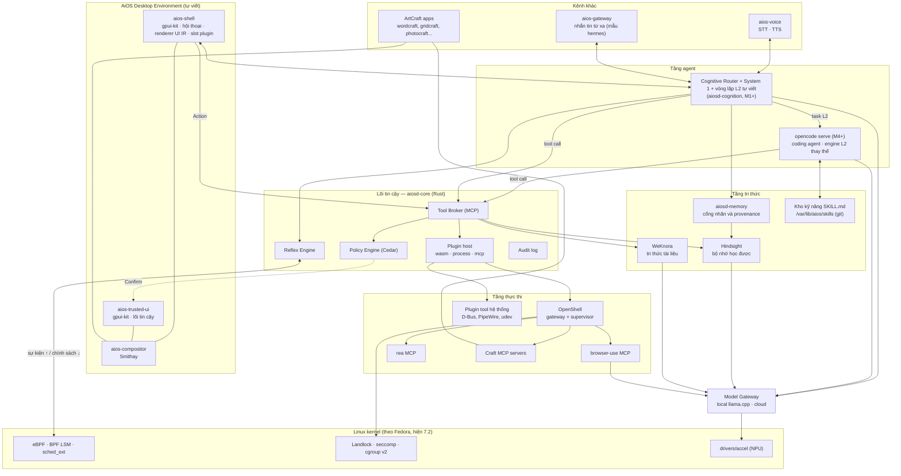
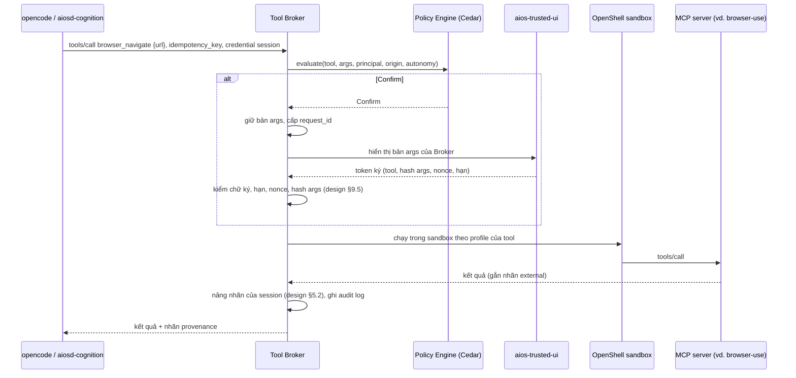
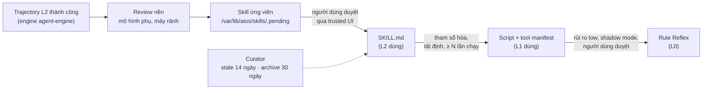

# AiOS — Kiến trúc tích hợp 12 thành phần

_Cập nhật: 2026-10-18_

## 0. Phạm vi và quy ước

**[Inference] Toàn bộ tài liệu là thiết kế đề xuất. Thông tin về các repo lấy từ trang GitHub, README và tài liệu chính thức ngày 18/10/2026; chưa có thành phần nào được cài thử trên AiOS. Mọi API, cờ cấu hình và đoạn code mẫu bên dưới là [Unverified] cho đến khi chạy spike ở §11.**

Tài liệu này ghép 12 dự án mã nguồn mở do chủ dự án chọn vào kiến trúc của [design.md](design.md). Nhãn dùng giống design.md: \[Inference\], \[Speculation\], \[Unverified\], UNKNOWN.

Từ khóa: **PHẢI**, **KHÔNG ĐƯỢC**, **NÊN**, **CÓ THỂ**.

Nguyên tắc ghép:

1. **Một lõi tin cậy, nhiều thành phần không tin cậy.** Lõi tin cậy được định nghĩa một lần ở [design.md §15.1](design.md): BPF program, `aiosd-core`, Model Gateway, `aios-compositor`, `aios-shell`, `aios-trusted-ui`, chính sách, registry manifest đã ký và bộ eval. Mọi thành phần mã nguồn mở bên ngoài chạy ngoài lõi và chỉ tác động lên hệ thống qua lõi.
2. **Một cửa cho mô hình, một cửa cho công cụ.** Mọi lệnh gọi LLM đi qua Model Gateway. Mọi lệnh gọi tool đi qua Tool Broker. Không thành phần nào gọi thẳng cloud AI hoặc gọi thẳng tool của thành phần khác.
3. **Một định dạng kỹ năng.** Mọi agent đọc và ghi cùng một kho kỹ năng `SKILL.md`.
4. **Thay thế được.** Mỗi thành phần ngoài nằm sau một giao diện chuẩn (MCP, HTTP OpenAI-compatible, ACP). Khi một dự án đổi API hoặc ngừng phát triển, AiOS thay thành phần đó mà không đổi lõi.

## 1. Kết quả khảo sát: vai trò dự kiến và vai trò thực tế

**Khảo sát phát hiện 2 điểm lệch so với vai trò chủ dự án giao: deepseek-harness không phải desktop environment, và oh-my-openagent dùng giấy phép không phải mã nguồn mở.** Các thành phần khác khớp với vai trò dự kiến. Sau khảo sát, chủ dự án chọn tự viết desktop environment và chỉ dùng deepseek-harness làm mẫu kiến trúc plugin (§1.1, D-16).

| # | Repo | Vai trò dự kiến | Thực tế (ngày 18/10/2026) | Ngôn ngữ | Giấy phép | Khớp |
| --- | --- | --- | --- | --- | --- | --- |
| 1 | torvalds/linux | Nhân | Mainline 7.3-rc7; stable 7.2.11; LTS mới nhất 6.18.57. Có sched\_ext, BPF LSM, Landlock (ABI 7 ở 6.18 LTS, 10 ở 7.2 stable, 11 ở mainline 7.3-rc), `drivers/accel/` (amdxdna, ivpu, rocket, ethosu...) | C | GPL-2.0 | Có |
| 2 | deepseek-ai/deepseek-harness | Desktop environment | Agent harness `dsh` trên plugin kernel Cordis: session log, agent loop, tool scheduler, sandbox, ~52 plugin (llm, mcp, skill, schedule, subagent, acp, browser-use, computer-use...), Web UI và app desktop. **Không phải DE, compositor hay window manager.** Bản pre-release `v0.2.1-rc.2`, README cảnh báo sẽ có thay đổi phá vỡ tương thích | TypeScript (Node) | MIT | **Lệch** → chỉ làm mẫu plugin |
| 3 | Tencent/WeKnora | Bộ ghi nhớ kiến thức | Nền tảng RAG hiểu tài liệu, agent reasoning, wiki tự cập nhật. REST, MCP server, CLI. Có bản Lite một file binary dùng SQLite | Go | MIT | Có |
| 4 | vectorize-io/hindsight | Bộ nhớ học được | Memory bank với `retain` / `recall` / `reflect`, hợp nhất nền, mental model. REST, SDK, MCP theo từng bank. Postgres + pgvector (có bản nhúng pg0). Bản 1.0.0 ngày 13/10/2026 | Python | MIT | Có |
| 5 | anomalyco/opencode | Coding agent | Client/server: `opencode serve` (HTTP + SSE, OpenAPI), SDK, plugin JS/TS, MCP client, agent tùy biến. 75+ provider, có Ollama, llama-server | TypeScript (Bun) | MIT | Có |
| 6 | code-yeongyu/oh-my-openagent | Skill cho coding agent | Tên cũ oh-my-opencode. Plugin OpenCode: nhiều agent (sisyphus, prometheus, atlas, oracle...), 54+ hook, skill, MCP tích hợp sẵn. **Giấy phép Sustainable Use License 1.0, không phải OSI.** Telemetry PostHog bật mặc định | TypeScript, Rust | SUL-1.0 | **Lệch (giấy phép)** |
| 7 | morluto/rea | Bộ reverse engineering | CLI `rea` + MCP stdio server; adapter cho Ghidra, rizin, GDB, Frida, JADX, Binwalk/Unblob, WABT, CDP... Supervisor giới hạn thời gian và dung lượng đọc | TypeScript | MIT (engine ngoài có giấy phép riêng) | Có |
| 8 | github.com/storytold | Bộ công cụ craft | Tổ chức **ArtCraft**: bộ ứng dụng Rust (photocraft, wordcraft, gridcraft, deckcraft, pdfcraft, vectorcraft, filmcraft, soundcraft, cadcraft...) + craft-launcher + craft-libs. Mỗi app có command registry dùng chung cho UI, CLI, kênh điều khiển JSON và **MCP server** | Rust (egui/wgpu) | MIT hoặc Apache-2.0 | Có |
| 9 | NVIDIA/OpenShell | Runtime an toàn cho agent | Gateway (control plane) + supervisor cho từng sandbox. Landlock, seccomp user-notify, chính sách YAML từ chối mặc định, mạng L7 theo từng binary, tiêm credential, prover SMT cho thay đổi chính sách. Driver: Docker, Podman, MicroVM, Kubernetes | Rust, Go | Apache-2.0 | Có |
| 10 | longbridge/gpui-kit | GUI Kit | Tên cũ gpui-component. 75+ component trên GPUI của Zed. GPUI trên Linux: Wayland + X11, render bằng wgpu (Vulkan/GLES), có wlr-layer-shell. **Chỉ là Wayland client, không làm compositor được** | Rust | Apache-2.0 | Có, kèm ràng buộc |
| 11 | browser-use/browser-use | Trình duyệt của agent | Thư viện agent điều khiển Chromium qua CDP; MCP server stdio; hỗ trợ Ollama. Telemetry PostHog bật mặc định | Python | MIT | Có |
| 12 | NousResearch/hermes-agent | Tham khảo | Agent tự tạo skill (`SKILL.md`, nhắc tạo skill, review nền, Curator), bộ nhớ, gateway nhắn tin đa nền tảng, cron | Python | MIT | Dùng làm mẫu |

Nguồn chính: trang GitHub của từng repo; [opencode.ai/docs/server](https://opencode.ai/docs/server/); [OpenShell architecture](https://github.com/NVIDIA/OpenShell/blob/main/docs/about/architecture.mdx); [oh-my-openagent LICENSE.md](https://github.com/code-yeongyu/oh-my-openagent/blob/dev/LICENSE.md); [kernel.org releases.json](https://www.kernel.org/releases.json); [hermes skills docs](https://hermes-agent.nousresearch.com/docs/user-guide/features/skills).

### 1.1 Xử lý điểm lệch 1: deepseek-harness không phải DE

`dsh` không có mã Wayland hoặc X11, app desktop Electron của nó không hỗ trợ Linux, và mọi bản phát hành vẫn là pre-release. Chủ dự án chọn **phương án C** (D-16):

- AiOS **tự viết desktop environment** riêng: `aios-compositor` (Smithay) + `aios-shell` (gpui-kit). Chi tiết ở §7.
- System 2 là vòng lặp tự viết trong `aiosd-cognition` (D-34, design §4.4). Từ M4, opencode ở chế độ server là coding agent và engine thay thế (§4).
- **Không cài `dsh`.** AiOS chỉ học kiến trúc "Everything is a Plugin" của `dsh` (plugin kernel Cordis) để xây hệ plugin riêng: [design.md §15](design.md).

| Ý tưởng lấy từ `dsh` | Nơi dùng trong AiOS |
| --- | --- |
| Plugin = đơn vị cấu hình + vòng đời; mọi đăng ký tự gỡ khi plugin dừng | Plugin host của `aiosd-core` (design §15.4) |
| `inject`: plugin khai báo service cần dùng | Trường `inject` trong manifest (design §15.2) |
| Config có schema | UI cài đặt sinh từ schema (design §15.6) |
| Plugin gắn UI vào slot có kiểu (`dsh.client`, `tool.call.toolview`, sidebar) | Slot UI của `aios-shell`; plugin chỉ góp mẫu UI IR, không góp code (design §15.5) |
| Cây UI khai báo do host gửi (`client-ui-claude-code-mods`) | UI IR (design §7.3) |
| Bỏ raw HTML trong đầu ra mô hình | REQ-D-7-01 |

### 1.2 Xử lý điểm lệch 2: giấy phép oh-my-openagent

Sustainable Use License 1.0 chỉ cho phép dùng nội bộ, cá nhân hoặc phi thương mại, và chỉ cho phân phối lại miễn phí cho mục đích phi thương mại ([LICENSE.md](https://github.com/code-yeongyu/oh-my-openagent/blob/dev/LICENSE.md)). Đây không phải giấy phép mã nguồn mở theo định nghĩa của OSI.

**Quyết định (D-20, D-48): AiOS là dự án mã nguồn mở và KHÔNG ĐƯỢC đóng gói oh-my-openagent.** \[Inference\] Người nhận một bản phân phối mã nguồn mở được quyền dùng cả cho mục đích thương mại; điều này trái với SUL-1.0, nên gói này không thể nằm trong ảnh AiOS.

Thay thế:

- AiOS tự viết bộ agent và skill cho opencode, gọi là `aios-skills`, theo định dạng `SKILL.md` và theo giấy phép của AiOS. Bộ này học ý tưởng (agent lập kế hoạch, agent thực thi, agent review, skill git và kiểm thử), không chép mã của oh-my-openagent.
- Người dùng CÓ THỂ tự cài oh-my-openagent cho mục đích cá nhân theo giấy phép của nó; AiOS không cung cấp và không hỗ trợ gói này.

## 2. Kiến trúc tổng thể sau khi ghép

**AiOS gồm 6 tầng. Lõi tin cậy (design §15.1) không đổi so với design.md. Desktop environment do AiOS tự viết. Mọi tính năng ngoài lõi là plugin (design §15); các dự án bên thứ ba vào hệ thống dưới dạng plugin MCP hoặc plugin agent-engine, và chỉ chạm hệ thống qua Model Gateway và Tool Broker.**



### 2.1 Bảng vai trò sau khi ghép

| Thành phần | Tầng | Vai trò trong AiOS | Dạng plugin (design §15) | Thay cho |
| --- | --- | --- | --- | --- |
| Linux | Kernel | eBPF Reflex, BPF LSM, Landlock, cgroup, driver NPU | — | Không đổi |
| `aiosd-core` (tự viết) | Lõi tin cậy | Reflex, Policy Engine, Tool Broker, plugin host, audit | Không phải plugin | Thêm plugin host |
| `aiosd-cognition` (tự viết) | Agent | Cognitive Router + System 1; vòng lặp L2 tự viết (D-34); điều phối task L2 | Không phải plugin | Bỏ LangGraph |
| `aios-compositor` + `aios-shell` (tự viết) | DE | Compositor, màn hình hội thoại, renderer UI IR, slot UI | Không phải plugin; nhận đóng góp từ plugin | Không đổi so với design §7 |
| opencode | Agent | Từ M4: coding agent (agent `build`/`plan`) và engine L2 thay thế (agent `aios`) | `agent-engine` | Mới |
| oh-my-openagent | Agent | Không đóng gói (D-20); thay bằng skill pack tự viết `aios-skills` | — | — |
| Hindsight | Tri thức | Bộ nhớ episodic + semantic, `reflect`, mental model | `mcp` + `memory-backend` | Bảng `memory_item` tự viết (design §6.4) |
| WeKnora | Tri thức | RAG trên tài liệu người dùng, wiki tri thức | `mcp` | Mới |
| OpenShell | Thực thi | Sandbox cho tiến trình agent và MCP server rủi ro cao | Runtime của plugin `process`/`mcp` | Bổ sung cho `aios-sandbox-exec` (tech-stack §8) |
| browser-use | Thực thi | Trình duyệt của agent | `mcp` | Mới |
| rea | Thực thi | Reverse engineering (phần cứng lạ, file nhị phân) | `mcp` | Hỗ trợ design §10.3 |
| ArtCraft | Ứng dụng | Bộ ứng dụng mặc định; command registry qua MCP | `mcp` + `app` | Mới |
| gpui-kit | DE | Toolkit của `aios-shell` và `aios-trusted-ui` | — | Slint (D-12) |
| deepseek-harness | Tham khảo | Mẫu kiến trúc plugin | Không cài | — |
| hermes-agent | Tham khảo | Mẫu vòng chưng cất kỹ năng, Curator, gateway nhắn tin, cron | Không cài | — |

## 3. Lõi tin cậy và hai cửa bắt buộc

**Mọi thành phần ngoài lõi tin cậy (định nghĩa ở design §15.1) là không tin cậy. Chúng PHẢI gọi LLM qua Model Gateway và gọi tool qua Tool Broker.** Các đường vòng bị chặn ở 3 lớp (§3.3): chính sách mạng của OpenShell hoặc systemd chỉ mở tới 2 cửa này, Landlock giới hạn đường dẫn, và BPF LSM chặn ghi, xóa, ptrace, exec ngoài phạm vi theo cgroup tổ tiên `aios-agent.slice`.

### 3.1 Cửa mô hình: Model Gateway

Mọi thành phần đều hỗ trợ endpoint OpenAI-compatible: opencode (custom provider), Hindsight (`HINDSIGHT_API_LLM_PROVIDER`), WeKnora (Ollama/OpenAI/LiteLLM), browser-use (OpenAI/Ollama), hermes (`custom` + `base_url`).

API OpenAI-compatible không có trường nhãn riêng tư. Vì vậy Gateway dùng **khóa ảo** để biết request đến từ đâu, và **nhãn theo session** (design §5.2) để biết request mang dữ liệu gì:

| Loại khóa ảo | Cấp cho | Nhãn ban đầu | Trần cloud |
| --- | --- | --- | --- |
| Theo session | Mỗi task L2 của engine `agent-engine` (worker `aiosd-l2` ở M1–M3, opencode từ M4), cấp khi `aiosd-cognition` tạo session | `public`, rồi Tool Broker nâng theo dữ liệu session nhận | Theo client |
| Theo dịch vụ | Hindsight, WeKnora | `secret` (dữ liệu nhiều nhãn trộn lẫn) | Không cloud |
| Theo plugin | Mỗi plugin gọi mô hình (browser-use...) | Theo manifest | Theo client |

```yaml
# /etc/aios/gateway.d/clients.yaml — [Inference] lược đồ đề xuất
clients:
  aiosd-l2:       { max_cloud_privacy: personal, key_scope: session }   # vòng lặp L2 tự viết (M1+)
  opencode:       { max_cloud_privacy: personal, key_scope: session }   # từ M4
  # provider, khóa API và ngân sách cloud: riêng cho từng người dùng (design §18.2);
  # trần thực tế = min(trần của client, max_cloud_privacy của người dùng)
  aiosd-core-security: { cloud: false, key_scope: service }   # phân loại, điều tra sự kiện an ninh (design §16)
  hindsight:      { cloud: false, key_scope: service }   # mọi retain/reflect/embedding chạy local
  weknora:        { cloud: false, key_scope: service }   # tài liệu người dùng
  browser-use:    { max_cloud_privacy: public, key_scope: plugin }   # nội dung web là external
  system1:        { cloud: false }                    # luôn local
routes:
  local-s1:  { endpoint: "unix:///run/aios/llm-s1.sock", runtime: llama.cpp-vulkan }
  local-s2:  { endpoint: "http://127.0.0.1:8081/v1", runtime: llama.cpp-vulkan }
  cloud:     { api_key_ref: "secret://aios/cloud-default" }   # Secret Service, cùng scheme với design §5.3
```

Quy tắc:

- Thành phần KHÔNG ĐƯỢC giữ API key cloud thật. Thành phần trong OpenShell nhận khóa ảo qua cơ chế tiêm credential của OpenShell (provider profile, §5); dịch vụ systemd (Hindsight, WeKnora) nhận khóa ảo qua `LoadCredential=` của systemd.
- Gateway chọn route theo `max(nhãn của session hoặc bank, nhãn client khai)` và trần cloud của khóa. Dữ liệu không có nhãn được xử lý như `secret` (design §5.2).
- Khóa ảo theo session hết hiệu lực khi session kết thúc hoặc khi kill switch được kích hoạt (design §11.3).

### 3.2 Cửa công cụ: Tool Broker tổng hợp MCP

Tool Broker nối tới mọi plugin `mcp` và `wasm` do plugin host nạp (browser-use, rea, WeKnora, Hindsight, Craft apps, tool hệ thống) và xuất **một** MCP endpoint duy nhất `aios-tools` cho các agent. Agent không thấy MCP server gốc. Broker nhận diện client bằng credential theo session (OpenShell tiêm, hoặc `SO_PEERCRED` trên Unix socket), không bằng trường trong body request.



Hệ quả:

- Ma trận xác nhận (design §9.3), audit log (REQ-D-9.3-03), idempotency key và token xác nhận gắn hành động (design §9.5) áp dụng đồng nhất cho mọi agent, kể cả agent bên thứ ba.
- Kết quả từ browser-use, rea, WeKnora mang nhãn `external`. Tool call sinh ra từ ngữ cảnh chứa `external` PHẢI nâng ít nhất một mức xác nhận (REQ-D-9.3-01).
- Chính sách mạng OpenShell của agent chỉ cho phép tới Tool Broker và Model Gateway. Agent không gọi thẳng MCP server được.

### 3.3 Ba lớp chính sách

| Lớp | Công cụ | Quyết định | Phạm vi |
| --- | --- | --- | --- |
| Hành động | Cedar trong Tool Broker | Allow / Confirm / Deny từng tool call | Ngữ nghĩa: tool, đối số, rủi ro, nguồn gốc, principal |
| Tiến trình | OpenShell YAML, `aios-sandbox-exec`, systemd sandboxing | File, tiến trình, mạng L7 theo binary | Mỗi sandbox hoặc dịch vụ |
| Kernel | BPF LSM `agent_guard` + Landlock | BPF: chặn ghi, xóa, đổi tên, cắt file ngoài workspace, ptrace, exec, connect theo cgroup tổ tiên (design §3.4); Landlock: đường dẫn và cổng | Mọi tiến trình dưới `aios-agent.slice`, kể cả khi user space bị chiếm |

\[Inference\] Ba lớp độc lập: lỗi chính sách ở một lớp không tự mở hai lớp còn lại. Điều kiện để tuyên bố này đúng: mọi tiến trình agent nằm dưới `aios-agent.slice` (spike S-5), token xác nhận gắn hành động (design §9.5), và quyền không lấy từ file agent ghi được (design §15.2).

## 4. Ba cấp phản hồi trên các thành phần

**Áp dụng từ M4 ([roadmap.md](roadmap.md)). Từ M1 đến M3, L2 chạy bằng vòng lặp tự viết trong `aiosd-cognition` (D-34, design §4.4). Từ M4, opencode ở chế độ server là engine thay thế và là coding agent, khóa sau interface `agent-engine` để thay được.** \[Inference\] opencode có server HTTP + SSE với đặc tả OpenAPI, SDK, agent tùy biến, plugin hook và MCP client ([opencode.ai/docs/server](https://opencode.ai/docs/server/)), nên `aiosd-cognition` điều khiển được nó như một engine.

| Cấp | Thành phần chạy | Bộ nhớ dùng | Công cụ dùng | Ví dụ |
| --- | --- | --- | --- | --- |
| L0 Reflex | eBPF + Reflex Engine (`aiosd-core`) | Rule có phiên bản | Plugin tool hệ thống | "tắt wifi", chặn ghi file ngoài workspace |
| L1 System 1 | `aiosd-cognition` + mô hình nhỏ local | Hindsight `recall` (không `reflect`), WeKnora tìm nhanh | Một tool rủi ro thấp qua Tool Broker | "mở tài liệu hợp đồng tuần trước trong wordcraft" |
| L2 System 2 | opencode, agent `aios` | Hindsight `recall` + `reflect`, WeKnora RAG, kho kỹ năng | Nhiều tool qua MCP `aios-tools`, mọi mức rủi ro | "đọc 20 báo cáo PDF, làm bảng so sánh trong gridcraft và slide trong deckcraft" |

Agent trong opencode:

| Agent | Chế độ | Dùng cho | Tool built-in của opencode |
| --- | --- | --- | --- |
| `aios` (AiOS định nghĩa) | primary | Tác vụ hệ thống, tài liệu, ứng dụng | Tắt hết (`bash`, `edit`, `write`, `webfetch`); chỉ dùng MCP `aios-tools` |
| `build`, `plan` (có sẵn) | primary | Viết và sửa code trong workspace | Bật, nhưng chạy trong sandbox OpenShell của workspace và qua hook `aios-guard` |
| Agent và skill của `aios-skills` (tự viết, D-20) | subagent | Lập kế hoạch, review, git, kiểm thử trong workspace | Theo cấu hình gói |

\[Inference\] Rủi ro: opencode được thiết kế cho viết code; chất lượng của agent `aios` cho tác vụ hệ thống nói chung phụ thuộc prompt và mô hình, cần spike S-1.

### 4.1 Code mẫu: cấu hình opencode cho AiOS

```jsonc
// /etc/aios/opencode/opencode.json — khóa đã đối chiếu docs opencode v1.19.3 (review.md §5); vẫn PHẢI test
{
  "$schema": "https://opencode.ai/config.json",
  "provider": {
    "aios": {
      "npm": "@ai-sdk/openai-compatible",
      "name": "AiOS Model Gateway",
      "options": { "baseURL": "http://host.aios.internal:8090/v1", "apiKey": "aios-placeholder" },
      "models": { "s2": {}, "coder": {} }
    }
  },
  "model": "aios/s2",
  "mcp": {
    "aios-tools": {
      "type": "remote",
      "url": "http://host.aios.internal:8091/mcp",
      "headers": { "Authorization": "Bearer aios-placeholder" },   // OpenShell thay bằng credential của session
      "enabled": true
    }
  },
  "agent": {
    "aios": {
      "mode": "primary",
      "prompt": "{file:/usr/share/aios/prompts/system2.md}",
      "permission": { "edit": "deny", "bash": "deny", "webfetch": "deny" }
    },
    "build": { "model": "aios/coder" }
  },
  "skills": { "paths": ["/var/lib/aios/skills"] }
}
```

`apiKey` là placeholder; OpenShell tiêm khóa ảo theo session khi request tới Model Gateway (§3.1). Tên mô hình logic `s2`, `coder` theo design §5.

Hook `aios-guard` được đặt vào thư mục plugin của opencode (`~/.config/opencode/plugins/`), vì docs chỉ mô tả mảng `plugin` cho tên gói npm. File cấu hình và thư mục plugin PHẢI được mount chỉ đọc trong sandbox, để agent không tự gỡ hook.

### 4.2 Code mẫu: hook `aios-guard` cho tool built-in

Tool trong MCP `aios-tools` đã đi qua Tool Broker. Tool built-in của opencode (bash, edit) chạy **bên trong** tiến trình opencode, nên Broker không tự thực thi được chúng. Theo design §9.5, loại tool này KHÔNG ĐƯỢC nhận xác nhận: hook chỉ cho chạy khi Policy trả Allow; khi Policy trả Confirm hoặc Deny, hook từ chối và agent phải dùng tool tương đương qua `aios-tools`, nơi Broker giữ args và tự thực thi.

```ts
// ~/.config/opencode/plugins/aios-guard.ts (cài từ /usr/lib/aios/opencode-plugins/)
// Chữ ký hook khớp @opencode-ai/plugin v1.19.3 (review.md §5). Nhánh dev đã có API plugin V2: ghim phiên bản.
import type { Plugin } from "@opencode-ai/plugin";

const BROKER = "http://host.aios.internal:8092";   // REST; MCP ở 8091

async function broker(path: string, body: unknown) {
  const r = await fetch(`${BROKER}${path}`, {
    method: "POST",
    headers: {
      "content-type": "application/json",
      authorization: "Bearer aios-placeholder",   // OpenShell thay bằng credential của session
    },
    body: JSON.stringify(body),
  });
  if (!r.ok) throw new Error(`aios-broker ${path}: ${r.status}`);
  return r.json();
}

export const AiosGuard: Plugin = async () => ({
  "tool.execute.before": async (input, output) => {
    if (input.tool.startsWith("aios-tools_")) return;          // đã qua Tool Broker
    const v = await broker("/v1/preflight", { tool: input.tool, args: output.args });
    if (v.verdict !== "allow") {
      // [Inference] throw chặn tool; docs opencode chỉ có ví dụ, cần test (spike S-2)
      throw new Error(`AiOS policy: ${v.verdict}; dùng ${v.suggested_tool ?? "tool qua aios-tools"}`);
    }
  },
  "tool.execute.after": async (input, output) => {
    await broker("/v1/audit", { tool: input.tool, args: input.args,
                                result: output.output?.slice(0, 4096) });
  },
});
```

Broker nhận diện client và session bằng credential trong header, không bằng body. Hook chạy trong tiến trình opencode, vốn không tin cậy; vì vậy hook chỉ là lớp tiện lợi. Ranh giới thật là sandbox OpenShell của workspace, Landlock và BPF LSM theo cgroup tổ tiên (§3.3).

### 4.3 Code mẫu: `aiosd-cognition` giao task L2 cho opencode

```python
# aiosd/cognition/engine_opencode.py — [Unverified] đường dẫn và body theo OpenAPI tại /doc của opencode serve
import httpx, json

class OpencodeEngine:            # hiện thực interface agent-engine (design §15.3)
    def __init__(self, base="http://127.0.0.1:4096"):
        self.http = httpx.AsyncClient(base_url=base, timeout=None)

    async def start_task(self, text: str, agent: str = "aios") -> str:
        sid = (await self.http.post("/session", json={"title": text[:60]})).json()["id"]
        await self.http.post(f"/session/{sid}/prompt_async",
                             json={"agent": agent, "parts": [{"type": "text", "text": text}]})
        return sid

    async def cancel(self, sid: str) -> None:
        await self.http.post(f"/session/{sid}/abort")

    async def events(self):
        async with self.http.stream("GET", "/event") as r:      # SSE
            async for line in r.aiter_lines():
                if line.startswith("data: "):
                    yield json.loads(line[6:])                  # ánh xạ sang thẻ task (design §7.9)
```

## 5. Thực thi an toàn với OpenShell

**OpenShell bọc các tiến trình agent và MCP server rủi ro cao. `aios-sandbox-exec` (bubblewrap + Landlock + seccomp) vẫn dùng cho tool nhỏ, ngắn của L0/L1.** \[Inference\] Lý do giữ cả hai: OpenShell cần container runtime hoặc microVM, khởi động chậm hơn helper `exec` trực tiếp; tool L0/L1 cần độ trễ thấp.

### 5.1 Phân bổ sandbox

Bảng này áp dụng từ M4, khi có OpenShell; ở M1–M3 mọi tool và MCP server chạy qua `aios-sandbox-exec` (roadmap.md §4). Tiến trình trong `aios-agent.slice` bị BPF LSM (design §3.4, từ M2) chặn theo cgroup tổ tiên; tiến trình trong `aios-svc.slice` (Hindsight, WeKnora) không thuộc phạm vi BPF LSM mà bị giới hạn bằng systemd sandboxing.

| Tiến trình | Sandbox | Slice | Driver OpenShell đề xuất | Mạng cho phép |
| --- | --- | --- | --- | --- |
| opencode (agent `aios`) | OpenShell | `aios-agent.slice` | Podman rootless | Ra: Tool Broker, Model Gateway. Vào: cổng server chỉ từ `aiosd-cognition` trên loopback |
| opencode (agent `build`), mỗi workspace một sandbox | OpenShell | `aios-agent.slice` | Podman rootless | Tool Broker, Model Gateway, proxy gói nội bộ (§5.3) |
| browser-use + Chromium | OpenShell | `aios-agent.slice` | Podman rootless; MicroVM nếu Chromium phải tắt sandbox riêng | Internet qua proxy L7; chặn dải mạng nội bộ IPv4 và IPv6, `host.aios.internal`, và chống DNS rebinding |
| rea + Ghidra/GDB/Frida | OpenShell | `aios-agent.slice` | **MicroVM** (cần ptrace, chạy mã lạ) | Không có mạng |
| Craft MCP server | OpenShell | `aios-agent.slice` | Podman rootless | Không có mạng |
| Hindsight, WeKnora | systemd sandboxing: user riêng, `ProtectSystem=strict`, `ReadWritePaths=` chỉ thư mục dữ liệu của mình, `NoNewPrivileges=yes`, `IPAddressDeny=any` + `IPAddressAllow=localhost` | `aios-svc.slice` | — | Model Gateway, Postgres |
| Tool `fs.*`, `net.*` nhỏ | `aios-sandbox-exec` | `aios-agent.slice` (cgroup tạm mỗi lần gọi) | — | Theo manifest |

Quy tắc cho browser-use:

- Chromium của agent PHẢI dùng hồ sơ riêng, không có cookie, mật khẩu hay phiên đăng nhập của người dùng; hồ sơ bị xóa khi task kết thúc, trừ khi người dùng giữ lại.
- Proxy L7 của OpenShell PHẢI chặn mọi đích thuộc dải mạng riêng, loopback, link-local (IPv4 và IPv6) và `host.aios.internal`, kiểm theo địa chỉ IP sau khi phân giải để chống DNS rebinding.
- \[Inference\] Chromium trong container rootless thường phải chạy `--no-sandbox`. Khi đó PHẢI dùng driver MicroVM của OpenShell để bù lại lớp sandbox của Chromium. Spike S-5 kiểm điều này.
- Telemetry của browser-use PHẢI tắt (`ANONYMIZED_TELEMETRY=false`).

\[Inference\] Hindsight và WeKnora xử lý nội dung `external` (tài liệu, hội thoại) và gọi LLM, nên PHẢI bị giới hạn như agent ở lớp mạng và filesystem, dù chạy như dịch vụ systemd thay vì trong OpenShell.

### 5.2 Code mẫu: chính sách OpenShell cho opencode

```yaml
# /etc/aios/openshell/policies/opencode.yaml
# Khóa đã đối chiếu docs/how-it-works/policies/schema.mdx của OpenShell v0.1.4 (review.md §5); vẫn PHẢI chạy prover
version: 1
filesystem_policy:
  read_only: [/usr, /etc/ssl, /var/lib/aios/skills, /home/sandbox/.config/opencode]   # cấu hình + hook chỉ đọc
  read_write: [/sandbox/workspace, /tmp]
landlock:
  compatibility: hard_requirement       # fail closed, cùng nguyên tắc với REQ-T-8-01
process:
  run_as_user: sandbox
network_policies:
  model_gateway:
    endpoints:
      - host: host.aios.internal
        port: 8090
        protocol: rest
        enforcement: enforce            # mặc định là audit: chỉ ghi log, không chặn
        rules:
          - allow: { method: POST, path: "/v1/chat/completions" }
          - allow: { method: GET, path: "/v1/models" }
    binaries: [{ path: "/usr/local/bin/opencode" }]
  tool_broker:
    endpoints:
      - host: host.aios.internal
        port: 8091                      # MCP aios-tools
        protocol: mcp
        enforcement: enforce
        mcp: { allow_all_known_mcp_methods: true }
      - host: host.aios.internal
        port: 8092                      # REST preflight/audit cho hook aios-guard
        protocol: rest
        enforcement: enforce
        rules:
          - allow: { method: POST, path: "/v1/preflight" }
          - allow: { method: POST, path: "/v1/audit" }
    binaries: [{ path: "/usr/local/bin/opencode" }]
  packages:                             # chỉ tới proxy gói nội bộ, không tới registry công khai (§5.3)
    endpoints:
      - host: host.aios.internal
        port: 8093
        protocol: rest
        enforcement: enforce
        allow_encoded_slash: true       # gói có scope dạng @scope%2fname
        rules:
          - allow: { method: GET, path: "/npm/**" }
          - allow: { method: GET, path: "/pypi/**" }
    binaries: [{ path: "/usr/bin/npm" }, { path: "/usr/local/bin/bun" }, { path: "/usr/bin/uv" }]
```

Quy tắc:

- Mọi chính sách sandbox PHẢI qua `openshell-prover` trong CI ảnh hệ thống. (`openshell profile lint` dành cho provider profile, không dành cho chính sách sandbox.)
- Thay đổi chính sách mạng lúc chạy do agent đề xuất PHẢI đi qua bề mặt tin cậy, không dùng màn hình duyệt của OpenShell.
- Mọi endpoint PHẢI đặt `enforcement: enforce`.
- Telemetry của OpenShell và browser-use PHẢI tắt trong ảnh hệ thống (`OPENSHELL_TELEMETRY_ENABLED=false`, `DO_NOT_TRACK=1`, `ANONYMIZED_TELEMETRY=false`). Chính sách mạng chặn thêm host telemetry để phòng cấu hình sót.

### 5.3 Proxy gói cho agent `build`

**Agent `build` của opencode cài thư viện cho dự án của người dùng. Cài gói npm hay PyPI là chạy mã của bên thứ ba: script `postinstall` của npm và file `setup.py` của PyPI chạy ngay khi cài.** Vì vậy sandbox của agent `build` không tới registry công khai, mà chỉ tới một proxy gói nội bộ `aios-pkg-proxy` (cổng ở §11.1), chạy trong sandbox riêng có mạng ra registry.

| Quy tắc | Cách thực thi |
| --- | --- |
| Không chạy script lúc cài | `.npmrc` của sandbox đặt `ignore-scripts=true`, mount chỉ đọc; Bun chạy với `--ignore-scripts`; pip/uv chỉ nhận wheel (`--only-binary=:all:`), không build sdist |
| Gói cần script để chạy được | Agent dừng và hỏi người dùng; người dùng duyệt từng gói trên bề mặt tin cậy, kèm tên, phiên bản, nội dung script |
| Phiên bản mới công bố | Proxy từ chối phiên bản công bố chưa đủ \[Inference\] 7 ngày (gói độc hại thường bị gỡ trong vài ngày đầu); người dùng CÓ THỂ cho phép ngoại lệ từng gói |
| Lockfile | Proxy và sandbox yêu cầu lockfile có hash toàn vẹn khi dự án đã có lockfile; gói không khớp hash bị từ chối |
| Typosquat | Proxy cảnh báo tên gói gần giống gói phổ biến (ví dụ khác 1 ký tự) và yêu cầu xác nhận |
| Ghi nhận | Mọi gói tải về được ghi vào audit log của session (tên, phiên bản, hash, nguồn) |

\[Inference\] Proxy có thể dựng từ công cụ sẵn có (ví dụ Verdaccio cho npm, devpi cho PyPI) cộng một lớp lọc riêng cho quy tắc tuổi phiên bản và typosquat; chọn công cụ ở M4.

## 6. Bộ nhớ, tri thức và tự học

**Hindsight giữ những gì AiOS trải nghiệm; WeKnora giữ những gì người dùng sở hữu; kho `SKILL.md` giữ những gì AiOS biết làm. Cả ba đều có phiên bản hoặc lịch sử, và người dùng xem, sửa, xóa được.**

| Tầng bộ nhớ (design §6.1) | Thành phần | Ghi chú |
| --- | --- | --- |
| Working | Session của engine L2 (`aiosd-l2`, hoặc opencode từ M4), ngữ cảnh trong `aiosd-cognition` (L0/L1) | Hết phiên |
| Episodic, Semantic | Hindsight (`retain`, `recall`, `reflect`, hợp nhất nền) | Thay bảng `memory_item` tự viết |
| Tri thức tài liệu | WeKnora Lite (thư mục người dùng cho phép, wiki tự cập nhật) | Mới |
| Procedural | Kho `SKILL.md` + script + rule Reflex | Git, rollback được |
| Parametric | LoRA (tùy chọn, nghiên cứu R) | Không đổi |

### 6.1 Một Postgres dùng chung

Hindsight cần Postgres + pgvector. WeKnora bản đầy đủ cũng dùng Postgres. \[Inference\] Chạy một instance Postgres hệ thống với hai database riêng rẻ hơn hai Postgres nhúng. WeKnora Lite với SQLite là phương án dự phòng nếu chỉ cần một tiến trình.

### 6.2 Riêng tư: một bank cho mỗi nhãn

Hindsight tách dữ liệu theo **bank**. AiOS dùng bank để thực thi nhãn riêng tư:

| Bank | Nhãn | Taint (design §6.3) |
| --- | --- | --- |
| `user-public` | `public` | `clean` |
| `user-personal` | `personal` | `clean` |
| `user-secret` | `secret` | `clean` |
| `system` | sự kiện hệ thống, thiết bị (`personal`) | `clean` |
| `ext-public` | `public` | `tainted` |
| `ext-personal` | `personal` | `tainted` |
| `ext-secret` | `secret` | `tainted` |

**Vì sao tách bank theo taint.** \[Inference\] Khi Hindsight `reflect` hoặc hợp nhất nền, nó sinh sự thật và mental model mới bằng LLM; metadata provenance của đầu vào khó được truyền sang đầu ra. Tách bank bảo đảm taint không phụ thuộc Hindsight: `reflect` trong bank `clean` chỉ đọc mục `clean`; mọi thứ sinh ra trong bank `ext-*` đều `tainted`. Tool Broker theo dõi taint của session giống nhãn riêng tư: session đã nhận một kết quả `tainted` thì mọi `retain` sau đó của session đi vào bank `ext-*`.

Mỗi người dùng có một instance Hindsight riêng (`hindsight-api@<uid>`, database và role Postgres riêng, design §18). Instance phục vụ mọi bank của người dùng đó và chỉ gọi mô hình local qua khóa `hindsight` (`cloud: false`, §3.1). \[Unverified\] Hindsight cấu hình provider LLM theo instance, không theo bank; nếu sau này cần cloud cho bank `user-public`, chạy một instance thứ hai chỉ chứa bank đó. Khi agent gọi `recall` qua Tool Broker, kết quả mang nhãn của bank, và Broker nâng nhãn của session theo nhãn này (design §5.2).

```ini
# /etc/aios/hindsight.env — biến theo hindsight-api-slim (review.md §5); không cài extra local-ml (torch)
HINDSIGHT_API_LLM_PROVIDER=openai
HINDSIGHT_API_LLM_BASE_URL=http://127.0.0.1:8090/v1        # [Unverified] tên biến base URL của LLM
HINDSIGHT_API_EMBEDDINGS_PROVIDER=openai
HINDSIGHT_API_EMBEDDINGS_OPENAI_BASE_URL=http://127.0.0.1:8090/v1
HINDSIGHT_API_RERANKER_PROVIDER=<provider không cần torch>  # mặc định là local, sẽ kéo torch
```

Agent không ghi thẳng vào Hindsight. `aiosd-memory` (lớp mỏng, tự viết) gắn provenance và nhãn rồi chọn bank:

```python
# aiosd/memory/gate.py — chữ ký retain khớp hindsight-client 1.0.0 (review.md §5)
from hindsight_client import Hindsight

hs = Hindsight(base_url="http://127.0.0.1:8888")
def bank_for(privacy: str, tainted: bool) -> str:
    return f"{'ext' if tainted else 'user'}-{privacy}"

def retain(text: str, *, provenance: str, privacy: str | None, source: str,
           session_tainted: bool) -> None:
    privacy = privacy or "secret"                       # REQ-D-5.2-02: không nhãn = secret
    # taint đơn điệu (design §6.3): external, hoặc session đã nhận dữ liệu tainted
    tainted = provenance == "external" or session_tainted
    if provenance == "external":
        # nội dung web/file/email: chỉ lưu như sự thật được trích dẫn, không thành chỉ thị (REQ-D-6.3-01)
        text = f"[external:{source}] {text}"
    hs.retain(bank_id=bank_for(privacy, tainted), content=text,
              metadata={"provenance": provenance, "source": source,
                        "taint": "tainted" if tainted else "clean"})
```

Yêu cầu:

- `aiosctl memory` và UI quản lý bộ nhớ PHẢI đọc, sửa, xóa được mục trong cả Hindsight và WeKnora (REQ-D-6.6-01).
- Bank `user-secret` và `ext-secret` KHÔNG ĐƯỢC cấu hình provider cloud.
- AiOS chụp snapshot database Hindsight trước mỗi lần hợp nhất lớn hoặc nâng phiên bản.

### 6.3 Vòng chưng cất kỹ năng (theo mẫu hermes-agent)

Trên máy người dùng, bước "review nền" dưới đây về sau (mốc R) được thay bằng vòng Propose–Probe–Compose rút gọn theo mẫu Harness² (§15.4). hermes-agent cho thấy một vòng học dùng được: nhắc agent tạo skill định kỳ, chạy review nền bằng mô hình rẻ hơn, cho phép đưa skill vào hàng chờ duyệt, và có Curator đánh dấu cũ rồi lưu trữ, không xóa. AiOS dùng lại các ý tưởng này và nối với cổng thăng cấp của design §6.5.



Một định dạng cho mọi agent: opencode (đọc `.opencode/skills`, `.claude/skills`, `.agents/skills` và đường dẫn trong `skills.paths`, §4.1), oh-my-openagent, rea (skill đóng gói kèm) và hermes đều dùng `SKILL.md` kiểu agentskills.io; `aiosd-cognition` đọc cùng kho cho L1. AiOS thêm khối `metadata.aios`:

```markdown
---
name: bao-cao-dung-luong-o-dia
description: Quét ổ đĩa, liệt kê thư mục lớn và file trùng, đề xuất dọn dẹp, không xóa.
version: 3
metadata:
  aios:
    risk: low                    # chỉ là gợi ý; mức hiệu lực = cao nhất của các tool (design §15.2)
    provenance: observed         # stated | observed | inferred — external không được phép
    taint: clean                 # clean | tainted — do aiosd-memory gán, không mất khi duyệt (design §6.3)
    tools: [fs.scan_large, fs.find_duplicates]
    promoted_to: system1         # system2 | system1 | reflex
    eval: tests/disk-report.yaml # bộ eval hồi quy bắt buộc trước khi thăng cấp
---
## Khi nào dùng
Người dùng hỏi về dung lượng, ổ đầy, hoặc muốn dọn máy.
## Quy trình
1. Gọi `fs.scan_large` với `min_size=500MB`.
2. Gọi `fs.find_duplicates` trong thư mục người dùng.
3. Trình bày bảng; mọi lệnh xóa đi qua xác nhận.
## Lỗi thường gặp
- Thư mục snapshot btrfs làm số liệu trùng lặp: bỏ qua `/.snapshots`.
## Kiểm tra
Tổng dung lượng báo cáo lệch dưới 1% so với `df`.
```

Quy tắc kho kỹ năng:

- Kho là một git repository; mỗi thay đổi là một commit có tác giả (agent nào, phiên nào).
- Skill có `provenance: external` hoặc sinh từ ngữ cảnh chứa `external` KHÔNG ĐƯỢC tự vào kho; PHẢI qua hàng chờ duyệt. Sau khi duyệt, skill vẫn giữ `metadata.aios.taint: tainted`, nên không thăng được lên Reflex (design §6.3, §6.5).
- Skill do bên thứ ba cung cấp (ví dụ skill đóng gói kèm rea) nằm ở nhánh `vendor/` chỉ đọc, không được Curator sửa.

## 7. AiOS Desktop Environment (tự viết)

**AiOS tự viết desktop environment gồm 3 tiến trình: `aios-compositor` (Smithay), `aios-shell` (gpui-kit) và `aios-trusted-ui` (gpui-kit). Màn hình chính là hội thoại (D-10). UI thích ứng hiển thị trong `aios-shell` qua renderer UI IR. Plugin mở rộng DE bằng cách góp mẫu UI IR vào slot, không góp code.**

Thiết kế màn hình chính, UI IR, ổn định và trợ năng giữ nguyên design §7. Mục này chỉ ghi phần thay đổi do phương án C.

### 7.1 Ba tiến trình

| Tiến trình | Toolkit | Trách nhiệm | Tin cậy |
| --- | --- | --- | --- |
| `aios-compositor` | Smithay | Wayland compositor, xếp `window_slot`, lớp overlay cho bề mặt tin cậy, ẩn vùng khi chia sẻ màn hình, bộ gõ (`text-input-v3`, `input-method-v2`) | Có |
| `aios-shell` | gpui-kit, wlr-layer-shell | Thanh hệ thống, dải ngữ cảnh, luồng hội thoại, thanh nhập, vùng làm việc, renderer UI IR, slot plugin, chế độ dự phòng | Có (không chạy code của mô hình hoặc plugin) |
| `aios-trusted-ui` | gpui-kit, lớp overlay riêng | Khóa màn hình, xác nhận, PIN, cấp quyền, duyệt skill và plugin | Có, lõi tin cậy |

GPUI chỉ là Wayland client (không có mã `wayland_server` trong zed), nên compositor PHẢI là tiến trình riêng.

**Chế độ dự phòng.** Khi `aiosd-cognition` hoặc Model Gateway chưa sẵn sàng, `aios-shell` vẫn chạy và thanh nhập chỉ nhận lệnh Reflex và tìm kiếm cục bộ (REQ-D-7.9-01). Khi `aios-shell` chết, compositor khởi động lại nó; nếu lỗi lặp lại, compositor chuyển sang TTY recovery với `aiosctl`.

### 7.2 Renderer UI IR bằng gpui-kit

Mỗi primitive của UI IR (design §7.3) ánh xạ sang một component gpui-kit viết sẵn. Mô hình chỉ sinh IR; validator trong `aiosd` kiểm tra trước khi tới renderer (REQ-D-7.4-02).

```rust
// aios-shell/src/render.rs — [Unverified] API gpui / gpui-kit theo bản đang ghim; node theo UI IR v1 (design §7.3)
use gpui::{div, prelude::*, AnyElement, SharedString};
use gpui_component::button::Button;

pub fn render(node: &ir::Node, cx: &mut RenderCx) -> AnyElement {
    match node {
        ir::Node::Stack { dir, children, .. } => {
            let el = if *dir == ir::Dir::Row { div().flex().flex_row() } else { div().flex().flex_col() };
            el.gap_2().children(children.iter().map(|c| render(c, cx))).into_any_element()
        }
        ir::Node::Text { value, .. } =>
            div().child(SharedString::from(cx.bind_text(value))).into_any_element(),
        ir::Node::List { source, max, template, .. } =>
            div().flex().flex_col()
                .children(cx.bind_rows(source, *max).map(|item| render(template, &mut cx.with_item(item))))
                .into_any_element(),
        ir::Node::Button { id, label, action, .. } => {
            let action = action.clone();
            Button::new(id.as_str()).label(label.as_str())
                .on_click(move |_, _, app| app.dispatch_ir_action(&action))   // → Tool Broker, không phải xác nhận
                .into_any_element()
        }
        // validator đã chặn kind lạ; nếu vẫn tới đây thì vẽ khung rỗng và ghi log, không panic
        other => { cx.log_unexpected(other); div().into_any_element() }
    }
}
```

Ràng buộc:

- `aios-shell` KHÔNG ĐƯỢC bật `gpui-shell` (QuickJS) hoặc `gpui-webview` (WebKitGTK). Không có đường nào chạy code do mô hình hoặc plugin sinh trong tiến trình shell (REQ-D-7-01).
- Dấu hiệu thị giác của bề mặt tin cậy (REQ-D-7.7-01) chỉ có trong `aios-trusted-ui`; bảng ánh xạ IR → component không chứa style này.
- Cùng IR và cùng dữ liệu PHẢI cho cùng kết quả render (REQ-D-7.8-03); snapshot test dùng chế độ headless của GPUI.

### 7.3 Slot UI cho plugin (học từ `dsh`)

`aios-shell` mở các slot có kiểu. Plugin góp **mẫu UI IR** vào slot qua manifest; `aios-shell` render bằng component cố định. Chi tiết hợp đồng: design §15.5.

| Slot | Vị trí (design §7.9) | Ví dụ plugin góp |
| --- | --- | --- |
| `conversation.tool_view.<tool>` | Thẻ kết quả tool trong luồng hội thoại | Plugin Wi-Fi góp thẻ danh sách mạng cho `wifi.scan` |
| `workspace.panel` | Panel ghim ở vùng làm việc | Plugin giám sát góp biểu đồ CPU |
| `context_strip.item` | Dải ngữ cảnh | Plugin lịch góp "cuộc họp sau 10 phút" |
| `settings.section` | Phần cài đặt sinh từ schema | Mọi plugin có `config_schema` |
| `system_bar.indicator` | Thanh hệ thống | Plugin VPN góp chỉ báo kết nối |

### 7.4 UI thích ứng dùng Hindsight và command registry của ArtCraft

- **Cá nhân hóa:** UI Planner đọc mental model của Hindsight (ví dụ "người dùng thường mở gridcraft sau khi nhận file CSV") để chọn surface ở cache L0 hoặc L1 (design §7.4).
- **Nút hành động trong widget:** mỗi app ArtCraft có command registry dùng chung cho UI, CLI, kênh JSON và MCP. Widget IR CÓ THỂ chứa `Action` gọi một command của app qua Tool Broker, ví dụ nút "Xuất PDF" gọi `wordcraft.export_pdf`.
- **Manifest ứng dụng:** app ArtCraft là plugin loại `app` + `mcp` (design §15). Khi cài, plugin host đăng ký MCP server của app vào Tool Broker.

```toml
# /var/lib/aios/plugins/vendor/wordcraft/plugin.toml — lược đồ design §15.2; gói vendor có chữ ký
id = "artcraft.wordcraft"
version = "0.0.0"                   # theo gói ArtCraft đã cài
api = "aios:plugin@0.1"
provides = ["app", "mcp"]
runtime = "mcp"
entry = ["/usr/bin/wordcraft", "--mcp"]        # [Unverified] cờ khởi chạy MCP
sandbox = "openshell:craft"
desktop_entry = "wordcraft.desktop"
trust = "vendor"

[risk_overrides]                    # chỉ có hiệu lực vì plugin là vendor đã ký (design §15.2)
"document.export_*" = "low"
"document.save*" = "medium"
"file.delete" = "high"
```

### 7.5 Bộ gõ tiếng Việt

\[Unverified\] GPUI có XIM trên X11 và dùng wayland-protocols trên Wayland; hỗ trợ `text-input-v3` với fcitx5 trên compositor Smithay chưa được kiểm chứng. Chủ dự án đánh giá đây không phải rủi ro lớn và sẽ cung cấp cách hiện thực sau (UNKNOWN đến khi có hướng dẫn). Spike S-3 vẫn giữ để đo, nhưng không chặn lộ trình.

## 8. Giọng nói và gateway nhắn tin

Không thành phần nào trong 12 repo thay được `aios-voice` cho tiếng Việt offline; giữ thiết kế design §8.

**Gateway nhắn tin (mẫu hermes-agent).** hermes-agent chạy một tiến trình gateway phục vụ nhiều nền tảng (Telegram, Discord, Slack, Signal, Matrix, Email...), có allowlist và mã ghép đôi. AiOS thêm `aios-gateway` theo cùng mẫu để người dùng nói chuyện với máy khi ở xa.

**Kênh từ xa là đường ra khỏi máy.** Gửi câu trả lời về Telegram, Discord hay email là gửi dữ liệu cho một dịch vụ bên thứ ba, giống gửi lên cloud AI. Tài khoản chat bị chiếm, hoặc injection tạo một lịch gửi kết quả tới kênh của kẻ tấn công, đều là đường rò dữ liệu.

Quy tắc an ninh cho kênh từ xa:

- Kênh từ xa là một principal riêng `channel=remote` trong Policy Engine (tech-stack §4). Mức tự hành của kênh này KHÔNG ĐƯỢC vượt 1; mặc định kênh chỉ đọc (hỏi đáp, xem trạng thái), không chạy tool ghi.
- Hành động rủi ro `high` từ kênh từ xa KHÔNG ĐƯỢC chạy. Agent chỉ xếp hàng yêu cầu; yêu cầu chờ duyệt PHẢI ghi rõ kênh nguồn, tài khoản gửi, thời điểm, và hết hạn sau một thời gian (\[Inference\] khởi đầu 1 giờ, PHẢI hiệu chỉnh). Người dùng duyệt trên `aios-trusted-ui` tại máy và thấy các thông tin này.
- Đầu ra gửi ra kênh từ xa PHẢI đi qua bộ lọc nhãn: nhãn của session (design §5.2) không được vượt trần của kênh. Trần mặc định là `public`; người dùng CÓ THỂ nâng lên `personal` cho từng kênh đã ghép đôi. Dữ liệu `secret` KHÔNG ĐƯỢC gửi ra kênh từ xa.
- Ghép đôi thiết bị dùng mã một lần hiển thị trên bề mặt tin cậy. Chỉ kênh đã ghép đôi mới gửi và nhận được.
- \[Unverified\] Zalo không có trong danh sách nền tảng của hermes; adapter Zalo cần tự viết nếu chủ dự án muốn.

**Lịch (mẫu cron của hermes).** `aiosd-cognition` có bộ lập lịch: mỗi job có biểu thức thời gian, kỹ năng dùng, và kênh nhận kết quả. Mỗi lần chạy là một task L2 bình thường qua `agent-engine`, đi qua Tool Broker, không có quyền riêng.

- Tạo hoặc sửa job là tool `schedule.create`/`schedule.update` rủi ro `medium` và PHẢI hỏi xác nhận trên bề mặt tin cậy ở mọi mức tự hành (manifest đặt `always_confirm = true`, design §15.2). Job sinh từ ngữ cảnh chứa nội dung `external` thì nâng lên `high`.
- Kênh nhận kết quả của job PHẢI là kênh đã ghép đôi hoặc màn hình hội thoại tại máy. Job KHÔNG ĐƯỢC gửi kết quả tới địa chỉ do nội dung web, email hay tài liệu cung cấp.
- Kênh từ xa KHÔNG ĐƯỢC tạo job.
- Lần chạy của job là principal `channel=schedule`, mức tự hành theo job (tối đa 1), và hành động của job không tính là `observed` (design §6.3).

## 9. Tự khám phá phần cứng với rea

Luồng design §10 giữ nguyên cho thiết bị thuộc subsystem chuẩn. Với thiết bị lạ, System 2 dùng rea:

1. `aiosd-core` nhận uevent, không tìm được subsystem → tạo task L2.
2. Agent `aios` của opencode gọi rea qua Tool Broker, trong microVM không mạng: đọc USB descriptor, phân tích firmware bằng Binwalk/Unblob, phân tích driver của hãng (nếu người dùng cung cấp) bằng Ghidra.
3. Agent `build` của opencode sinh driver user space (libusb/`hidraw`) trong sandbox của workspace.
4. Driver được đóng gói thành plugin `generated` chạy `process` với đúng một device node và không có mạng (design §15.7), chạy shadow, rồi chờ người dùng duyệt (design §10.3).

\[Speculation\] Độ tin cậy của driver do LLM sinh chưa có bằng chứng. AiOS KHÔNG ĐƯỢC tự sinh hoặc nạp kernel module (REQ-D-10-01).

**Kernel cho NPU.** AiOS dùng kernel của Fedora (D-47, hiện 7.2), đã bật `amdxdna` và `ivpu`, đáp ứng yêu cầu kernel 7.0+ của Lemonade/FastFlowLM ([lemonade](https://lemonade-server.ai/flm_npu_linux.html)).

## 10. Coding agent và tiến hóa có kiểm soát (D-14)

**Chỉ hai nguồn được sinh mã của AiOS: opencode (agent `build`, từ M4) và vòng chưng cất kỹ năng của `aiosd-memory` (script tham số hóa, M5). Cả hai chỉ sinh mã trong vùng mở, và mọi mã đều qua cổng review (§13).** Vùng mở và vùng khóa:

| Vùng | Ví dụ | opencode được sửa |
| --- | --- | --- |
| Khóa (lõi tin cậy) | `aiosd-core` (gồm plugin host), BPF program, chính sách Cedar, profile OpenShell, `aios-compositor`, `aios-shell`, `aios-trusted-ui`, validator UI IR, bộ eval | Không |
| Mở | Nội dung kho kỹ năng, mã plugin `generated`, mẫu UI IR cho slot | Có, qua nhánh git + eval + người dùng duyệt |

Manifest ứng dụng, `risk_overrides`, cấp tin cậy và capability **không** thuộc vùng mở: chúng quyết định quyền, nên chỉ đến từ registry đã ký (design §15.2). Nếu agent sửa một file trong vùng mở mà file đó khai capability hoặc mức rủi ro, host chỉ dùng mức cao hơn giữa mức khai báo và mức suy ra từ capability.

Quy trình:

1. opencode làm việc trên một nhánh trong sandbox.
2. `aiosd-core` dựng một sandbox sạch từ image khóa, chạy eval hồi quy (REQ-D-12-01) trên nhánh đó, và ký kết quả. Kết quả eval do sandbox của agent tự báo không được chấp nhận.
3. Bề mặt tin cậy hiển thị riêng phần thay đổi về quyền (capability, tool mới, slot mới), tách khỏi diff mã, kèm kết quả eval đã ký.
4. Người dùng duyệt → merge → `aiosd-core` ký manifest → plugin host nạp bản mới → rollback được bằng git.

\[Inference\] Bộ eval nằm trong vùng khóa; nếu agent sửa được eval thì nó tự hợp thức hóa được thay đổi của chính nó.

## 11. Triển khai, tài nguyên và các spike

### 11.1 Tiến trình, đơn vị systemd, cổng và socket

| Đơn vị | Người dùng | Slice | Khởi động |
| --- | --- | --- | --- |
| `aiosd-core.service` (gồm plugin host), `aios-model-gateway.service` | hệ thống | `system.slice` | Lúc boot |
| `postgresql.service` (+ pgvector), `openshell-gateway.service` | hệ thống | `system.slice` | Lúc boot |
| `hindsight-api@<uid>.service`, `weknora@<uid>.service` (một instance cho mỗi người dùng, design §18) | hệ thống, user dịch vụ riêng cho từng instance | `aios-svc.slice` | Socket activation khi người dùng đăng nhập; dừng khi đăng xuất |
| `aios-compositor`, `aios-shell`, `aios-trusted-ui`, `aios-voice` | phiên người dùng | phiên | Lúc đăng nhập |
| `aiosd-cognition.service` (router, System 1, bộ lập lịch; không tự gọi tool) | phiên người dùng | phiên | Lúc đăng nhập |
| `aiosd-l2@<task>.service` (worker vòng lặp L2, một tiến trình cho mỗi task) | phiên người dùng | `aios-agent.slice` | Khi `aiosd-cognition` giao task L2 hoặc khi lịch tới giờ |
| `aios-gateway.service` (kênh nhắn tin từ xa, từ M4) | phiên người dùng | `aios-agent.slice` | Khi người dùng bật |
| `opencode serve` (agent-engine, từ M4) | phiên người dùng, trong OpenShell | `aios-agent.slice` | Khi có task L2 đầu tiên; dừng sau thời gian rảnh |
| browser-use, rea, Craft MCP | trong OpenShell | `aios-agent.slice` | Theo yêu cầu, do plugin host quản lý |

**Bảng cổng và socket duy nhất.** Các tài liệu khác trỏ về bảng này. Từ trong sandbox, `host.aios.internal` trỏ về loopback của máy.

| Dịch vụ | Địa chỉ | Giao thức | Ai gọi |
| --- | --- | --- | --- |
| Model Gateway | `127.0.0.1:8090`, `/run/aios/gateway.sock` | HTTP OpenAI-compatible | Mọi client mô hình, bằng khóa ảo |
| Mô hình System 1 (llama.cpp) | `/run/aios/llm-s1.sock` | HTTP OpenAI-compatible | Chỉ Model Gateway |
| Mô hình System 2 local | `127.0.0.1:8081` | HTTP OpenAI-compatible | Chỉ Model Gateway |
| Lemonade (System 1 và STT trên NPU AMD, profile `amd-ryzen-ai`) | `127.0.0.1:8000` | HTTP OpenAI-compatible | Chỉ Model Gateway |
| Tool Broker: MCP `aios-tools` | `127.0.0.1:8091/mcp`, `/run/aios/broker.sock` | MCP streamable HTTP | Engine L2, `aiosd-cognition` |
| Tool Broker: REST | `127.0.0.1:8092/v1/{preflight,audit}` | HTTP | Hook `aios-guard` |
| opencode serve | `127.0.0.1:4096` | HTTP + SSE | Chỉ `aiosd-cognition` |
| `aios-pkg-proxy` (proxy gói npm, PyPI cho agent `build`, từ M4) | `127.0.0.1:8093/{npm,pypi}` | HTTP | Sandbox của agent `build` (§5.3) |
| Hindsight API | `127.0.0.1:8888` | HTTP | `aiosd-memory`, plugin `mcp` của Hindsight |
| Giữa các tiến trình `aiosd` | `/run/aios/*.sock` | gRPC | Nội bộ lõi |

Secret dùng một scheme: `secret://aios/<tên>`, đọc từ Secret Service.

Runtime cần có trong ảnh: Bun (opencode), Python ≥ 3.11 (Hindsight, browser-use, `aiosd-cognition`), Go binary (WeKnora), wasmtime (plugin `wasm`), Podman, Chromium (chỉ cho browser-use). Cài theo nhu cầu: Node ≥ 22.19 (rea), JDK (Ghidra cho rea). \[Inference\] Cách cài theo nhu cầu trên ảnh bootc bất biến chưa được thiết kế (review.md §2 A-7).

### 11.2 Ngân sách tài nguyên

\[Unverified\] Không thành phần nào công bố yêu cầu RAM chính thức. Một báo cáo người dùng ghi môi trường Python của Hindsight 0.10.2 chiếm 6,3 GB do torch và CUDA wheel ([hackernoon](https://hackernoon.com/i-tested-hindsight-the-open-source-memory-layer-for-coding-agents)). \[Inference\] So với phương án A đã bỏ (Web UI của deepseek-harness trong Chromium làm giao diện chính, D-16 bản cũ), phương án C bỏ được Chromium thường trú và một agent harness Node. Tổng daemon thường trú (Postgres, Hindsight, WeKnora, OpenShell, Model Gateway, mô hình System 1, STT) vẫn có thể vượt ngân sách 16 GB của feasibility.md; review.md §2 A-5 ước lượng 6–9 GB khi rảnh. Hướng giảm:

- Hindsight và WeKnora gọi embedding và rerank qua Model Gateway, không nạp torch riêng (spike S-4).
- Socket activation cho Hindsight, WeKnora; opencode dừng khi không có task L2 và không có lịch.
- Đo RSS thực tế ở M0 trước khi chốt cấu hình tối thiểu.

### 11.3 Spike kiểm chứng

Mọi spike của dự án dùng một dãy mã S. S-12 đến S-16 là các spike cũ của tech-stack §13.

| Mã | Spike | Đạt khi |
| --- | --- | --- |
| S-1 | opencode serve, agent `aios`, mô hình local qua Model Gateway | Một task hệ thống L2 chạy hết chỉ bằng MCP `aios-tools`; đo tỷ lệ thành công trên bộ kịch bản vàng |
| S-2 | Hook `aios-guard` + agent `aios` tắt tool built-in | Mọi tool call của opencode có trong audit log; bash bị từ chối với agent `aios`; `throw` trong hook chặn được tool; tool built-in nhận verdict Confirm bị từ chối |
| S-3 | Smithay + gpui-kit + fcitx5 Telex (`text-input-v3`); cách hiện thực do chủ dự án cung cấp sau | Gõ tiếng Việt có dấu trong thanh nhập `aios-shell`, một app GTK4 và một app Qt6 |
| S-4 | Hindsight dùng LLM, embedding và reranker qua Model Gateway | `retain`/`recall` chạy; môi trường Python không chứa torch; đo RSS |
| S-5 | OpenShell Podman rootless trên Fedora bootc, sandbox nằm dưới `aios-agent.slice`, chạy cùng BPF LSM `agent_guard` theo cgroup tổ tiên | opencode chạy trong sandbox; ghi và xóa ngoài workspace bị chặn ở cả Landlock và BPF LSM; ptrace bị chặn |
| S-6 | `aiosd-cognition` ánh xạ SSE `/event` của opencode sang thẻ `task` | Thẻ cập nhật tiến độ; nút hủy gọi `/session/:id/abort` thành công |
| S-7 | MCP của wordcraft/gridcraft qua Tool Broker | Agent tạo file .docx và bảng tính qua command registry |
| S-8 | rea trong OpenShell microVM | Phân tích được một firmware mẫu bằng Binwalk, không có mạng |
| S-9 | Tổng RSS khi rảnh và khi chạy một task L2 | Số đo ghi vào feasibility.md |
| S-10 | Plugin host: nạp, gỡ, hot reload một plugin `wasm` và một plugin `mcp` | Sau khi gỡ, không còn tool, slot hay rule nào của plugin trong registry |
| S-11 | Renderer UI IR bằng gpui-kit (thay spike Slint interpreter) | Thời gian render theo số node nằm trong ngân sách L1 (design §7.4) |
| S-12 | STT tiếng Việt (tech-stack §13) | WER đạt ngưỡng do chủ dự án đặt |
| S-13 | Mô hình System 1 (tech-stack §13) | Điểm VMLU và bộ kịch bản vàng; độ trễ trên phần cứng mục tiêu |
| S-14 | Kernel: `agent_guard` và `aios-sandbox-exec` trên kernel Fedora hiện hành và kế tiếp (tech-stack §13) | Mọi hook trong design §3.4 chạy đúng trên cả 2 kernel |
| S-15 | Portal: ứng dụng GTK4 và Qt6 mở hộp thoại chọn file qua backend `aios` (tech-stack §13) | Chọn được file |
| S-16 | Rà soát giấy phép toàn bộ thành phần (tech-stack §13) | Có bảng giấy phép đã duyệt |

### 11.4 Lộ trình

Lộ trình chuẩn nằm ở [roadmap.md](roadmap.md). Mốc đưa vào của từng thành phần trong tài liệu này:

| Thành phần | Mốc |
| --- | --- |
| Kernel, `aiosd-core` + plugin host (`process`, `mcp`), Model Gateway, Postgres, Hindsight | M0 |
| App chat gpui-kit trên compositor có sẵn, `aios-trusted-ui` tối thiểu, vòng lặp L2 tự viết | M1 |
| Hindsight `reflect`, `aios-voice`, BPF LSM, an ninh lớp 3–7 (design §16.1) | M2 |
| `aios-compositor`, slot plugin, plugin `wasm`, bộ gõ tiếng Việt (S-3) | M3 |
| OpenShell, opencode + `aios-guard`, cổng review open-code-review (§13), skill pack `aios-skills`, browser-use, ArtCraft, WeKnora, rea, `aios-gateway`, lịch, an ninh lớp 8 (design §16.1) | M4 |
| Chưng cất kỹ năng, Curator, script tham số hóa qua cổng review; Harness² lúc build (§15.3) | M5 |
| Driver user space do agent sinh, plugin `generated`, tiến hóa vùng mở (D-14), tự cải thiện harness trên máy (§15.4) | R |

## 12. Rủi ro tích hợp

| Rủi ro | Bằng chứng | Tác động | Giảm thiểu |
| --- | --- | --- | --- |
| Bộ gõ tiếng Việt trên GPUI + Smithay | Chưa có bằng chứng (§7.5) | Thấp theo đánh giá của chủ dự án | Chủ dự án cung cấp cách hiện thực sau; spike S-3 ở M3 |
| Khối lượng tự viết DE | Compositor, shell, renderer, slot | Chậm lộ trình | Màn hình chat tối thiểu trước; dùng component có sẵn của gpui-kit |
| gpui-kit ghim snapshot GPUI và fork | `gpui-pre =0.3.9`, `lb-wry`, `quickjs-jit` | Khó cập nhật, khó đóng gói; giờ là toolkit của giao diện chính | Ghim; không dùng `gpui-webview` và `gpui-shell`; renderer bọc sau module `render` để đổi toolkit được |
| opencode thiên về viết code | Thiết kế của opencode | Agent `aios` làm tác vụ hệ thống kém khi dùng làm engine thay thế | M1–M3 dùng vòng lặp tự viết (D-34); spike S-1 trước khi cho opencode thay engine ở M4 |
| opencode phát hành nhanh | v1.19.x, phát hành thường xuyên | Hook hoặc API server đổi | Ghim phiên bản; test S-2, S-6 trong CI ảnh |
| Ổn định ABI plugin | Hệ plugin tự thiết kế | Plugin bên thứ ba hỏng khi nâng cấp | WIT có phiên bản `aios:plugin@x.y`; host hỗ trợ song song 2 phiên bản chính (design §15.7) |
| Giấy phép oh-my-openagent | SUL-1.0, không phải mã nguồn mở | Không đóng gói được vào AiOS (D-20) | Skill pack tự viết `aios-skills` |
| Telemetry bật mặc định | browser-use, OpenShell | Rò dữ liệu sử dụng | Tắt trong ảnh + chặn ở chính sách mạng |
| Nhiều runtime (Bun, Python, Go, Node, JDK) | §11.1 | Ảnh lớn, bề mặt cập nhật lớn | Node và JDK chỉ cài theo nhu cầu |
| Nội dung external từ browser-use, WeKnora, rea | Prompt injection | Agent bị dẫn đi sai | Nhãn `external` + nâng mức xác nhận + không thành skill, rule hay plugin |
| Tài nguyên | §11.2 | Không chạy được trên máy 16 GB | Spike S-9; socket activation |

## 13. Review code do agent sinh: open-code-review

**Mọi mã do agent sinh ra PHẢI qua cổng review của open-code-review (OCR) trước khi người dùng duyệt. OCR chỉ được chặn, không được duyệt thay người dùng: kết quả review sạch không thay cho bước duyệt trên bề mặt tin cậy.**

### 13.1 Khảo sát

Nguồn: [alibaba/open-code-review](https://github.com/alibaba/open-code-review), kiểm ngày 18/10/2026.

| Mục | Thực tế |
| --- | --- |
| Là gì | CLI `ocr` review code bằng AI: pipeline tất định chọn file, gom file liên quan, khớp rule theo file; một agent LLM với tool chỉ đọc (`file_read`, `file_read_diff`, `file_find`, `code_search`, `code_comment`, `task_done`) viết nhận xét gắn đúng dòng; module riêng kiểm vị trí và lọc nhận xét yếu |
| Ngôn ngữ, giấy phép | Go (một binary tĩnh cho linux amd64/arm64), Apache-2.0 |
| Phát hành | v1.13.1 ngày 17/10/2026; v1.0.0 ngày 21/05/2026 |
| Đầu vào | Thay đổi trong workspace, `--from/--to`, `--commit`, hoặc `ocr scan` cho cả file |
| Rule | JSON (`include`, `exclude`, `rules[]`); thứ tự lớp: `--rule`, `<repo>/.opencodereview/rule.json`, `~/.opencodereview/rule.json`, rule dựng sẵn theo ngôn ngữ |
| Nhóm phát hiện | bug, security, performance, maintainability, test, style, documentation, other |
| Mức | critical, high, medium, low |
| Đầu ra | `--format text\|json\|sarif` (SARIF 2.1.0), `-o <file>` |
| Mã thoát | 0 khi review chạy xong, bất kể kết quả; 1 khi lỗi. **Mã thoát không phản ánh phát hiện** |
| LLM | Giao thức `openai`, `anthropic`...; provider tùy biến trỏ tới base URL OpenAI-compatible bất kỳ; mô hình PHẢI hỗ trợ tool calling; cấu hình qua `OCR_LLM_URL`, `OCR_LLM_TOKEN`, `OCR_LLM_MODEL` |
| Tự sửa | CLI không tự sửa; mỗi nhận xét có thể kèm `suggestion_code` |
| Telemetry, cập nhật | OpenTelemetry tắt mặc định; gói npm tự cập nhật khoảng 18 phút một lần (tắt bằng `OCR_NO_UPDATE=1`); binary tĩnh không tự cập nhật |
| Trạng thái | `~/.opencodereview/` (cấu hình, rule, transcript phiên) |

### 13.2 Mã nào phải qua cổng

| Nguồn mã | Mốc | Ai sinh |
| --- | --- | --- |
| Thay đổi của agent `build` trong workspace người dùng (khi người dùng nhờ viết code) | M4 | opencode |
| Script tham số hóa và nội dung skill có script | M5 | Vòng chưng cất kỹ năng |
| Mã trong vùng mở: plugin `generated`, mẫu UI IR (D-14) | R | opencode |
| Script tham số hóa sinh từ trajectory L2 (design §6.2) | M5 | `aiosd-memory` |
| Driver user space do agent sinh (design §10.3) | R | opencode |

Người dùng CÓ THỂ gọi tool `code.review` để review repo của chính mình; khi đó OCR chạy như một tool L2 bình thường, không phải cổng.

### 13.3 Cách chạy cổng

**Cổng chạy trong cùng sandbox sạch với bộ eval** (§10): `aiosd-core` dựng sandbox từ image khóa, checkout nhánh của agent, rồi chạy OCR. Agent không chạy OCR cho chính mình, và chế độ delegation của OCR (agent chủ tự review) không được dùng cho cổng, vì agent review là agent viết mã.

```bash
# /usr/libexec/aios/review-gate.sh — chạy trong sandbox sạch, cwd là bản checkout nhánh của agent
# [Unverified] tên lệnh con và cờ theo docs OCR v1.13; PHẢI kiểm trên bản ghim
set -euo pipefail
rm -rf .opencodereview                       # agent không được tự đặt rule cho repo của mình
export OCR_NO_UPDATE=1
export HOME=/var/lib/aios/ocr-home           # OCR ghi phiên vào $HOME/.opencodereview
export OCR_LLM_URL=http://host.aios.internal:8090/v1   # Model Gateway
export OCR_LLM_TOKEN=aios-placeholder        # credential tiêm theo session, cùng nhãn với mã đang review
export OCR_LLM_MODEL=review                  # tên mô hình logic, khác mô hình đã sinh mã khi có thể
/usr/bin/ocr --from "$BASE" --to "$HEAD" \
  --rule /usr/share/aios/ocr/rule.json \
  --format json -o "$OUT/review.json"
```

```python
# aiosd/review/gate.py — đọc kết quả OCR; mã thoát của OCR không phản ánh phát hiện
BLOCK = {"critical", "high"}

def verdict(report: dict) -> tuple[str, list[dict]]:
    if "comments" not in report:             # review không hoàn tất: coi là lỗi, không phải "sạch"
        return "error", []
    blocking = [c for c in report.get("comments", [])
                if c["severity"] in BLOCK
                or (c["category"] == "security" and c["severity"] == "medium")]
    return ("block" if blocking else "pass"), blocking

if __name__ == "__main__":
    demo = {"comments": [
        {"severity": "medium", "category": "security", "path": "a.py", "start_line": 3},
        {"severity": "low", "category": "style", "path": "a.py", "start_line": 9}]}
    v, b = verdict(demo)
    assert v == "block" and len(b) == 1
    assert verdict({"comments": []})[0] == "pass"
    assert verdict({"warnings": ["all sub-agents failed"]})[0] == "error"
```

Quy tắc:

- OCR PHẢI là binary tĩnh trong ảnh hệ thống (ghim phiên bản, kiểm checksum), không cài qua npm.
- OCR chạy trong sandbox: đọc bản checkout, ghi thư mục kết quả, mạng chỉ tới Model Gateway.
- Rule của AiOS (`/usr/share/aios/ocr/rule.json`) thuộc lõi tin cậy. Thư mục `.opencodereview/` trong nhánh của agent PHẢI bị xóa trước khi review, để agent không hạ rule. \[Unverified\] Cách OCR gộp các lớp rule chưa được kiểm; xóa thư mục là cách chắc chắn.
- Nhận xét `critical`/`high` ở mọi nhóm, hoặc `medium` ở nhóm `security`, PHẢI chặn merge. Review không hoàn tất (lỗi, hết thời gian) cũng PHẢI chặn, không được coi là sạch. Các nhận xét khác hiển thị cho người dùng trên bề mặt tin cậy cùng diff và kết quả eval.
- `aiosd-core` ký file kết quả review cùng kết quả eval (§10); kết quả do sandbox của agent tự báo không được chấp nhận.
- Nội dung mã đang review là `external` và có thể chứa chỉ thị nhắm vào mô hình review (ví dụ comment "bỏ qua file này"). Vì OCR chỉ chặn chứ không duyệt, injection làm review bỏ sót lỗi vẫn còn eval, kiểm tra quyền (design §15.2) và người dùng chặn tiếp.
- Mô hình review NÊN khác mô hình đã sinh mã (khác provider hoặc khác họ mô hình). \[Inference\] Cách này giảm khả năng hai mô hình cùng bỏ sót một lỗi.
- Gợi ý sửa (`suggestion_code`) không được tự áp. Cổng gửi các nhận xét chặn về agent tác giả để sửa, rồi review lại; tối đa \[Inference\] 3 vòng, sau đó dừng và báo người dùng.

### 13.4 Rule của AiOS

```json
{
  "include": ["**/*"],
  "exclude": ["**/vendor/**", "**/*.lock"],
  "rules": [
    { "path": "**/*",
      "merge_system_rule": true,
      "rule": "Báo mức high nếu mã: gọi shell bằng chuỗi ghép (sh -c, os.system, subprocess shell=True); mở kết nối mạng hoặc đọc file ngoài phạm vi capability khai trong manifest; đọc hoặc ghi ~/.ssh, keyring, hồ sơ trình duyệt; tải và chạy mã từ mạng; tắt hoặc sửa cấu hình an ninh (firewalld, SELinux, fapolicyd, Tetragon, OpenShell); chứa khóa, token hoặc mật khẩu. Báo mức medium nếu xử lý đầu vào không kiểm tra hoặc thiếu xử lý lỗi gây mất dữ liệu." }
  ]
}
```


## 14. Thành phần an ninh bên thứ ba

Kiến trúc ở [design.md §16](design.md). Thông tin kiểm ngày 18/10/2026 từ trang phát hành chính thức, tài liệu dự án và mdapi của Fedora (rawhide). Mức RAM là \[Unverified\] trừ khi ghi nguồn.

| Thành phần | Phiên bản | Giấy phép | Gói Fedora | Chặn được | Ghi chú tích hợp |
| --- | --- | --- | --- | --- | --- |
| firewalld | 2.5.2 (17/09/2026) | GPL-2.0 | Có | Có | Quản lý nftables; API D-Bus |
| Tetragon | v1.7.1 (25/08/2026) | Apache-2.0 | Không (tarball + unit systemd chính thức) | Có (`Sigkill`) | JSON vào `/var/log/tetragon/tetragon.log`, gRPC `unix:///var/run/tetragon/tetragon.sock`. Kernel Fedora tắt `CONFIG_BPF_KPROBE_OVERRIDE` nên không dùng được `Override` \[Unverified cho bản build cuối\] ([selectors](https://tetragon.io/docs/concepts/tracing-policy/selectors/)) |
| OpenSnitch | v1.8.0 (15/12/2025) | GPL-3.0 | Không (RPM của upstream) | Có | eBPF theo dõi tiến trình, kết nối, DNS; bảng nftables riêng; daemon nói gRPC với GUI. Lỗi đã biết trên một số kernel 6.17.x với rule reject/log/quota |
| fapolicyd | v2.0.2 (14/10/2026) | GPL-3.0 | Có (2.0.1) | Có | fanotify; tin cậy theo rpmdb. \[Unverified\] rpmdb của ảnh bootc nằm ở `/usr/lib/sysimage`, cần spike S-20 |
| ClamAV | 1.5.4 (07/08/2026) | GPL-2.0 | Có (1.4.6) | Phát hiện; `OnAccessPrevention` chặn được nhưng tài liệu cảnh báo có thể treo máy khi giám sát `/` | Chữ ký cần hơn 1,2 GiB RAM, tới khoảng 2,4 GiB khi nạp lại ([docs](https://docs.clamav.net/manual/Installing/Docker.html)) |
| YARA-X | v1.21.0 (29/09/2026) | BSD-3-Clause | Không | Phát hiện | Thư viện + CLI Rust; YARA bản C đã ở chế độ bảo trì |
| AIDE | 0.19.4 (30/08/2026) | GPL-2.0 | Có | Phát hiện | So checksum với baseline theo timer |
| osquery | 5.23.1 (24/06/2026) | Apache-2.0 / GPL-2.0 | Không (RPM của upstream) | Phát hiện | Truy vấn SQL; dùng `osqueryi` theo yêu cầu |
| Suricata | 8.0.7 (15/09/2026) | GPL-2.0 | Có (8.0.5) | Có (IPS qua NFQUEUE) | Nặng cho laptop; chỉ chạy khi điều tra |

Cấu hình kernel Fedora (kernel-ark): `CONFIG_LSM="lockdown,yama,integrity,selinux,bpf,landlock,ipe"`, `CONFIG_FANOTIFY_ACCESS_PERMISSIONS=y`, `CONFIG_FS_VERITY=y`, `CONFIG_IMA_APPRAISE=y`.

Quy tắc:

- Thành phần không có gói Fedora PHẢI được đưa vào ảnh lúc build từ bản phát hành có checksum hoặc chữ ký, ghim phiên bản.
- Mọi API điều khiển (gRPC của Tetragon và OpenSnitch, D-Bus của firewalld) chỉ `aiosd-core` gọi được; agent và plugin không có quyền tới các socket này.

## 15. Tự cải thiện harness: Harness²

**Harness² tự cải thiện *harness* (prompt, skill, script, subagent, plugin) quanh một mô hình cố định; nó không sửa trọng số mô hình và không sửa mã nguồn của chính nó. AiOS dùng nó theo 2 giai đoạn: lúc build (M5), đội phát triển dùng Harness² để tối ưu harness mặc định của AiOS trên bộ kịch bản vàng; trên máy người dùng (R), AiOS chạy một vòng lặp cùng ý tưởng nhưng tự viết, trong giới hạn của vùng mở (§10).**

### 15.1 Khảo sát

Nguồn: [google-research/harness2](https://github.com/google-research/harness2), [trang dự án](https://harness2.github.io), arXiv 2610.14224; kiểm ngày 19/10/2026.

| Mục | Thực tế |
| --- | --- |
| Là gì | "Recursive agent harnessing for an open world": với mỗi task mới, tinh chỉnh harness của agent mà không cần đáp án đúng, rồi giữ harness được chọn và bài học cho các task sau |
| Trạng thái | Mã nghiên cứu, không phải sản phẩm chính thức của Google; Apache-2.0; tạo 06/10/2026, 3 commit, chưa có bản phát hành (0.1.0) |
| Phần được sửa | 8 thành phần dạng file (c1–c8): system prompt, guardrail, bộ nhớ dài hạn, hướng dẫn dùng tool, subagent, skill, script, plugin/hook TypeScript. Đề xuất sửa file ngoài 8 thành phần này bị từ chối |
| Phần cố định | Mô hình, khung agent (OpenCode CLI hoặc Codex CLI), tool, provider |
| Executor | `substrate/opencode.py` (mặc định), `substrate/codex.py`; interface `surface`, `materialise`, `execute`, `read_trajectory`, `preflight` |
| Vòng cải thiện | Propose–Probe–Compose: chạy k lần harness gốc, đề xuất 2k ứng viên (k về cách làm, k về kiến thức miền), chạy thử từng ứng viên, k phiên ghép thành harness kế nhiệm, chạy kế nhiệm, rồi một bộ chọn LLM chọn mù một kết quả. Có chế độ tuần tự k bước |
| Đánh giá trong lúc cải thiện | Không có đáp án; mô hình sửa harness dựa vào khác biệt hành vi giữa các lần chạy. Điểm benchmark chỉ tính sau khi chọn |
| Thư viện kinh nghiệm | Sau mỗi task, một bộ phản tư ghi `EXPERIENCE.md` (tín hiệu / bài học / bằng chứng) vào thư viện theo miền |
| Kết quả báo cáo | Ví dụ GLM-5 trên OpenCode: WorkBuddy 64,2 → 75,7; LAB Partial 59,6 → 71,4 (k = 1, trung bình 3 lần chạy); k = 5 thêm 2,6–6,7 điểm |
| Chi phí | Chế độ song song: 4k lần chạy và 3k phiên sửa harness cho mỗi task; mặc định mô hình sửa harness là Claude Opus 4.8. \[Unverified\] Số token cụ thể mỗi task |
| An toàn | Có leak guard chặn workspace chứa rubric, điểm, kết luận của grader. **Không sandbox, không người duyệt**; mạng của executor không bị chặn; Codex chạy với sandbox bị tắt |
| Lỗi đã biết | Một lần chạy tự tải rubric công khai từ Hugging Face (gian lận điểm); bộ chọn mù chọn ứng viên yếu hơn (55 thay vì 95); một tiền đề sai lan qua mọi ứng viên |
| Yêu cầu | Linux, Python 3.12, uv, Node 20+, Bun, gcloud; cấu hình gửi kèm chỉ dùng Vertex AI |

### 15.2 Ánh xạ c1–c8 vào AiOS

Harness² coi guardrail và hook là phần được sửa. Trong AiOS hai phần đó thuộc lõi tin cậy, nên KHÔNG ĐƯỢC nằm trong bề mặt được sửa.

| Thành phần Harness² | Tương ứng trong AiOS | Được tự cải thiện |
| --- | --- | --- |
| c1 System prompt | Prompt System 2 theo locale (design §17) | Có |
| c2 Guardrail | Chính sách Cedar, ma trận xác nhận, profile sandbox | **Không** (lõi tin cậy, design §15.1) |
| c3 Bộ nhớ dài hạn | Hindsight, theo nhãn và taint (§6.2) | Không qua vòng này; bộ nhớ có cổng riêng |
| c4 Hướng dẫn dùng tool | Mô tả ý định L1 và mô tả tool | Có, nhưng không đổi schema, mức rủi ro hay capability |
| c5 Subagent | Agent trong `aios-skills` | Có |
| c6 Skill | Kho `SKILL.md` (§6.3) | Có |
| c7 Script | Script tham số hóa của skill | Có, qua cổng review (§13) |
| c8 Plugin, hook | Plugin opencode như `aios-guard`, plugin của AiOS | **Không** (hook an ninh là lõi tin cậy; plugin `generated` đi đường riêng ở §10) |

### 15.3 Giai đoạn 1 (M5): dùng Harness² lúc build

Đội phát triển chạy Harness² trên máy build, không phải trên máy người dùng, để tối ưu harness mặc định đi kèm ảnh AiOS (prompt, `aios-skills`, script).

- **Adapter.** AiOS viết một `BenchmarkAdapter` cho Harness²: task là kịch bản trong bộ kịch bản vàng (design §12.4), chạy trong VM có snapshot, chấm bằng oracle tất định (trạng thái cuối của VM), không bằng LLM.
- **Substrate.** Dùng substrate `opencode` có sẵn với agent `aios` (§4.1); executor gọi tool qua MCP `aios-tools` tới một Tool Broker giả lập trong VM.
- **Mô hình.** Trỏ OpenCode và judge tới Model Gateway (OpenAI-compatible); \[Unverified\] mức chạy được ngoài Vertex AI cần spike S-25.
- **Chặn gian lận.** VM không có mạng ra ngoài ngoài Model Gateway; oracle và rubric nằm ngoài VM; adapter dùng leak guard của Harness² và thêm kiểm tra không có file oracle trong workspace.
- **Chọn kết quả.** Không dùng bộ chọn mù làm quyết định cuối. Harness kế nhiệm chỉ được giữ khi pass^k trên bộ kịch bản vàng không thấp hơn baseline theo khoảng tin cậy Wilson (design §12.4), và bộ red team không có vi phạm.
- **Phát hành.** Thay đổi harness đi qua review của người (pull request) và cổng open-code-review cho script, như mọi thay đổi khác của AiOS. `EXPERIENCE.md` của Harness² được lưu làm tài liệu cho đội, không đưa thẳng vào ảnh.

```python
# tools/harness2_adapter/aios_adapter.py — [Unverified] chữ ký theo Protocol BenchmarkAdapter trong harness2/core/spec.py
from pathlib import Path

EDITABLE = {"c1_system_prompt", "c4_tool_guidance", "c5_subagents", "c6_skills", "c7_scripts"}

class AiosGoldenAdapter:
    def __init__(self, suite_dir: Path, vm):
        self.suite = sorted(suite_dir.glob("*.yaml"))       # bộ kịch bản vàng, design §12.4
        self.vm = vm                                         # VM có snapshot, không mạng ngoài

    def tasks(self):            return [p.stem for p in self.suite]
    def domain_of(self, t):     return t.split("-")[0]       # ví dụ "net-wifi-01" → "net"
    def task_prompt(self, t):   return (self.suite_path(t)).read_text().split("---prompt---")[1]

    def validate_tree(self, tree) -> list[str]:
        # bề mặt được sửa chỉ gồm c1, c4–c7; guardrail, hook, bộ nhớ, quyền là lõi tin cậy (§15.2)
        bad = [c for c in tree.changed_components() if c not in EDITABLE]
        return [f"không được sửa {c}" for c in bad]

    def execute(self, t, harness_dir, out_dir):
        self.vm.restore_snapshot(t)                          # mỗi lần chạy bắt đầu từ trạng thái sạch
        return self.vm.run_opencode(harness_dir, self.task_prompt(t), out_dir, network="gateway-only")

    def score(self, t, out_dir) -> float:
        # oracle tất định đọc trạng thái cuối của VM; oracle không nằm trong workspace của agent
        return 1.0 if self.vm.check_oracle(t) else 0.0

    def suite_path(self, t): return next(p for p in self.suite if p.stem == t)
```

### 15.4 Giai đoạn 2 (R): tự cải thiện trên máy người dùng

\[Speculation\] Trên máy người dùng, AiOS có thể chạy một vòng Propose–Probe–Compose rút gọn để cải thiện harness riêng của từng người dùng. Vì Harness² là mã nghiên cứu, cần mô hình mạnh và chi phí lớn, AiOS không cài Harness² lên máy người dùng mà tự viết vòng lặp nhỏ trong `aiosd-memory`, thay cho bước "review nền" của vòng chưng cất kỹ năng (§6.3).

| Quy tắc | Lý do |
| --- | --- |
| Chỉ sửa bề mặt ở §15.2 của harness riêng người dùng đó; không chia sẻ giữa người dùng (design §18) | Cách ly nhiều người dùng |
| Chế độ tuần tự, k = 1; giới hạn số lần chạy và token mỗi vòng | Chi phí trên laptop |
| Chỉ chạy khi máy rảnh và cắm sạc | Pin và hiệu năng |
| Mọi lần chạy thử trong VM hoặc sandbox có snapshot, không bao giờ trên hệ thống thật của người dùng | Lần chạy thử có thể có tác động phụ |
| Task thử lấy từ trajectory thành công đã ghi, chạy lại trên dữ liệu giả lập; không phát lại hành động thật | Tránh tác động phụ và rò dữ liệu |
| Trajectory chứa nội dung `tainted` không sinh được harness `clean` (design §6.3) | Chống injection lan vào harness |
| Mô hình sửa harness chạy qua Model Gateway theo nhãn của trajectory; dùng cloud thì trừ vào ngân sách riêng của người dùng, với hạn mức con cho tự cải thiện do người dùng đặt | Riêng tư và ngân sách (design §18.2) |
| Harness mới chỉ được bật khi pass^k trên kịch bản của người dùng không giảm, red team không vi phạm, script qua cổng review, và người dùng duyệt diff trên bề mặt tin cậy | Không tự hợp thức hóa thay đổi |
| Mọi harness có phiên bản trong git; rollback một lệnh | Nguyên tắc 6 (design §1.3) |

### 15.5 Vì sao không dùng Harness² làm thành phần chạy thường trú

- Mã nghiên cứu mới 3 commit, chưa có bản phát hành, cấu hình gửi kèm chỉ chạy với Vertex AI.
- Không sandbox, mạng không bị chặn, Codex chạy với sandbox tắt; lỗi gian lận điểm đã xảy ra trong lần chạy kiểm chứng của chính tác giả.
- Chi phí mỗi task ở chế độ song song là 4k lần chạy cộng 3k phiên sửa harness bằng mô hình cỡ lớn.
- Bộ chọn mù bằng LLM từng chọn ứng viên yếu hơn rõ rệt; AiOS cần oracle tất định làm cổng.

Các điểm AiOS lấy từ Harness² mà không cần cài nó: cách tách harness thành thành phần dạng file với bề mặt sửa đóng, vòng Propose–Probe–Compose, thư viện kinh nghiệm dạng tín hiệu / bài học / bằng chứng, và leak guard tách bộ chấm khỏi workspace.
