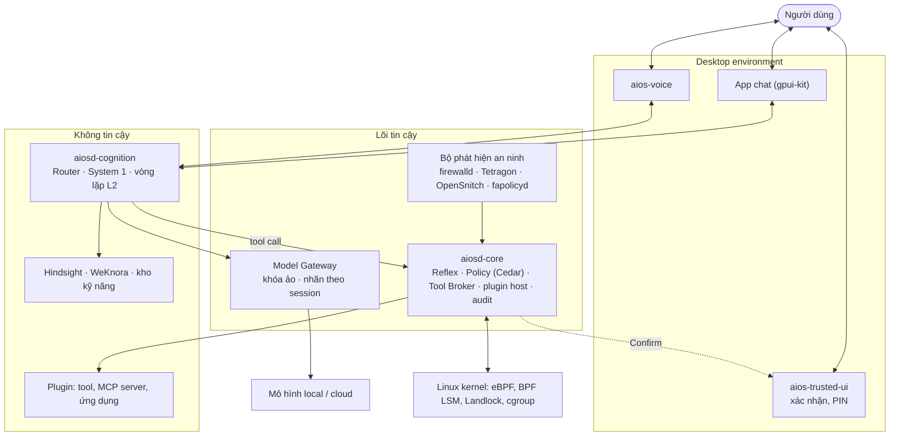

# AiOS — Tổng quan

_Cập nhật: 2026-10-18_

**AiOS là hệ điều hành dựa trên Linux, lấy hội thoại làm màn hình chính, phản hồi qua 3 cấp (code tất định, mô hình nhỏ, mô hình lớn), tự học, tự bảo vệ, và chạy được với AI local lẫn cloud AI. Mô hình AI luôn bị coi là không tin cậy: quyền hành động nằm ở lõi tất định, không nằm ở prompt.**

\[Inference\] Toàn bộ bộ tài liệu là thiết kế đề xuất, chưa có mã nguồn và chưa được kiểm chứng bằng triển khai. Số liệu độ trễ, tài nguyên và ngưỡng là ước lượng.

## 1. AiOS làm được gì

| Khả năng | Cách hiện thực | Tài liệu |
| --- | --- | --- |
| Tích hợp AI vào nhân Linux | LLM chạy ở user space; kernel chạy eBPF (Reflex, BPF LSM) và nhận chính sách từ `aiosd-core` | design §1, §3 |
| 3 cấp phản hồi | L0 Reflex (code tất định), L1 System 1 (mô hình nhỏ local), L2 System 2 (mô hình lớn, plan → act → verify) | design §4; roadmap §2.3 |
| Tự học, tự ghi nhớ | Hindsight (bộ nhớ học được), WeKnora (tri thức tài liệu), kho `SKILL.md`; chưng cất System 2 → System 1 → Reflex có cổng kiểm định | design §6; integration §6 |
| UI thích ứng | Hội thoại là màn hình chính; mô hình sinh UI IR, renderer tất định vẽ; bề mặt tin cậy tách riêng | design §7; integration §7 |
| AI local và cloud | Model Gateway định tuyến theo nhãn riêng tư của session; `secret` không rời máy | design §5; integration §3.1 |
| Giọng nói | Pipeline local: wake word, VAD, STT, TTS tiếng Việt | design §8 |
| Dùng công cụ | Mọi công cụ là plugin, đi qua Tool Broker và Policy Engine, chạy trong sandbox | design §9, §15 |
| Tự khám phá phần cứng | Ánh xạ thiết bị vào subsystem chuẩn của Linux rồi sinh adapter | design §10 |
| An ninh | Phòng thủ nhiều lớp chống mã độc, sâu máy tính, tấn công mạng; AI phân loại và điều tra cảnh báo nhưng chỉ đề xuất | design §16 |
| Review mã do agent sinh | Cổng open-code-review trong sandbox sạch; chỉ chặn, không duyệt thay người dùng | integration §13 |
| Tự cải thiện harness | Harness² tối ưu prompt, skill, script lúc build (M5); vòng tự cải thiện riêng từng người dùng trên máy (R); guardrail và hook không bao giờ bị sửa | integration §15 |
| Nhiều người dùng | Mỗi người dùng độc lập: bộ nhớ, kỹ năng, khóa và ngân sách cloud riêng; agent không truy cập dữ liệu người khác | design §18 |

## 2. Kiến trúc một trang

Ba nguyên tắc chi phối mọi quyết định:

1. **AI đề xuất, lõi tất định quyết định.** Mọi tác động lên hệ thống đi qua Tool Broker và Policy Engine; hành động không đảo ngược cần người dùng xác nhận trên bề mặt tin cậy bằng token ký gắn đúng hành động.
2. **Dữ liệu mang nhãn và taint theo nguồn.** Nhãn riêng tư quyết định dữ liệu được lên cloud hay không; taint ngăn nội dung từ bên ngoài thành chỉ thị, rule hay kỹ năng.
3. **Fail-safe.** Tắt toàn bộ tầng AI thì máy vẫn là một Linux dùng được; `aiosctl` và shell dự phòng chạy không cần mô hình.

## 3. Bản đồ tài liệu

| Tài liệu | Trả lời câu hỏi |
| --- | --- |
| [overview.md](overview.md) | AiOS là gì, đọc gì trước, thuật ngữ |
| [decisions.md](decisions.md) | Quyết định nào đã chốt, đang đề xuất, đã bị thay |
| [roadmap.md](roadmap.md) | MVP gồm gì, các mốc M0–M5 + R, cổng nghiệm thu, spike |
| [m0/](m0/README.md) | Thiết kế chi tiết và nghiệm thu từng task của M0 |
| [design.md](design.md) | Thiết kế chi tiết từng tầng, yêu cầu PHẢI/KHÔNG ĐƯỢC |
| [integration.md](integration.md) | Cách ghép từng dự án mã nguồn mở, cổng và socket, sandbox |
| [tech-stack.md](tech-stack.md) | Chọn thư viện và công cụ cụ thể, kèm nguồn |
| [feasibility.md](feasibility.md) | Phần nào khả thi, phần nào là nghiên cứu |
| [review.md](review.md) | Phản biện toàn bộ thiết kế và trạng thái xử lý từng phát hiện |
| [requirements.md](requirements.md) | Danh sách yêu cầu trích tự động bằng `scripts/extract_requirements.py` |

Đọc theo thứ tự: overview.md → decisions.md → roadmap.md → design.md → integration.md → tech-stack.md → requirements.md. review.md đọc khi cần biết vì sao một thiết kế có dạng hiện tại.

## 4. Thuật ngữ

| Thuật ngữ | Nghĩa trong AiOS | Định nghĩa ở |
| --- | --- | --- |
| `aiosd` | AI Runtime Daemon ở user space, gồm `aiosd-core`, `aiosd-cognition`, `aiosd-memory` | design §2 |
| `aiosd-core` | Tiến trình Rust trong lõi tin cậy: Reflex Engine, Policy Engine, Tool Broker, plugin host, audit log | design §2 |
| `aiosctl` | CLI quản trị; mọi thao tác hệ thống chạy được khi không có mô hình | design §7.10 |
| Bề mặt tin cậy | Giao diện do `aios-trusted-ui` vẽ (xác nhận, PIN, khóa màn hình); mô hình không vẽ được | design §7.7 |
| Bí mật cá nhân | Cụm từ hoặc hình người dùng chọn, chỉ bề mặt tin cậy hiển thị; hộp thoại thiếu nó là giả | design §7.7 |
| Cổng review | Bước chạy open-code-review trên mã do agent sinh, trong sandbox sạch; chỉ chặn, không duyệt | integration §13 |
| `agent-engine` | Interface của engine L2; M1–M3 là vòng lặp tự viết, từ M4 có opencode | design §4.4, §15.3 |
| Khóa ảo | Khóa Model Gateway cấp theo session, theo dịch vụ hoặc theo plugin; client không giữ khóa cloud thật | design §5.2; integration §3.1 |
| Kill switch | `aios-killswitch.service` đóng băng mọi agent, thu hồi khóa và token, không cần `aiosd-core` | design §11.3 |
| L0 / L1 / L2 | Ba cấp phản hồi: Reflex, System 1, System 2 | design §4 |
| Lõi tin cậy | Phần không phải plugin, được ký, cố định: BPF, `aiosd-core`, Model Gateway, compositor, shell, trusted-ui, chính sách, registry, eval, bộ phát hiện an ninh | design §15.1 |
| Mốc | Giai đoạn lộ trình M0–M5 và R | roadmap §3 |
| Nhãn riêng tư | `public`, `personal`, `secret`; dữ liệu không nhãn coi là `secret` | design §5.2 |
| Nhãn theo session | Mức cao nhất của dữ liệu một session đã nhận; Gateway dùng để chọn route | design §5.2 |
| Plugin | Đơn vị mở rộng `wasm`, `process` hoặc `mcp`, có manifest ký, capability, tự gỡ theo phạm vi | design §15 |
| Policy Engine | Cedar với hai tập `auto` và `confirmable` cùng `forbid`; trả Allow, Confirm, Deny | tech-stack §4 |
| Provenance | Nguồn của một mục: `stated`, `observed`, `inferred`, `external` | design §6.3 |
| Reflex | Rule tất định có phiên bản, chạy trong kernel (eBPF) hoặc `aiosd-core`, không cần mô hình | design §4 |
| Reflex an ninh | Rule tất định khoanh vùng đảo ngược được (đóng băng, chặn kết nối ra, cách ly file) khi bộ phát hiện báo | design §16.4 |
| Registry đã ký | Nơi duy nhất cung cấp manifest, mức rủi ro, capability cho Policy Engine | design §15.2 |
| Shell dự phòng | Giao diện cố định chạy khi tầng mô hình chưa sẵn sàng hoặc khi freeze | design §7.9 |
| Spike | Thử nghiệm nhỏ kiểm chứng một giả định; mã S-1 đến S-22 | integration §11.3; roadmap §3.1 |
| Surface, UI IR | Cây node khai báo mô hình sinh ra; renderer vẽ bằng design system cố định | design §7.3 |
| System 1 / System 2 | Mô hình nhỏ local cho việc nhanh / mô hình lớn cho việc nhiều bước | design §4 |
| Taint | `clean` hoặc `tainted`; đơn điệu, không mất khi duyệt; mục `tainted` không thành Reflex hay chỉ thị | design §6.3 |
| Token xác nhận | Chữ ký của `aios-trusted-ui` trên tool, hash args, nonce, hạn; Broker kiểm và tự thực thi | design §9.5 |
| Tool Broker | Cửa duy nhất tới mọi tool, xuất một MCP endpoint `aios-tools` | design §9; integration §3.2 |
| Vùng mở / vùng khóa | Phần agent được sửa qua review và duyệt / phần không agent nào được sửa | integration §10 |
| Workspace | Filesystem riêng của từng người dùng nơi agent được ghi; BPF LSM chặn ghi ngoài nó | design §3.4, §18.4 |
| Ngân sách cloud | Giới hạn chi phí cloud theo ngày và tháng, do từng người dùng tự đặt; mặc định 0 | design §18.2 |
| Proxy gói | `aios-pkg-proxy`: nơi duy nhất agent `build` tải gói npm, PyPI | integration §5.3 |

## 5. Trạng thái

- M0 (nền móng) đã hiện thực và qua cổng nghiệm thu trong VM phát triển (2026-10-21, [spikes/S-9-baseline-m0.md](spikes/S-9-baseline-m0.md)); M1 chưa bắt đầu.
- Quyết định đã chốt và đang đề xuất: [decisions.md](decisions.md) (D-01 → D-53).
- Câu hỏi còn mở cần chủ dự án quyết định: roadmap.md §5 và design.md §14.
