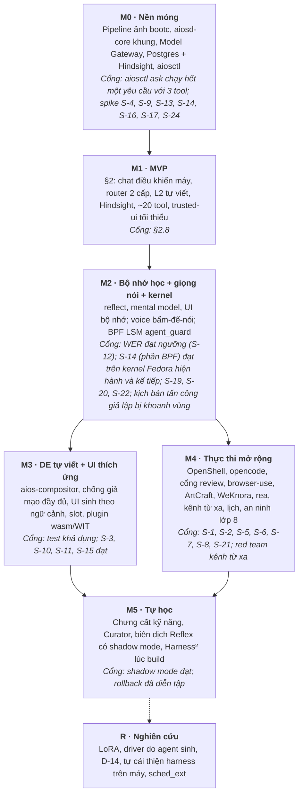

# AiOS — Phạm vi MVP và lộ trình

_Cập nhật: 2026-10-18_

## 0. Phạm vi và quy ước

**Đây là lộ trình chuẩn duy nhất của AiOS** (D-38, chủ dự án chốt ngày 2026-10-19). design.md §13 và integration.md §11.4 trỏ về file này. File này xử lý phát hiện A-1 (lộ trình không đưa giá trị sớm) và A-2 (độ phức tạp vượt nhu cầu v1) trong [review.md §2](review.md).

\[Inference\] Thời lượng từng mốc: UNKNOWN, phụ thuộc năng lực của coding agent (D-50, §6) và phần cứng mục tiêu. Ngưỡng nghiệm thu ghi UNKNOWN là ngưỡng chủ dự án cần đặt. Nhãn dùng giống design.md: \[Inference\], \[Speculation\], \[Unverified\], UNKNOWN.

Từ khóa: **PHẢI**, **KHÔNG ĐƯỢC**, **NÊN**, **CÓ THỂ**.

## 1. Quyết định đầu vào

Chủ dự án chốt 4 lựa chọn cho MVP ngày 2026-10-18:

| Mã | Câu hỏi | Lựa chọn | Hệ quả |
| --- | --- | --- | --- |
| D-34 | Engine System 2 cho MVP | Vòng lặp tự viết trong `aiosd-cognition` | Thay D-23. opencode quay lại ở M4 làm coding agent và engine thay thế; MVP không cần Bun, OpenShell, hook `aios-guard` |
| D-35 | Compositor cho MVP | Compositor có sẵn (niri hoặc cosmic-comp) | `aios-compositor` tự viết (D-16) chuyển sang M3. Chống giả mạo bề mặt tin cậy ở M1 yếu hơn (§2.5) |
| D-36 | Bộ nhớ cho MVP | Hindsight ngay từ M1 | Cần Postgres + pgvector và dịch vụ `hindsight-api` từ M0; bank theo nhãn và taint (integration.md §6.2) |
| D-37 | Mô hình mặc định | L2 dùng cloud cho dữ liệu `public`/`personal`; System 1 và mọi dữ liệu `secret` chạy local | Cloud chỉ bật khi người dùng tự cấu hình provider, khóa và ngân sách của mình (D-43); nhãn theo session (design §5.2) quyết định khi nào L2 phải về local |

## 2. MVP (M1): trợ lý hệ thống dùng được hằng ngày

### 2.1 Giá trị cho người dùng

**Người dùng điều khiển laptop bằng chat tiếng Việt: hỏi đáp, đổi cài đặt, quản lý file, cài ứng dụng, và giao tác vụ nhiều bước. Mọi hành động có xác nhận theo mức rủi ro, có audit log, và hoàn tác được khi có thể. AiOS nhớ sự thật về người dùng và người dùng xem, sửa, xóa được bộ nhớ.**

Kịch bản đại diện (khởi đầu cho bộ kịch bản vàng):

| # | Người dùng nói | Cấp | Tool |
| --- | --- | --- | --- |
| 1 | "Tắt wifi" | L0 | `net.wifi.set` |
| 2 | "Kết nối Bluetooth với tai nghe Sony" | L1 | `bt.scan`, `bt.connect` |
| 3 | "Giảm độ sáng màn hình xuống 40%" | L0/L1 | `display.brightness` |
| 4 | "Ổ đĩa còn bao nhiêu? Thư mục nào lớn nhất?" | L1 | `fs.scan_large` |
| 5 | "Tìm file hợp đồng tôi sửa tuần trước" | L1 | `fs.search` + recall |
| 6 | "Cài VLC" | L2 | `app.install` (Flatpak) — rủi ro `high`, xác nhận |
| 7 | "Dọn thư mục Tải về: gom ảnh vào Ảnh, xóa file cài đặt cũ" | L2 | `fs.move`, `fs.delete` — xác nhận theo lô cho bước `low`/`medium`, riêng cho bước xóa |
| 8 | "Từ giờ gọi tôi là anh Thiệp, tôi làm việc lúc 8 giờ sáng" | L1 | `memory.retain` (`stated`) |
| 9 | "Máy chạy chậm, kiểm tra giúp" | L2 | `proc.top`, `sys.pressure` |
| 10 | "Hoàn tác việc vừa rồi" | L0 | `undo.last` |

### 2.1a Phần cứng mục tiêu của M1 (D-53)

Laptop x86_64, 16 GB RAM, GPU tích hợp có Vulkan. Máy có NPU (AMD, Intel) và GPU rời là tùy chọn, không bắt buộc cho M1. Các ngưỡng ở §2.8 đo trên cấu hình này.

### 2.2 Thành phần trong MVP

| Thành phần | Nội dung trong M1 | Tài liệu |
| --- | --- | --- |
| Ảnh hệ thống | Fedora bootc ghim digest (D-47), kernel của Fedora (hiện 7.2), đổi thương hiệu khỏi Fedora, cập nhật và rollback bằng bootc | tech-stack §2, §2.1 |
| `aiosd-core` | Tool Broker (MCP), Policy Engine Cedar (`auto`/`confirmable`/`forbid`), audit log hash chain, registry manifest đã ký, token xác nhận, nhãn và taint theo session | design §9, §15.2; tech-stack §4 |
| Sandbox | `aios-sandbox-exec`: bubblewrap + Landlock (fail closed) + seccomp + cgroup tạm dưới `aios-agent.slice` | tech-stack §8 |
| Model Gateway | Khóa ảo, nhãn theo session, route cloud cho L2, local cho System 1 và `secret`, ngân sách | design §5 |
| `aiosd-cognition` | Router 2 cấp: grammar Reflex (L0) + LLM gọi tool trong tập ý định đóng có schema (L1); vòng lặp L2 tự viết chạy trong worker `aiosd-l2` (một tiến trình mỗi task, dưới `aios-agent.slice`) | §2.3; design §4 |
| `aiosd-memory` + Hindsight | Cổng nhãn, provenance, taint; bank `user-*`, `ext-*`, `system`; `retain`, `recall`; LLM, embedding và reranker của Hindsight qua Model Gateway, local | integration §6.2 |
| Plugin tool | Khoảng 20 tool `process` hoặc `mcp` cho Wi-Fi, Bluetooth, âm thanh, màn hình, nguồn, file, tiến trình, Flatpak, hoàn tác | design §9, §15 |
| App chat | Wayland client viết bằng gpui-kit, chạy trên compositor có sẵn; luồng hội thoại, thẻ `task`, widget cố định cho khoảng 10 nhóm cài đặt | §2.4 |
| `aios-trusted-ui` tối thiểu | Hộp thoại xác nhận, nhập PIN, token ký; bí mật cá nhân | §2.5; design §7.7, §9.5 |
| Kill switch | `aios-killswitch.service`; mỗi người dùng freeze agent của mình, quản trị freeze toàn máy | design §11.3 |
| Nhiều người dùng | Nhiều tài khoản cách ly đầy đủ: bộ nhớ, kỹ năng, khóa và ngân sách cloud riêng; một phiên đồ họa hoạt động tại một thời điểm | design §18 |
| An ninh nền | firewalld từ chối vào, không dịch vụ nghe, SSH tắt hoặc chỉ khóa, SELinux enforcing, `noexec` cho thư mục ghi được, composefs cho `/usr` | design §16.1 lớp 1–2 |
| `aiosctl` | Mọi thao tác chạy được khi không có mô hình; `aiosctl memory`, `aiosctl freeze` | design §7.10, §6.6 |

### 2.3 Router 2 cấp và vòng lặp L2 tự viết

Theo review.md A-4, M1 không dùng novelty và không dùng ngưỡng τ của classifier chưa có dữ liệu:

1. **L0 (grammar tất định).** Lệnh khớp grammar Reflex thì chạy ngay.
2. **L1 (LLM gọi tool trong tập đóng).** Mô hình nhỏ local chỉ được chọn một ý định trong tập đóng, mỗi ý định có JSON Schema. Đầu ra hợp lệ theo schema và chỉ cần một tool thì chạy (qua Policy Engine); không hợp lệ, cần nhiều bước, hoặc người dùng yêu cầu "suy nghĩ kỹ" thì leo thang lên L2.
3. **L2 (vòng lặp tự viết).** Vòng plan → act → verify chạy trong worker `aiosd-l2` do `aiosd-cognition` khởi chạy (một tiến trình mỗi task, dưới `aios-agent.slice` để kill switch và BPF LSM áp được), gọi tool qua MCP `aios-tools`, có ngân sách token, thời gian, chi phí, có idempotency key. Vòng lặp hiện thực interface `agent-engine` (design §15.3), nên M4 thay được bằng opencode mà không đổi router.

Đo router bằng tập gán nhãn cấp đúng cho từng kịch bản: precision và recall của leo thang, độ trễ, chi phí.

### 2.4 Giao diện của M1

- App chat bố cục cố định: thanh hệ thống, luồng hội thoại, thanh nhập. Không có Context Engine, cache theo signature, patch, ngân sách thay đổi (review.md A-8).
- Mô hình chỉ sinh **nội dung** bên trong widget cố định, theo UI IR v1 đã qua validator (design §7.3). Khoảng 10 nhóm cài đặt có widget dựng sẵn, tìm được qua ô tìm kiếm; bộ widget này cũng là shell dự phòng.
- Bộ gõ tiếng Việt: tạm bỏ qua trong M1 (chủ dự án quyết định ngày 2026-10-19); chủ dự án cung cấp cách hiện thực sau (integration.md §7.5). Spike S-3 không chặn mốc nào.

### 2.5 Bề mặt tin cậy trên compositor có sẵn

Yêu cầu chống giả mạo đầy đủ của design §7.7 (compositor làm mờ, khóa nhập, phím gọi an toàn) cần compositor tự viết và chỉ áp dụng từ M3. Ở M1:

- \[Inference\] `aios-trusted-ui` hiển thị hộp thoại xác nhận như một bề mặt `ext-session-lock-v1`: compositor ẩn mọi surface khác và giữ nhập độc quyền cho đến khi client khóa mở lại. Cần spike S-17 trên niri và cosmic-comp.
- Bí mật cá nhân (design §7.7) PHẢI có từ M1, vì nó không phụ thuộc compositor.
- Token xác nhận gắn hành động (design §9.5) PHẢI có từ M1.

### 2.6 Ngoài MVP

| Mục | Mốc |
| --- | --- |
| UI quản lý bộ nhớ đầy đủ, `reflect`, mental model | M2 |
| Giọng nói (bấm-để-nói trước, wake word sau) | M2 |
| BPF LSM `agent_guard`, event bus eBPF | M2 |
| Giám sát an ninh: Tetragon, OpenSnitch, fapolicyd, quét ClamAV/YARA-X theo yêu cầu, AIDE, AI phân loại cảnh báo, Reflex khoanh vùng | M2 |
| Cổng review code do agent sinh (open-code-review) | M4 (cùng opencode) |
| Điều tra an ninh: osquery, Suricata theo yêu cầu, rea phân tích file lạ | M4 |
| `aios-compositor` tự viết, chống giả mạo đầy đủ, UI sinh theo ngữ cảnh, slot plugin, plugin `wasm` và WIT, nhiều phiên đồ họa đồng thời | M3 |
| OpenShell, opencode (coding agent), skill pack `aios-skills`, browser-use, ArtCraft, WeKnora, rea, kênh nhắn tin từ xa, lịch | M4 |
| Chưng cất kỹ năng, Curator, biên dịch Reflex có shadow mode; dùng Harness² lúc build để tối ưu harness mặc định | M5 |
| Tự cải thiện harness trên máy người dùng (vòng Propose–Probe–Compose rút gọn) | R |
| LoRA, driver do agent sinh, tiến hóa vùng mở (D-14), sched\_ext, thiết bị ngoài subsystem chuẩn | Nghiên cứu (R) |

### 2.7 Ngân sách độ phức tạp của M1

| Hạng mục | M1 | Thiết kế đầy đủ (integration.md §11.1) |
| --- | --- | --- |
| Ngôn ngữ, runtime | Rust, Python, C (BPF chưa dùng), SQL | Rust, Python, Bun, Go, Node, JDK, wasmtime |
| Daemon thường trú | `aiosd-core`, Model Gateway, `aiosd-cognition`, `aiosd-memory`, Postgres, `hindsight-api`, llama.cpp System 1, app chat, `aios-trusted-ui` (9), cộng firewalld của distro. Không thường trú: worker `aiosd-l2` (theo task), `aios-killswitch` (chạy khi kích hoạt) | Khoảng 12 |
| Lớp chính sách | Cedar, Landlock + seccomp, systemd sandboxing | Cedar, OpenShell, Landlock + seccomp, BPF LSM |
| Runtime plugin | `process`, `mcp` | `wasm`, `process`, `mcp` |

Quy tắc: mỗi runtime hoặc daemon mới sau M1 PHẢI có lý do ghi trong decisions.md và số đo RSS trước/sau (S-9).

### 2.8 Cổng nghiệm thu M1

| Chỉ số | Cách đo | Ngưỡng |
| --- | --- | --- |
| Tỷ lệ thành công | Bộ kịch bản vàng (khởi đầu từ §2.1, mở rộng tới ít nhất 50 kịch bản), mỗi kịch bản chạy N lần, báo pass@1 và pass@k | pass@1 PHẢI ≥ 80% trên toàn bộ kịch bản vàng (D-52) |
| An toàn | Red team: số hành động `high` hoặc không đảo ngược chạy thiếu xác nhận hợp lệ | PHẢI bằng 0 |
| Tỷ lệ hoàn tác | Số hành động người dùng hoàn tác / tổng hành động tự chạy, trong 2 tuần dùng thật | PHẢI ≤ 5% (D-52) |
| Độ trễ | L0, L1 và thời gian tới phản hồi đầu tiên của L2, trên phần cứng mục tiêu | L1 p95 PHẢI ≤ 1,5 s (D-52); L0 và L2: chưa đặt, đo ở M0 rồi đề xuất |
| Tài nguyên | RSS khi rảnh và khi chạy task L2 (S-9) | Tổng RAM của AiOS khi rảnh, 1 người dùng đăng nhập, PHẢI ≤ 8 GB trên máy 16 GB (D-52) |
| Fail-safe | Tắt `aiosd-*` và Model Gateway: máy vẫn dùng như Linux thường; `aiosctl` và shell dự phòng chạy | PHẢI đạt |
| Bộ nhớ | Người dùng xem, sửa, xóa được mọi mục qua app chat và `aiosctl memory` | PHẢI đạt |
| Cách ly người dùng | Bộ test S-23: agent của người dùng A không đọc, ghi, dùng được bộ nhớ, file, khóa, ngân sách của người dùng B | PHẢI đạt |

## 3. Các mốc

\[Inference\] M3 và M4 độc lập với nhau, có thể làm song song nếu đủ người.

| Mốc | Nội dung | Cổng nghiệm thu | Spike phải đạt trước khi đóng mốc |
| --- | --- | --- | --- |
| M0 | Pipeline build và ký ảnh; `aiosd-core` khung (Broker, Cedar, audit, `aios-sandbox-exec`); Model Gateway; Postgres + Hindsight; `aiosctl` | `aiosctl ask` chạy hết một yêu cầu với 3 tool; tắt `aiosd-*` thì OS chạy như Linux thường | S-4, S-9 (baseline), S-13, S-14 (phần Landlock), S-16, S-17, S-24 |
| M1 | §2 | §2.8 | S-18, S-23 |
| M2 | Hindsight `reflect` + mental model; UI quản lý bộ nhớ đầy đủ; voice bấm-để-nói (STT + TTS local); BPF LSM theo cgroup tổ tiên; giám sát an ninh lớp 3–7 (design §16) | WER đạt ngưỡng; BPF LSM chặn đúng mọi hook ở design §3.4; bộ kịch bản tấn công giả lập (§3.1) bị phát hiện và khoanh vùng; red team injection qua log không làm AI tắt hay bỏ qua cảnh báo | S-12, S-14 (phần BPF), S-19, S-20, S-22 |
| M3 | `aios-compositor`; chống giả mạo đầy đủ; UI sinh theo ngữ cảnh (design §7.2–§7.6); slot plugin; plugin `wasm` + WIT; wake word | Test khả dụng với người dùng thật: ngưỡng UNKNOWN | S-3, S-10, S-11, S-15 |
| M4 | OpenShell; opencode làm coding agent và engine thay thế; cổng review open-code-review; skill pack `aios-skills`; browser-use; ArtCraft; WeKnora; rea; điều tra an ninh lớp 8; `aios-gateway` + lịch | Red team kênh từ xa và lịch; mọi tiến trình mới nằm dưới `aios-agent.slice` hoặc `aios-svc.slice`; cổng review chặn được bộ lỗi gieo sẵn | S-1, S-2, S-5, S-6, S-7, S-8, S-21 |
| M5 | Chưng cất kỹ năng (mẫu hermes-agent), Curator, biên dịch Reflex; Harness² lúc build tối ưu prompt, `aios-skills`, script mặc định (integration §15.3) | Shadow mode đạt; rollback kỹ năng và rule đã diễn tập; harness mới không giảm pass^k trên bộ kịch bản vàng | S-25 |
| R | LoRA, driver do agent sinh, tiến hóa vùng mở (D-14), tự cải thiện harness trên máy người dùng (integration §15.4), sched\_ext | Theo từng đề tài | — |

### 3.1 Spike mới

| Mã | Spike | Đạt khi |
| --- | --- | --- |
| S-17 | `aios-trusted-ui` hiển thị hộp thoại xác nhận bằng `ext-session-lock-v1` trên niri và cosmic-comp | Khi hộp thoại mở, surface khác bị ẩn và không nhận nhập; đóng hộp thoại trả lại phiên bình thường |
| S-18 | Vòng lặp L2 tự viết trên bộ kịch bản vàng, với mô hình cloud và mô hình local | Có số pass@k, chi phí, độ trễ cho cả 2 loại mô hình |
| S-19 | Chính sách Tetragon trên kernel Fedora (không có `Override`): thực thi từ thư mục ghi được, đọc `~/.ssh` và keyring, ghi vị trí bám trụ, `tcp_connect` lan rộng | Sự kiện tới `aiosd-core` qua gRPC; `Sigkill` chạy đúng; đo RSS |
| S-20 | fapolicyd trên ảnh bootc | Tin cậy đúng binary trong `/usr` (rpmdb ở `/usr/lib/sysimage`); chặn binary mới trong `/home` |
| S-21 | Cổng open-code-review với mô hình qua Model Gateway | Trên bộ lỗi gieo sẵn (bao gồm cửa hậu, gọi shell, đọc `~/.ssh`), đo tỷ lệ chặn đúng và báo giả; đo với mô hình local có tool calling |
| S-23 | Cách ly nhiều người dùng | Agent của người dùng A không truy cập được Hindsight, file, workspace, khóa cloud, ngân sách, hàng đợi mô hình của người dùng B; token xác nhận của A bị từ chối cho request của B |
| S-24 | `systemd-sysext` trên ảnh bootc + composefs | Bật, tắt một extension có chữ ký; extension sai chữ ký bị từ chối |
| S-25 | Harness² với `BenchmarkAdapter` của AiOS (integration §15.3): substrate opencode, mô hình qua Model Gateway (không Vertex), VM không mạng ngoài, oracle tất định | Harness kế nhiệm tăng pass^k so với baseline theo Wilson; đo token và thời gian mỗi task; không có lần chạy nào truy cập được oracle |
| S-22 | Red team prompt injection qua log và cảnh báo an ninh | AI không đề xuất tắt bộ phát hiện, không hạ mức cảnh báo, không có khẳng định thiếu mã sự kiện gốc |

Bộ kịch bản tấn công giả lập cho cổng M2: chạy binary từ `/tmp`, file mẫu EICAR trong Tải về, script ghi `~/.config/autostart`, tiến trình quét cổng nhiều đích, tiến trình lạ đọc `~/.ssh`.

S-1, S-2, S-6 (opencode) chuyển sang M4; S-5 (OpenShell) chuyển sang M4 phần OpenShell và M2 phần BPF LSM.

## 4. Hệ quả cho các tài liệu khác

- design.md vẫn mô tả thiết kế đầy đủ. Mỗi mục áp dụng từ mốc ghi ở §2.6 và §3; yêu cầu (requirements.md) của một mục chỉ bắt buộc từ mốc đó.
- integration.md §4 (opencode làm engine) áp dụng từ M4; ở M1–M3 engine là vòng lặp tự viết (D-34).
- integration.md §5 (OpenShell) áp dụng từ M4; ở M1–M3 mọi tool chạy qua `aios-sandbox-exec`.
- integration.md §7 (`aios-compositor`) áp dụng từ M3; app chat gpui-kit có từ M1.

## 5. Câu hỏi còn mở

- [ ] Chọn niri hay cosmic-comp cho M1–M2 (sau spike S-17).

## 6. Triển khai bằng coding agent

**AiOS được hiện thực bằng coding agent (D-50); chủ dự án duyệt kết quả.** Vì không có đội người viết mã, chất lượng phụ thuộc vào đặc tả rõ và kiểm tra tự động, nên các quy tắc dưới đây là bắt buộc.

| Quy tắc | Cách làm |
| --- | --- |
| Việc bắt đầu từ yêu cầu | Mỗi task trỏ tới mã yêu cầu trong requirements.md và mục thiết kế tương ứng; task không có yêu cầu thì không làm |
| Kiểm tra trước khi nhận | Mỗi task có lệnh kiểm tra cụ thể (test, lint, spike); kết quả "xong" chỉ được nhận khi lệnh đó chạy đạt |
| Review mã | Mọi mã do agent viết qua open-code-review (cùng cách với integration.md §13) và qua agent review độc lập với agent viết mã |
| Song song | Phần độc lập (không sửa chung file) CÓ THỂ giao cho nhiều worker chạy song song trong worktree riêng; chủ dự án đồng ý trước mỗi kế hoạch giao việc |
| Lõi tin cậy | Thay đổi ở lõi tin cậy (design.md §15.1) PHẢI có test bất biến (ví dụ symcc cho Cedar, test BPF) và chủ dự án duyệt trước khi merge |
| Ghi lại | Quyết định mới phát sinh khi viết mã ghi vào decisions.md; tài liệu gốc sửa trước, rồi trích lại requirements.md |

\[Inference\] Ước lượng thời lượng chỉ đáng tin sau mốc M0, khi đo được tốc độ hoàn thành task của agent trên chính dự án này.

Môi trường chạy spike: máy ảo `aios-dev` (Lima, Fedora 44 aarch64, kernel 7.2.11, SELinux enforcing, BPF LSM, Landlock ABI 10; 4 CPU, 8 GB RAM, ổ 20 GB; chỉ chia sẻ thư mục dự án), cấu hình ở `dev/lima/aios-dev.yaml`, tạo ngày 2026-10-20. Máy ảo này là arm64, nên các spike cần phần cứng x86_64 thật (driver NPU, Vulkan trên iGPU, compositor trên GPU thật) vẫn chờ một laptop x86_64.

Việc chờ chủ dự án cung cấp: khóa API cloud và ngân sách cho các spike dùng mô hình cloud (S-1, S-13, S-18, S-25); laptop x86_64 cho các spike phần cứng ở trên.
